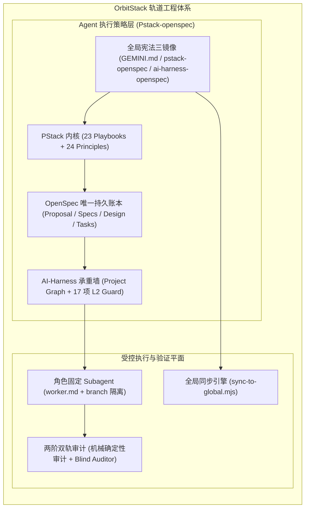

# Pstack-openspec

> **OrbitStack 轨道工程体系 · Agent 执行策略层 (Agent Execution Strategy Layer)**  
> **Throughput Comes From Trust（吞吐量源于信任体系）**  
> 本仓库将 Lauren Tan (`@poteto`) 的 `PStack` 工程准则、`OpenSpec` 增量生命周期与 `AI-Harness` 工程承重墙深度咬合，构建了一套以**双阶段双门禁**、**五层信任防御金字塔**、**两阶双轨盲审**与 **17 项 L2 自动化静态守卫**为核心的工业级多智能体执行策略体系。

---

## 目录

1. [为什么需要 Pstack-openspec：从失控生成到受控工程](#1-为什么需要-pstack-openspec从失控生成到受控工程)
2. [在 OrbitStack 轨道工程中的定位与三核融合架构](#2-在-orbitstack-轨道工程中的定位与三核融合架构)
3. [Lauren Tan 五层信任防御金字塔 (L1–L5)](#3-lauren-tan-五层信任防御金字塔-l1l5)
4. [Step 0–Step 5 双阶段双门禁闭环 SOP](#4-step-0step-5-双阶段双门禁闭环-sop)
5. [两阶双轨深度审计体系 (Two-Step Dual-Scope Deep Audit)](#5-两阶双轨深度审计体系-two-step-dual-scope-deep-audit)
6. [核心演进公理全景导览 (Axioms 1–80 精华)](#6-核心演进公理全景导览-axioms-180-精华)
7. [23 个 PStack Playbook 路由与 10 大受管技能生态](#7-23-个-pstack-playbook-路由与-10-大受管技能生态)
8. [17 项自动化 L2 静态守卫矩阵 (`npm run guard:*`)](#8-17-项自动化-l2-静态守卫矩阵-npm-run-guard)
9. [仓库目录结构与核心资产](#9-仓库目录结构与核心资产)
10. [安装部署、全局应用与打包维护](#10-安装部署全局应用与打包维护)

---

## 1. 为什么需要 Pstack-openspec：从失控生成到受控工程

AI 编程在复杂仓库中高频失效，根源通常不是模型写不出代码，而是缺少**确定性的执行策略层**。下表总结了传统 AI 编程的典型失效模式与 `Pstack-openspec` 的对应防线：

| 传统 AI 编程失效模式 | Pstack-openspec 工程防线 | 核心机制与守卫 |
|:--|:--|:--|
| 未对齐意图直接改码、擅自删改既有业务 | **Step 0 门禁 1 + 门禁 2 双重授权** + **源码封印** | Spec-Kit 1:1 RTM、双清单、`@ANTIGRAVITY_INVARIANT_LOCK` |
| 上下文压缩后遗忘需求、改着改着丢掉第 3/4 项 | **累计需求台账 + 1:1 双向物理核销** | `guard:ledger-continuity`、`mergeLedgerDelta` |
| 只修当前报错实例、写 `if (id === '...')` 硬编码 | **公理 78：通用问题类泛化与反特指硬编码** | `guard:anti-hardcoding`、全仓兄弟模式横扫、$\ge 2$ 正交变体 |
| 遇到报错头痛医头、语义阶段交给机械脚本直出 | **公理 79：前置五维问题头脑风暴 + `/correct` 四级防线** | `guard:problem-brainstorm`、Agent 认知门禁、历史错题反证 |
| 面对 `1,2,3,4` 号问题只答 `2` 号就只修 `2` 号 | **公理 80：问题清单增量合并 + 未裁定条目反问** | `guard:problem-ruling`、逐项 `pending_ruling` 拦截 |
| 自己改代码自己写弱测试、宣称“已修复”却无实证 | **两阶双轨深度审计 + Fresh Blind Auditor** | `guard:blind-audit`、变异元审计、真实产物退出码 0 |
| 随意并发拉起多 Agent 失控、或私自 `kill` 复用线程 | **公理 77：智能体防蔓延与角色固定复用锁** | `guard:agent-lifecycle`、人类授权终止锁 |
| 随手提交 API Key、Token、Cookie 或个人路径 | **L2 隐私与密钥静态防线** | `guard:privacy`、`guard:portability`、`guard:neutrality` |

---

## 2. 在 OrbitStack 轨道工程中的定位与三核融合架构

**OrbitStack（轨道工程体系）** 将多智能体研发治理划分为相互咬合的协作层级，其中 **`Pstack-openspec` 专职承担 Agent 执行策略层**：

1. **PStack 主干执行内核 (`bundle/pstack-upstream/`)**：锁定只读的 Lauren Tan 官方 PStack 镜像，提供 23 个标准 Playbooks 与 24 项工程 Principles。
2. **OpenSpec 唯一持久状态账本 (`openspec/`)**：任务的意图（`proposal.md`）、RFC 2119 行为契约（`specs/`）、架构与状态机设计（`design.md`）、单焦点任务锁（`tasks.md`）及归档记录全部收敛在此，不建立第二套任务状态。
3. **AI-Harness 工程承重墙与 L2 守卫 (`scripts/check-*.mjs`, `.harness/`)**：通过类型边界、架构依赖图、17 项 `guard:*` 静态守卫与全局同步引擎，将策略下沉为不可绕过的机器门禁。



---

## 3. Lauren Tan 五层信任防御金字塔 (L1–L5)

体系严格按照防复发效力从强到弱排序（**能用高层级根治，绝不退化为低层级口头规则**）：

1. **L1 · 架构与类型承重墙**：
   - 状态机显式建模，使非法状态在类型层不可表达；
   - 缺失与未知显式分离（区分 `unknown` 与 `false`/默认值），禁止防御性吞错或掩盖非法状态；
   - 源码级防篡改封印（`// @ANTIGRAVITY_INVARIANT_LOCK_START` ... `END`），日常重构享有只读豁免；
   - 语义或质量敏感流水线强制设立 **Agent 认知把关门禁**，禁止纯机械脚本无人值守直出最终产物。
2. **L2 · 静态分析与编译器硬阻断门禁**：
   - 坚持 **Zero Warnings, Zero Errors**（`--max-warnings=0`），禁止 `@ts-ignore`、`eslint-disable`、`as any` 逃避检查；
   - 遵循 poteto **`Encode Lessons in Structure`** 铁律：同一人工纠错出现第二遍，立刻下沉编码为 Lint、AST 检查或 `guard:*` 静态守卫。
3. **L3 · 契约立法与验证隔离**：
   - 验证平面（测试集、黄金标本、盲审标准）与施工平面物理隔离，禁止修改测试以迎合实现；
   - 行为测试优先（Test Behavior, Not Implementation），新增防线必须用**真实历史故障样本**反证其能红灯拦截。
4. **L4 · 外部环境见证者与实测证据**：
   - 区分 `实测 (Measured)`、`推演 (Inferred)` 与 `猜想 (Guess)`，任何完成宣称必须附带真实进程 Exit Code 0 与实测输出。
5. **L5 · 双清单门禁与人类触觉终审**：
   - 动工前呈报“拟变范围 + 保持现状承诺”双清单；修改后通过 VS Code 原生两栏 Diff 把控最终合流。

---

## 4. Step 0–Step 5 双阶段双门禁闭环 SOP


- **Step 0 · Spec-Kit 零损耗立案（门禁 1）**：100% 逐字留存用户原始输入，拆解为 `1:1 需求物理对账矩阵 (RTM)` 与《前瞻性扩展提案清单》。**门禁 1 期间严禁夹带代码实现细节或拟变文件清单**，确认需求后方进入下一步。
- **Step 1 · 底座感知与剧本锚定**：查询 `.harness/project-graph.json` 锁定爆炸半径，通过 `docs/pstack-openspec-route-map.json` 匹配固定 Playbook。Explore 阶段只做只读推演与拓扑梳理，不落笔改代码。
- **Step 2 · OpenSpec 规格立法（门禁 2）**：编写 `proposal.md`、`specs/`（RFC 2119）、`design.md`、`tasks.md`，挂载**拟变范围清单**与**保持现状承诺清单**，运行 `openspec validate --strict` 通过后呈报用户批准动工。
- **Step 3 · 单焦点施工锁 `[-]`**：同一时刻 `tasks.md` 严格只允许 1 个任务处于 `[-]` 进行中；通过 `vscode-review` / `code --reuse-window --diff` 交由用户检阅。
- **Step 4 · 触觉审计与高频原子提交**：小步验证全绿后立即提交，杜绝大爆炸式单次提交。
- **Step 5 · 双向物理核销与自迭代归档**：逐条对照原始 RTM 出具 `[Measured]` 核销表，运行 `openspec validate --all --strict` 并归档至 `openspec/changes/archive/`。

---

## 5. 两阶双轨深度审计体系 (Two-Step Dual-Scope Deep Audit)

为根除“弱断言假通”与“Agent 自审确认偏差”，终审强制分为两阶：

1. **第一步：机械确定性审计（准入钥匙 1）**：
   - 验证平面只读隔离（改测试触发 `VERIFIER_TAMPERING_DETECTED`）；
   - 变异元审计杀伤力检查（注入反例变异必须红灯，否则判定 `TRIVIAL_ASSERTION_FRAUD`）；
   - 全量 `guard:*` 守卫与负向边界测试真实退出码为 0。
2. **第二步：智能体语义规范审计（准入钥匙 2）**：
   - **裁执物理隔离（Fresh Blind Auditor）**：由独立上下文 Subagent 以纯敌手视角审查真实产物与代码行号区间，出具反向证伪攻击记录；
   - **双轨规范 1:1 守恒**：全局宪法不变量（Global Specs）与当前变更契约（Local Specs）逐条核销，遗漏即触发 `SPEC_OMISSION_DETECTED`。

---

## 6. 核心演进公理全景导览 (Axioms 1–80 精华)

全局宪法（[`GEMINI.md`](GEMINI.md)）已持续演进至 **Axiom 80**，核心支柱包括：

- **通用问题类泛化与反特指硬编码（Axiom 78 · `UNIVERSAL_PROBLEM_CLASS_GENERALIZATION_AXIOM`）**：
  - 修复任何缺陷前先抽象为通用 **Problem Class**，禁止 `if (id === '...')` 等单点特判过拟合（`SPECIAL_CASE_OVERFITTING_BLOCKED`）；
  - 强制全仓兄弟模式横扫（`analogousSitesChecked`），多分支收口为表驱动（`TABLE_DRIVEN_REFACTOR_REQUIRED`），并配备 $\ge 2$ 个正交变体测试（`VARIANT_QUOTA_DEFICIT_BLOCKED`）。
- **问题处理五维头脑风暴与 `/correct` 四级防线升级（Axiom 79 · `SYSTEMIC_PROBLEM_BRAINSTORM_&_STRUCTURAL_PREVENTION_AXIOM`）**：
  - 遇到已发生的问题时，Agent 必须先主动完成五维头脑风暴：① 现象→系统症结穿透与控制面边界审计（拦截“语义阶段交由纯机械脚本无人值守直出” `UNATTENDED_MECHANICAL_SEMANTIC_PIPELINE_BLOCKED`）；② 通用工程准则对齐；③ 同类发散；④ L1–L4 多方案对比；⑤ 收敛与前提质疑（连续失败 $\ge 2$ 次强制 `attack-the-premise`）；
  - 按 **L1 架构 > L2 类型/Lint > L3 行为测试 > L4 规则** 升级根治，低于 L1 须说明原因，并用真实历史故障样本反证新守卫。
- **问题清单增量合并、原子拆条与集合差值核销（Axiom 80 · `PROBLEM_LEDGER_INCREMENTAL_MERGE_&_RULING_GATE_AXIOM`）**：
  - 无论是任务产出还是用户提供的问题清单，补充说明一律执行增量合并（`mergeProblemLedgerDelta`），禁止覆盖丢项（`PROBLEM_LEDGER_REPLACEMENT_DROP_BLOCKED`）；
  - 强制“一缺陷一原子 ID”（禁止复合打包 `BUNDLED_ISSUE_ID_BLOCKED`）与呈报前源集物理集合差值核销（`LEDGER_SET_DIFFERENCE_NON_ZERO_BLOCKED`），任何豁免必须绑定原子级理由（`PER_ATOMIC_WAIVER_RATIONALE_REQUIRED_BLOCKED`）；
  - 当多条目清单（如 `1, 2, 3, 4`）中用户仅补充或解释局部条目（如 `2` 号）时，禁止只处理 `2` 号，必须追问缺失处置并主动反问剩余 `pending_ruling` 条目（`1, 3, 4`），直到 100% 获裁定；
  - 任务处理完成后强制执行初始问题清单终局校对（`POST_TASK_PROBLEM_LEDGER_PROOFREAD_MANDATE`），确保全部初始问题已完全解决（`resolved`），仅经过交互排除（`waived` / `deferred` 且带显式依据）的条目除外（`POST_TASK_UNRESOLVED_SOURCE_ISSUES_BLOCKED`）。
- **智能体防蔓延与角色固定复用锁（Axiom 77 · `ANTI_SPRAWL_ROLE_PINNED_REUSE_&_LIFECYCLE_LOCK_AXIOM`）**：
  - 未经人类明确授权禁止并发拉起多 Subagent 或 Swarm，也禁止私自 `kill` / `kill_all` 终止任何活跃或空闲智能体；优先按职责固定并持续复用已有智能体。
- **盲审隔离与真实产物见证（Axiom 74）**、**UI 极简精纯与像素级对齐（Axiom 73）**、**累计需求台账与 Re-Gating 协议（Axiom 71）**、**项目架构依赖图与爆炸半径锁定（Axiom 70）**、**全仓通用可移植性与凭证隔离（Axiom 67）**。

---

## 7. 23 个 PStack Playbook 路由与 10 大受管技能生态

### 7.1 23 个 PStack Playbook 确定性路由
通过 [`docs/pstack-openspec-route-map.json`](docs/pstack-openspec-route-map.json) 将上游 23 个 Playbooks（含 Feature、Bug Fix、Investigation、Refactor、Code Review、Migration、UI Polish、Eval、Authoring a Skill 等）精确映射到 OpenSpec 生命周期与模型算力层级（`flash_lite` / `flash` / `pro`）。

### 7.2 10 大受管核心技能 (`skills/`)

| 技能目录 | 定位与核心能力 |
|:--|:--|
| [`skills/pstack-openspec/`](skills/pstack-openspec/) | OrbitStack × PStack × OpenSpec 主控治理技能与核心公理全集镜像 |
| [`skills/ai-harness-openspec/`](skills/ai-harness-openspec/) | AI-Harness 与 OpenSpec 端到端闭环 SOP、双清单模板与核销规程 |
| [`skills/spec-driven-workflow/`](skills/spec-driven-workflow/) | 面向 OpenSpec 原生团队的规格驱动兼容路由入口 |
| [`skills/desktop-exe-development/`](skills/desktop-exe-development/) | 基于 Tauri v2 的 Windows 桌面 `.exe`、IPC 桥接与安装包工程流水线 |
| [`skills/ui-ux-design-engineering/`](skills/ui-ux-design-engineering/) | Shape → Distill → Polish 三阶前端美学升维、少字原则与 WCAG 2.2 AA 规范 |
| [`skills/drawio-mcp/`](skills/drawio-mcp/) | Draw.io MCP 企业研发周期（IPD/Stage-Gate）、泳道网格编译与拓扑绘图技能 |
| [`skills/rea-reverse-engineering/`](skills/rea-reverse-engineering/) | 基于 REA MCP 的二进制反编译、Electron/APK 源码还原与证据链审计技能 |
| [`skills/app-reverse-deconstruction/`](skills/app-reverse-deconstruction/) | 双轨逆向解构与 Clean-Room 净室规格书 (`DECONSTRUCT_SPEC.md`) 工程技能 |
| [`skills/tavily-search/`](skills/tavily-search/) | 基于 Tavily AI 的语义检索与正文萃取技能（运行时读取本地凭据，主备双 Key 容灾） |
| [`skills/xmind-cloud-mcp/`](skills/xmind-cloud-mcp/) | Xmind 云端思维导图只读/增量大纲编辑与发布推送驱动技能 |

---

## 8. 17 项自动化 L2 静态守卫矩阵 (`npm run guard:*`)

所有守卫均接入 [`.harness/project-graph.json`](.harness/project-graph.json)，任一项失败即退出码 1 阻断合流：

| 守卫命令 | 脚本路径 | 核心校验目标与拦截范围 |
|:--|:--|:--|
| `guard:neutrality` | `scripts/check-packaged-docs-neutrality.mjs` | 随包分发文档中立性，拦截宿主耦合路径与内部维护细节 |
| `guard:unslop` | `scripts/check-unslop-purity.mjs` | 清除 `worker.md` 与文档中的冗余空话与 AI 套话 |
| `guard:portability` | `scripts/check-universal-portability.mjs` | 校验通用可移植性，拦截跨环境硬编码宿主依赖 |
| `guard:privacy` | `scripts/check-secret-privacy.mjs` | 扫描全仓已跟踪文件，拦截 API Key、Token、Cookie 与私钥泄露 |
| `guard:graph` | `scripts/check-project-graph.mjs` | 校验 `.harness/project-graph.json` 模块拓扑与入口完整性 |
| `guard:ledger-continuity` | `scripts/check-ledger-continuity.mjs` | 校验累计需求台账连续性、增量合并与 Re-Gating 锁 |
| `guard:pstack-sync` | `scripts/check-pstack-sync.mjs` | 校验本地 `pstack-upstream` 镜像版本与核心剧本完整度 |
| `guard:issue-clearance` | `scripts/check-issue-clearance.mjs` | 校验问题台账清零状态，防止遗漏挂起项 |
| `guard:workflow-spec` | `scripts/check-workflow-spec-compliance.mjs` | 校验工作流规格合规性与原子规则测试覆盖 |
| `guard:invocation-purity` | `scripts/check-invocation-purity.mjs` | 校验调用方策略与通用底层机制的物理隔离纯洁度 |
| `guard:blind-audit` | `scripts/check-blind-audit.mjs` | 校验盲审隔离轨迹与真实产物见证凭据 |
| `guard:ui-slop` | `scripts/check-ui-slop.mjs` | UI 精简度、少字原则与 WCAG 对比度静态门禁 |
| `guard:drawio-model` | `scripts/check-drawio-model.mjs` | Draw.io 泳道网格与几何拓扑 Diagram-as-Test 守卫 |
| `guard:agent-lifecycle` | `scripts/check-agent-lifecycle.mjs` | 智能体防蔓延、角色固定复用与人类授权终止锁（Axiom 77） |
| `guard:anti-hardcoding` | `scripts/check-anti-hardcoding.mjs` | 反特指字面量硬编码与表驱动重构守卫（Axiom 78） |
| `guard:problem-brainstorm` | `scripts/check-problem-brainstorm.mjs` | 五维问题头脑风暴与四级防线升级三镜像一致性守卫（Axiom 79） |
| `guard:problem-ruling` | `scripts/check-problem-ledger-ruling.mjs` | 问题清单增量合并与未裁定条目反问门禁守卫（Axiom 80） |

---

## 9. 仓库目录结构与核心资产

```text
Pstack-openspec/
├── GEMINI.md                     # 跨线程最高法定宪法 (Axioms 1–80)
├── worker.md                     # 子智能体隔离执行契约 (Sections 1–3)
├── AGENTS.md / Agent.md          # PStack-first 入口规则与历史行为保护
├── .harness/project-graph.json   # 7 大模块架构拓扑与守卫登记图
├── bundle/pstack-upstream/       # Lauren Tan 官方 PStack 只读上游镜像
├── docs/
│   ├── ps-openspec-system.md     # 体系架构与权责边界详述
│   └── pstack-openspec-route-map.json # 23 剧本到 OpenSpec 路由表
├── skills/                       # 10 项受管治理与行动技能
├── scripts/                      # 17 项 L2 静态守卫、全局同步与跨平台安装器
├── tests/                        # L2 守卫单元测试与三镜像回归套件
├── openspec/                     # OpenSpec 规格基线、门禁备忘录与归档目录
└── packages/ai-harness/          # 独立分发的 npm 基座包 (@hujiale2609/ai-harness)
```

---

## 10. 安装部署、全局应用与打包维护

### 10.1 一键全局应用（同步本机策略层）
```powershell
node scripts/sync-to-global.mjs
```
表驱动同步 `GEMINI.md`、`worker.md`、`docs/pstack-openspec-route-map.json`、全部 10 个 `skills/*` 技能目录及全部 L2 守卫脚本至用户全局配置目录（`~/.gemini/`），并严格隔离受保护目录。

### 10.2 注入其他目标项目
Windows PowerShell：
```powershell
.\scripts\install-to-harness.ps1 -TargetDir "D:\MyOtherProject" -SkillLocation all
```
Linux / macOS：
```bash
./scripts/install-to-harness.sh /path/to/my-other-project
```

### 10.3 全量回归校验
```powershell
npm run guard:privacy
npm run guard:problem-ruling
npm run guard:problem-brainstorm
npm run guard:anti-hardcoding
npm run guard:agent-lifecycle
npm run guard:neutrality
npm run guard:unslop
node scripts/tests/gemini-adapter.test.mjs
```

### 10.4 打包归档与 `@hujiale2609/ai-harness` 维护
- **打包完整发布资产**：`pnpm pack:bundle`（生成 `dist/Ps-openspec-V2.10.zip`）
- **npm 基座包补丁层维护**：`packages/ai-harness/` 通过补丁层维护 `templates/`、`schemas/` 与 `.agents/`，严禁将主机耦合信息写入随包文档，详细说明见 [`packages/ai-harness/README.md`](packages/ai-harness/README.md)。
