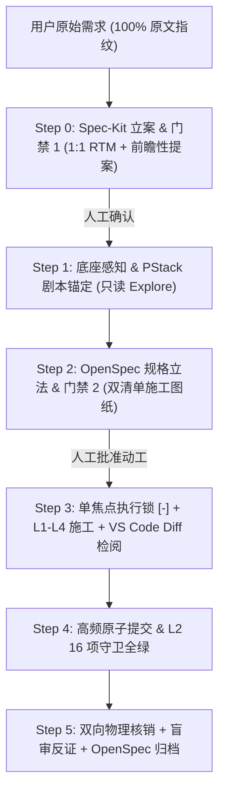

# Pstack-openspec

> **OrbitStack 轨道工程体系 · Agent 执行策略层 (Agent Execution Strategy Layer)**  
> **Throughput Comes From Trust** —— 将 Lauren Tan (`@poteto`) 的 `PStack` 工程准则、`OpenSpec` 增量生命周期与 `AI-Harness` 工程承重墙深度咬合，为编码 Agent 提供可验证、防退化、防失控的执行策略底座。

---

## 1. 在 OrbitStack 轨道工程中的定位

**OrbitStack** 将多智能体研发治理划分为互相协作的层级，本仓库 **Pstack-openspec** 专职承担 **Agent 执行策略层**：

1. **PStack 主干执行力**：以锁定只读的 [`bundle/pstack-upstream/`](bundle/pstack-upstream/)（23 个标准 Playbooks、24 项工程 Principles）为执行内核，通过 [`docs/pstack-openspec-route-map.json`](docs/pstack-openspec-route-map.json) 完成意图到剧本的确定性路由。
2. **OpenSpec 唯一持久状态**：所有需求意图、RFC 2119 行为契约、架构设计与单任务状态均收敛在 `openspec/`（`proposal.md`、`specs/`、`design.md`、`tasks.md`），不建立第二套任务账本。
3. **AI-Harness 工程承重墙与 L2 自动化守卫**：通过类型约束、静态守卫（16 项 `guard:*`）与双阶双轨审计将规范下沉为机器可执行门禁，而非停留在口头提示。



---

## 2. 核心设计思路与关键防线

### 2.1 Lauren Tan 五层信任防御金字塔
1. **L1 架构与类型承重墙**：非法状态不可表达、未知与否定显式分离、源码级防篡改封印（`@ANTIGRAVITY_INVARIANT_LOCK`）、关键流强制加入 Agent 认知把关门禁。
2. **L2 静态分析与自动化守卫（Hard Blocker）**：机器门禁优先级高于自然语言提示；同类人工纠错出现第二遍，立即编码为 Lint / AST / 静态守卫（`Encode Lessons in Structure`）。
3. **L3 契约与验证隔离**：验证平面与施工平面物理隔离，行为测试用真实历史错题反证其有效拦截能力。
4. **L4 实测证据锚定**：所有完成声明必须附带真实进程退出码 0 与 `[Measured]` 实测凭证。
5. **L5 双门禁与双清单把关**：动工前呈报“拟变范围 + 保持现状承诺”双清单；交付前逐条 1:1 双向核销。

### 2.2 核心执行策略机制（Axioms 1–79 演进精华）
- **双阶段双门禁闭环（Step 0–Step 5）**：需求确认（门禁 1）与规格/施工范围授权（门禁 2）物理分离，禁止未授权提前改码。
- **问题处理五维头脑风暴与 `/correct` 四级防线升级（Axiom 79）**：面对已发生的问题或审计异常，Agent 必须先完成五维系统性头脑风暴（现象→系统症结穿透与控制面边界审计、通用工程准则对齐、同类发散、L1–L4 多方案对比、前提质疑），杜绝“语义阶段交由纯机械脚本无人值守直出”，并优先以 **L1 架构 > L2 类型/Lint > L3 行为测试 > L4 规则** 根治复发。
- **通用问题类泛化与反特指硬编码（Axiom 78）**：修复整个问题类而非单点实例，强制全仓兄弟模式横扫（`analogousSitesChecked`），禁止针对特定 ID/输入字面量打特判补丁（`guard:anti-hardcoding`）。
- **智能体防蔓延与角色复用锁（Axiom 77）**：未经人工授权禁止并发拉起多个 Subagent 或 Swarm，也禁止私自 `kill` 活跃或空闲子智能体；优先按职责固定并持续复用已有智能体。
- **独立盲审与真实产物见证（Axiom 74）**：隔离上下文盲审裁决，验证真实输出产物而非代理指标。

---

## 3. 核心资产与目录结构

| 路径 | 角色与说明 |
|:--|:--|
| [`GEMINI.md`](GEMINI.md) / [`worker.md`](worker.md) | 跨线程全局宪法（Axiom 1–79）与子智能体执行规范 |
| [`AGENTS.md`](AGENTS.md) / [`Agent.md`](Agent.md) | PStack-first 入口规则、OpenSpec 根定位与历史行为保护 |
| [`bundle/pstack-upstream/`](bundle/pstack-upstream/) | Lauren Tan 官方 PStack 只读上游镜像（锁定见 [`pstack-upstream.lock.json`](bundle/pstack-upstream.lock.json)） |
| [`docs/pstack-openspec-route-map.json`](docs/pstack-openspec-route-map.json) | 23 个 PStack Playbook 到 OpenSpec 生命周期的路由注册表 |
| [`docs/ps-openspec-system.md`](docs/ps-openspec-system.md) | 体系架构、权责边界、handoff 与安装验证详解 |
| [`skills/`](skills/)（10 项受管技能） | `pstack-openspec`、`ai-harness-openspec`、`spec-driven-workflow`、`desktop-exe-development`、`ui-ux-design-engineering`、`drawio-mcp`、`rea-reverse-engineering`、`app-reverse-deconstruction`、`tavily-search`、`xmind-cloud-mcp` |
| [`scripts/`](scripts/) | 16 项 L2 静态守卫（`check-*.mjs`）、一键全局同步（`sync-to-global.mjs`）与跨平台安装器 |
| [`.harness/project-graph.json`](.harness/project-graph.json) | 模块边界、入口与结构化守卫依赖图 |
| [`packages/ai-harness/`](packages/ai-harness/) | 独立分发的 npm 基座包 `@hujiale2609/ai-harness`（补丁层维护） |
| [`openspec/`](openspec/) | OpenSpec 规格基线、门禁备忘录与归档变更历史 |

---

## 4. 16 项自动化 L2 静态守卫矩阵 (`npm run guard:*`)

| 守卫命令 | 校验目标与拦截范围 |
|:--|:--|
| `guard:neutrality` | 随包分发文档中立性，拦截宿主路径与内部维护细节泄漏 |
| `guard:unslop` | 清除 `worker.md` 与文档中的冗余空话与 AI 套话 |
| `guard:portability` | 校验通用可移植性，拦截跨环境硬编码宿主依赖 |
| `guard:privacy` | 扫描全部已跟踪文件，拦截 API Key、Token、Cookie 与私钥泄露 |
| `guard:graph` | 校验 `.harness/project-graph.json` 模块拓扑与入口完整性 |
| `guard:ledger-continuity` | 校验累计需求台账连续性与无损追溯 |
| `guard:pstack-sync` | 校验本地 `pstack-upstream` 镜像版本与核心剧本完整度 |
| `guard:issue-clearance` | 校验问题台账清零状态，防止遗漏挂起项 |
| `guard:workflow-spec` | 校验工作流规格合规性与原子规则覆盖 |
| `guard:invocation-purity` | 校验调用方与通用底层机制的物理隔离纯洁度 |
| `guard:blind-audit` | 校验盲审隔离轨迹与真实产物见证凭据 |
| `guard:ui-slop` | UI 精简度、少字原则与 WCAG 对比度静态门禁 |
| `guard:drawio-model` | Draw.io 泳道网格与几何拓扑 Diagram-as-Test 守卫 |
| `guard:agent-lifecycle` | 智能体防蔓延、角色固定复用与人类授权终止锁（Axiom 77） |
| `guard:anti-hardcoding` | 反特指字面量硬编码与表驱动重构守卫（Axiom 78） |
| `guard:problem-brainstorm` | 五维问题头脑风暴与四级防线升级三镜像一致性守卫（Axiom 79） |

---

## 5. 安装部署与全局应用

### 一键全局应用（同步本机执行策略层）
```powershell
node scripts/sync-to-global.mjs
```
自动将 `GEMINI.md`、`worker.md`、`docs/pstack-openspec-route-map.json`、全部 10 个 `skills/*` 技能目录及全部 L2 守卫脚本同步至用户全局配置目录（`~/.gemini/`），并保持受保护目录绝对只读隔离。

### 注入其他目标项目
Windows PowerShell：
```powershell
.\scripts\install-to-harness.ps1 -TargetDir "D:\MyOtherProject" -SkillLocation all
```
Linux / macOS：
```bash
./scripts/install-to-harness.sh /path/to/my-other-project
```

### 打包归档与 `@hujiale2609/ai-harness` 维护
- 打包完整发布资产：`pnpm pack:bundle`（输出 `dist/Ps-openspec-V2.10.zip`）
- npm 基座包维护与中立性边界详见 [`packages/ai-harness/README.md`](packages/ai-harness/README.md)
