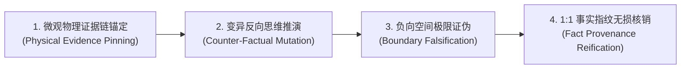

# Agent 智能体认知审计与规范核销方法论指南
# (Agent Cognitive Audit & Specification Verification Guide)

> **最高定位**：本指南为 OrbitStack（Ps-openspec 轨道工程体系）应对“AI Agent 过于依赖机械 Exit 0、迎合性自审与走过场式打勾”的法定认知审计标准。
> 机械审计（编译器、类型系统、Linter、自动化测试）负责守住系统的**下限（确定性底线）**；
> Agent 认知审计（独立 Auditor Subagent、语义契约证伪、负向空间挖掘）负责守住系统的**上限与死角（语义完备性与契约抗毁性）**。

---

## 🏛️ 一、 核心定位与心智模型：波普尔证伪主义与独立敌手审讯官

当前 AI 辅助编程中普遍存在“自施工、自审核、自夸奖”的严重自利偏差（Sycophancy & Confirmation Bias）。写代码的 Agent 会本能地为自己的实现假设寻找合理性依据。

### 1. 裁执彻底物理隔离 (Fresh Auditor by Default)
- **施工平面与审计平面解耦**：施工 Agent（Builder）严禁兼任终审法官。完成开发并通过机械确定性审计后，必须派发全新的独立 Subagent（加载只读上下文，使用更高推理算力，如 `Model='pro'`, `Workspace='branch'`），以纯粹的“局外人”身份执裁；
- **零脏状态污染**：审计 Agent 严禁继承施工 Agent 带有调试摩擦和偏见假设的上下文，恪守零信任原则。

### 2. 波普尔证伪主义心智 (Popperian Falsification Mindset)
- **审讯官心智**：审计 Agent 的第一心智不是“寻找证明它做对的理由”，而是**“穷尽一切手段证明它在某种边界下会失败”**；
- **攻击先行**：主动寻找没有被现有测试用例覆盖的极端状态、边界载荷与异常路径；只有当一段代码经历了最刻薄的边界攻击与反例推演却依然无法被推翻时，Agent 审计员才出具合格判定；
- **超越 Exit 0 幻觉**：审讯官必须持续追问：“这个 Exit 0 究竟证明了什么？它遗漏了什么没有证明？”。

```text
┌────────────────────────────────────────────────────────────────────────┐
│                        裁执物理隔离与敌手审讯架构                       │
│                                                                        │
│   ┌──────────────────────────┐         ┌──────────────────────────┐    │
│   │   施工智能体 (Builder)    │         │   审计智能体 (Auditor)    │    │
│   │   • 目标: 实现功能、单步测通 │         │   • 目标: 穷尽手段证明其崩溃 │    │
│   │   • 心智: 求解与构造       │         │   • 心智: 证伪与攻击 (波普尔)│    │
│   └─────────────┬────────────┘         └─────────────▲────────────┘    │
│                 │                                    │                 │
│                 │ 提交代码变动产出物 (Diff)             │ 敌手攻击与行号挑刺│
│                 └────────────────────────────────────┘                 │
└────────────────────────────────────────────────────────────────────────┘
```

---

## 🌐 二、 规范双轨治理网：全局规范防“暗度陈仓”，局部规范穷尽“负向空间”

在项目审计中，必须严格区分**全局规范（Macro Invariants）**与**局部规范（Micro Contracts）**，实施双轨并行穿透：

```text
┌────────────────────────────────────────────────────────────────────────┐
│                   【两阶双轨规范深度审计拓扑】                          │
├────────────────────────────────────────────────────────────────────────┤
│ 轨道一: 全局规范审讯 (Macro Invariants - 系统宪法与承重墙)             │
│   • 目标: 严防局部优化对宏观架构造成隐性腐蚀与暗度陈仓                  │
│   • 重点: 机制与策略隔离 / 状态合法性因果溯源 / 零防御性捏造 / 源码封印│
├────────────────────────────────────────────────────────────────────────┤
│ 轨道二: 局部规范审讯 (Micro Contracts - 功能模块原子行为契约)           │
│   • 目标: 穷尽微观状态空间，严格核销 RFC 2119 行为闭包与负向空间       │
│   • 重点: SHALL/WHEN/THEN 逐条兑现 / 负向异常拒绝 / 1:1 事实指纹守恒   │
└────────────────────────────────────────────────────────────────────────┘
```

### 1. 全局规范审讯（Macro Invariants）
全局规范是全系统的法定宪章。审计 Agent 必须以宏观架构师的视角，审视本次局部改动是否违背了系统级不变量：
- **机制与策略倒挂审计**：本次改动是否将调用端的业务特异逻辑或特判硬编码塞进了底层共享通用程序？
- **状态合法性因果审计**：异常出现时，是否顺着数据流逆向追溯到 Origin Producer，还是在 Consumer Sink 处进行了局部就地掩盖（Scattered Guards / Swallowed Errors / Clamped Values）？
- **防御性捏造审计**：代码中是否出现了 `val || default_value`、非法伪造的兜底数据，制造虚假的“完整性”？
- **不可变源码封印审计**：凡标注 `@ANTIGRAVITY_INVARIANT_LOCK` 的关键逻辑，是否保持 100% 绝对未被擅动？

### 2. 局部规范审讯（Micro Contracts）
局部规范针对具体功能模块的原子行为契约。机械测试往往只能覆盖正向主链路，Agent 审计必须主攻**“负向空间（Negative Space）”**：
- **未写代码的缺失审计（What is missing）**：机械测试只能验证“已写的代码能跑通”，Agent 审计必须挖掘“未写的代码会引发什么”——未捕获的错误分支、未处理的边界类型、未释放的资源句柄、并发竞态下的死锁；
- **RFC 2119 行为契约逐项兑现**：对局部规范中的每一项 `SHALL`（必须）、`WHEN`（触发边界）、`THEN`（确定性后果）进行显式控制流跟踪，杜绝死分支遮蔽；
- **项数绝对守恒与遗漏熔断 ($N_{\text{Global}} + M_{\text{Local}}$)**：出具 itemized 清算表，缺少任意一条规范的核销证据，直接触发 `SPEC_OMISSION_DETECTED` 熔断阻断。

---

## ⚡ 三、 Agent 认知审计的四大核心操作律 (The 4 Cognitive Operations)

真正的 Agent 审计绝非口水化的“经核对符合要求”，必须执行具有物理可测性的四大认知操作律：



### 1. 微观物理证据链锚定 (Physical Evidence Pinning)
- 审计报告中的每一个判定结论，必须精确绑定目标源码的**绝对路径与行号区间**（例如 `file:///repo/src/pipeline.ts#L42-L78`）以及外部终端运行日志凭据；
- 凡是没有行号区间与实测日志支持的宣称，一律判定为“口水化假对账”，直接否决。

### 2. 变异反向思维推演与弱断言识别 (Counter-Factual & Mutation Reasoning)
- **变异自问**：“如果我把这几行关键状态校验代码删掉，现有的单元测试套件会不会变红？”
- **弱断言欺诈驳回**：如果现有测试仅是浅层的 `assert.ok(res)`，即便删掉核心转换逻辑测试依然报 Exit 0，Agent 审计员必须直接判定其为 `TRIVIAL_ASSERTION_FRAUD`（弱断言欺诈），锁死任务专注锁，责令补充针对复杂状态结构的严格深度断言。

### 3. 负向空间极限证伪攻击 (Boundary Falsification Attack)
- 审计智能体必须主动推演并记录攻击尝试：注入异常变异入参（非法类型、极端空值、畸形格式、超限载荷）；
- 审查目标代码是否遵循 **Fail-Fast 原则** 在系统物理边界就地拦截并抛出受控致命异常，严禁携带脏状态向系统深处传播。

### 4. 1:1 事实指纹双向守恒清算 (Zero-Loss Fact Provenance Reconciliation)
- 坚决杜绝“粗粒度相似度欺骗（Macro-Statistical Evading）”；
- 审计员必须将任务输入载荷中的每一个微观原子意图，与最终交付代码/产出进行 1:1 逐字逐项双向物理核对，严禁任何形式的削足适履式裁剪或关键细节蒸发。

---

## 🔄 四、 防线下沉自迭代闭环：从“单次纠错”到“机械免疫” (Defense Escalation)

**Agent 审计的终极目标，不是在当前代码中充当救火队员，而是让系统获得永久免疫力。**

当审计智能体在认知层面捕获到一个漏洞、缺陷或偏离时，严禁就地打完补丁即关单，必须强制执行 **Lauren Tan 信任金字塔防线下沉规程**：

```text
┌────────────────────────────────────────────────────────────────────────┐
│                   Agent 审计驱动的防线下沉自迭代闭环                     │
│                                                                        │
│   Agent 认知审计抓到了漏洞 (Cognitive Defect Found)                     │
│                           │                                            │
│                           ▼                                            │
│      能下沉为 L1 吗？ ────> 改造类型状态机，使非法状态在编译期不可表达 │
│            │ (不能)                                                    │
│            ▼                                                           │
│      能下沉为 L2 吗？ ────> 编写一条具体的 AST / ESLint 静态拦截规则   │
│            │ (不能)         (黄金法则：同类错误出现两次，必立项为机检) │
│            ▼                                                           │
│      能下沉为 L3 吗？ ────> 固化进 AGENTS.md 宪法，作为正向准入约束    │
│            │ (不能)                                                    │
│            ▼                                                           │
│      下沉为 L4 变异测试 ──> 注入对抗性变异用例，永久防范回归退化       │
│└────────────────────────────────────────────────────────────────────────┘
```

1. **L1（架构与类型承重墙）**：能否通过代数数据类型（`Option/Result`）、严格状态机或 Brand Types，让这个错误在类型检查阶段直接编译报错？
2. **L2（静态机检与 AST 规则）**：【**黄金法则：纠错两遍即立项为 Lint**】。若同类问题发生过两次，必须立刻编写带正向修复指引的 AST/ESLint 规则，下沉为机器底座准入门禁；
3. **L3（契约立法与剧本库）**：若无法写成 AST，是否需要在 `AGENTS.md` 中增加封闭作用域的正向准入标准；
4. **L4（自验证与变异测试）**：将证伪攻击用例固化为持久化的回归测试用例，确保未来任何一次修改均受到变异杀伤力保护。

---

## ⚖️ 五、 人机双钥匙准出机制 (Human Tactile Double-Key Gate)

整个研发工程的合流与交付，依托于严密的**人机双钥匙准出架构**：

$$\text{准出充要条件} = \underbrace{\text{机械确定性机检全绿 (Key 1)}}_{\text{验证隔离 + Exit 0 + 零告警 (--max-warnings=0) + 变异杀伤力}} \;\land\; \underbrace{\text{Agent 认知规范审计核销全绿 (Key 2)}}_{N_{\text{Global}} + M_{\text{Local}} \text{ 逐条物理行号锚定与证伪攻击记录}} \;\land\; \underbrace{\text{人类 VS Code Diff 终审}}_{\text{原生两栏触觉把控}}$$

1. **钥匙 1（机械入场券）**：机械机检红灯或存在编译告警，Agent 认知审计根本无需介入，直接熔断；
2. **钥匙 2（智能体判决书）**：由独立 Auditor Subagent 出具《全局规范与局部规范双向微观核销表》，完成双轨规范清算；
3. **人类终审（VS Code 原生 Diff 触觉门禁）**：双钥匙全部就绪后，调用 `vscode-review` 中的 `review_diff_in_vscode`，拉起原生两栏 Diff Editor，由人类工程师完成最终物理确认与合流发版。
---

## 🔍 六、 强制前置全量通读与任务后主动找茬铁律 (Mandatory Ingestion & Active Bug Hunting)

1. **用户规范方案前置 100% 全量通读 (Zero-Omission Ingestion)**：
   - 凡用户在会话上下文、提示词或引用文档中给出了系统架构规范、正确做法或审计方案，任何 Agent（主 Agent 及全部 Subagents）动工前必须 100% 逐字全量阅读并建立对账基准；
   - 严禁大模型凭通用预训练常识擅自脑补，严禁粗粒度略读或截断遗漏。
2. **任务后主动认知审计（结合机械审计，Agent 必须主动找茬）**：
   - 机械 Exit Code 0 是必要底座（钥匙 1），但绝不能作为验收充要凭证；
   - 任务交付前，Agent 必须以敌手身份主动寻找代码中的深层死角、未处理的边界异常、状态机未响应分支与资源泄漏，主动证明系统存在的问题，严禁消极放行与走过场式打勾。

---

## 🔨 七、 变异反欺诈与逆向举证硬门禁机制 (Mutation Anti-Fraud & Negative Proof Gate)

为彻底解决 Agent 自检悖论（自审确认偏差）、虚假 Exit Code 0、弱断言欺诈与形式主义走过场，体系设立四道机器硬阻断门禁：

### 1. 变异元注入反欺诈门禁 (Mutation Sanity Gate & TRIVIAL_ASSERTION_FRAUD)
- **变异杀伤力公理**：任何自动化测试集与验证脚本必须具备变异杀伤力。
- **自动反例变异注入**：在系统准出前，受控注入反例变异体（如反转核心条件分支、跳过关键前置校验、替换关键返回值）。
- **弱断言欺诈硬阻断**：若测试套件与审计脚本在变异体侵入状态下依然输出 Exit Code 0 或绿灯判定，系统直接判定为弱断言欺诈（`TRIVIAL_ASSERTION_FRAUD`），任务执行锁（`[-] lock`）坚决锁死，一票否决。

### 2. 逆向举证门禁与强制找茬配额 (Negative Proof Gate & Mandatory Adversarial Quota)
- **严禁 0 缺陷消极放行**：对任何非平凡（Non-Trivial）工程任务（涉及业务逻辑增改、状态机流转或架构契约变更），审计报告若宣称“0 缺陷 / 0 问题 / 完美通过”，直接触发 `ZERO_FINDING_SUSPICION` 熔断驳回。
- **强制逆向举证配额**：审计 Agent 必须强制出具至少 1~2 项主动构造的证伪反例攻击记录（包含具体的执行命令、非预期崩溃/异常表现、以及系统边界防御见证），或出具 1 项经变异测试验证杀伤力的实测见证。凡未出具对抗性证伪反例、仅凭口水化宣称“无问题”的审计报告一律视为无效。

### 3. 裁执物理死锁与全新独立 Pro 审讯官 (Fresh Pro Auditor Enforcement)
- **施工者物理剥夺审判权**：施工 Agent 仅拥有代码编写权，被底层系统在物理上剥夺任务自审打勾与终审放行权。
- **全新独立 Pro 敌手审讯**：终审必须派发全新的独立子智能体（`Model='pro'`, `Workspace='branch'`），加载 `/interrogate` 敌手剧本，以推翻施工假设、攻击极端边界为唯一目标执行敌手审讯。

### 4. 用户规范两碰立项机器化下沉公理 (Two-Strike Machine Escalation Axiom)
- **散文劝诫为最弱防线**：Prompt 劝诫与文档口水说教是防御金字塔中最脆弱的一层。
- **两碰立项硬下沉**：凡用户在交互或人工 Review 中指出达到两次的同类执行偏差、排版疏漏或审计漏洞，严禁仅在代码中打创可贴了事，必须强制将其转化为具体的、具备真实 Exit 1 阻断力的机器机检资产（AST/Lint 规则、预提交钩子或参数化变异测试用例），永久固化到系统底座。

---

## 🤖 八、 智能体自动编组、四位一体任务交接胶囊与裁执物理隔离体系 (Autonomous Subagent Swarm & Four-in-One Handoff Architecture)

为解决复杂工程任务中主智能体认知过载（Syntax Drift）、交接口水化信息失真、错误上下文污染与自审自改权责混淆，体系确立五项最高编组准则：

### 1. 默认自动编组与主协调禁下场铁律 (Auto-Dispatch by Default)
- **协调者纯净视角**：接收用户指令的主协调智能体（Main Agent / Coordinator）严格定位为系统架构师、门禁把关者与最高审计官，严禁亲自下场直接编写或修改业务代码；
- **自动编组派发**：所有具体编码、排错、重构与测试执行任务，默认必须自动编组、派发给执行子智能体（Executor Subagent）完成。

### 2. 智能 Subagent 复用判定决策树 (Subagent Reuse vs. Fresh Decision Tree)
- **探查前置**：派发前必须调用 `manage_subagents(Action='list')` 探查当前活跃子智能体状态；
- **状态延续性复用 (`send_message`)**：唯独当后续工作严格属于当前子智能体尚未完成的同一任务断点、或持有未落盘瞬态开发环境（挂载中的 Git 工作分支、运行中的常驻测试服务/进程）时，方可通过 `send_message` 队列复用；
- **全新默认原则 (`Fresh Subagents by Default` via `invoke_subagent`)**：凡属新任务、重构任务、排错转向或重试，一律强制启动干净的全新 Subagent（`Workspace='branch'`），杜绝污染上下文断链追问。

### 3. 四位一体无损任务交接胶囊 (Four-in-One Lossless Handoff Capsule)
派发简报严禁用大白话口水化随口压缩，必须 100% 封装四位一体不可精简交付胶囊：
1. **`ps-openspec` 架构契约**：挂载 OpenSpec 增量提案、RFC 2119 规范、单任务专注锁（`[-] lock`）条目及真实 Exit Code 0 验收命令；
2. **`skill` 执行方法论**：显式注入执行该任务所必须绑定的方法论技能（如 `pstack-openspec`、`unslop`、`tdd` 等）；
3. **`上下文 (Context)` 物理围栏**：物理封闭的可读写文件白名单、严禁触碰的只读承重墙与 `@ANTIGRAVITY_INVARIANT_LOCK` 封印代码块、基准 Commit SHA 及冻结的事实指纹；
4. **`提示词 (Prompt)` 聚焦指令**：单一职责清晰指令，显式声明 **非目标 (Non-Goals)**，严禁越权发散。

### 4. 主动完成报告与响应式审计唤醒 (Active Return & Reactive Wakeup)
- **标准化完成报告**：Subagent 施工完毕后必须主动向主协调智能体回传报告，包含真实修改文件清单、`[Measured]` 真实退出码 0 日志凭据、变异测试杀伤记录及遗留阻碍；
- **响应式自动唤醒**：系统通过底层事件自动唤醒主 Agent 接管，严禁主 Agent 在循环中轮询等待，唤醒后立即启动两阶双轨认知审计。

### 5. 裁执物理隔离与合流权限封锁 (Verifier-Only Merge Authority & Workspace Sandboxing)
- **执行端沙箱隔离**：执行 Subagent 必须在 `Workspace='branch'` 中启动，物理隔离主系统工作树，从底层机制上杜绝执行端直接篡改主系统；
- **裁决端唯一合流权**：系统合流与最终主干代码落盘权限严格归属于主协调/审计 Agent，必须在双阶段机械审计与敌手反向挑刺全绿后，方可完成代码合流。

---

## 🔬 九、 终端物理叶子节点穿透式审计与六大通用工程铁律 (Leaf-Node Penetration & Universal Engineering Invariants)

为杜绝任何浅层伪审计、粗粒度假通与形式主义打勾，体系在认知审计中确立六大通用工程检验公理：

### 1. 终端物理叶子节点离散断言 (Terminal Leaf-Node Assertion)
- **拒绝宏观统计学指标**：进程退出码 0、函数被调用过、字符串包含关键字或整体长度相似，在法律上**一律不能作为功能正确的充分证据**；
- **直击底层离散属性**：审计断言必须直接穿透至底层数据模型的最深层物理叶子节点（如抽象语法树 AST 的叶子属性、底层的 DOM/XML 属性值、内存状态机的精确枚举）。

### 2. 状态跃迁差分见证 (Differential State Witness)
- 任何声明完成状态变更的原语或任务，必须出具执行前（未满足）与执行后（严格满足）的差分见证；凡无法提供差分跃迁证据的变更，判定为伪执行欺诈 (`SILENT_NO_OP_FRAUD`)。

### 3. 同构属性零方差检验 (Zero-Variance Invariant)
- 针对同构平行集合，审计工具必须对其微观排版与控制属性（缩进量、间隙尺度、度量单位）进行统计方差校验，要求 $\text{Var}(P) \equiv 0$；严禁通过数据流补丁字符伪造展现属性。

### 4. 拓扑同构映射保真度审计 (Topology Fidelity Audit)
- 输出结构必须是源输入结构的同构子集（$T_{\text{out}} \subseteq \Phi(T_{\text{in}})$）；审计 Agent 必须主动审查输出结构中是否存在未被源规范授权的投机性拟造层级、说明行或冗余嵌套。

### 5. 核心必填槽位非空硬检验 (`EMPTY_MANDATORY_SLOT_BLOCKED`)
- 凡核心业务或数据模型定义的必填槽位，内容为空或纯空白字符必须触发致命拦截；严格核验实体属性是否发生跨槽位溢出与篡改。

### 6. 洁净原型隔离验证 (Clean Prototype Isolation)
- 审查动态新增节点是否携带被克隆原型的局部边界特异性（如末尾标记、特异索引）；未经过显式净化的克隆追加一律判定为脏状态扩散违规。

## 🔄 十、 人机协同纠错后规范与审计门禁主动自增补规程 (Autonomous Spec & Audit Gate Co-Evolution Standard)

> **最高铁律**：就地修补片面性绝对禁令（Anti-Patch-and-Forget）。凡人类工程师介入指出缺陷、提出质询或提供纠偏指导，Agent 在修复业务逻辑后，严禁就地终止。代码修复仅为最底层必要动作，未完成项目规范、审计指导与机器门禁的主动同步自增补，一律判定为未交付闭环。

### 1. 就地修补片面性绝对禁令 (Anti-Patch-and-Forget Invariant)
- **片面修补零容忍**：人类的每一次纠偏指正，暴露的不仅是代码缺陷，更是项目规范的盲区与审计防线的缺口。
- **交付阻断判定**：若 Agent 仅修复代码而未主动发起规范与审计门禁的增补，任何声称“已修复完成”的报告均视为无效，单任务专注锁（`[-] lock`）坚决禁止打勾解除。

### 2. 项目规范与审计指导文档模糊探测机制 (Fuzzy Probing of Project Guidance)
- **模糊路径探测**：Agent 必须在项目上下文、根目录及文档目录中，主动探测并识别项目既有的规范、标准、约定或审计指导文件（无论是 `specs/`、`docs/`、`guidelines/`、`standards/`、`audit_guide.md`、`qa_rules.md` 还是其他非标命名的指导性文档）。
- **Living Spec 主动立案**：若检测到项目缺乏集中规范文档，Agent 必须主动提请并在标准目录建立 Living Spec 规范文件，确立基准。

### 3. 三位一体主动自增补规程 (The Trinity Self-Augmentation Procedure)
在业务代码修复完成后，Agent 必须无需用户催促，主动发起并向用户呈报对以下三层资产的增补：
1. **项目规范条款增补 (Living Specification Augmentation)**：
   - 将本次纠偏的规则提炼为明确的契约条款（RFC 2119 `SHALL` / `SHALL NOT`），增补进项目规范文档中，严格界定合法操作域与非法操作域。
2. **审计方法与核验清单增补 (Audit Guidance & Inspection Checklist Enrichment)**：
   - 将本次捕获的失效模式（Failure Mode）、反例形态与挑刺核验步骤，增补进项目的审计指导文档，作为后续人类与 Agent 审计的显式检查项。
3. **机器化确定性门禁铸造 (Deterministic Gate Construction - `principle-build-the-lever`)**：
   - 贯彻 Lauren Tan 工具杠杆原则（Build the Lever），必须将该教训固化为一条可重复执行的自动化测试断言、预提交校验脚本或 AST/Lint 规则（保证在未满足时抛出真实 Exit Code 1），使之具备机器一票否决权。

### 4. 后续审计永久基准继承 (Permanent Baseline Inheritance)
- **代码库永久资产晋升**：所有增补的规范条款与审计门禁，经用户 VS Code Diff 终审通过并提交后，立即晋升为该项目代码库的永久法定基准。
- **全集群子智能体无损继承**：后续任意会话、任意派发的子智能体（Subagent）在执行涉及该模块的任务时，必须自动读取并执行该门禁，彻底杜绝同类问题在未来的隐蔽复发。

## 🛡️ 十一、 既有法定规范保护、反审计倒置与宪法修改排他权规程 (Spec Supremacy, Invariant Immunity & Constitutional Amendment Exclusivity Standard)

> **最高铁律**：规范高于审计（Spec Supremacy）与反特洛伊木马式改宪（Anti-Trojan Amendments）。审计智能体是规范的执行者与见证者，绝无立宪权或释宪权；合规免审保护锁（`SPEC_IMMUNITY_PROTECTED`）一票保护法定代码，违者直接判定为审计倒置欺诈（`SPEC_INVERSION_FRAUD`）；宪法修改神圣排他权严禁在任何具体业务情境中夹带暗改宪法，违者触发 `CONSTITUTIONAL_TAMPERING_DETECTED` 致命熔断。

### 1. 规范高于审计与合规免审保护锁 (Spec Supremacy & SPEC_IMMUNITY_PROTECTED)
- **权能物理绝对隔离**：立宪权（人类与 Living Spec）与审计权（Auditor Agent）物理隔离。审计 Agent 无论拥有多高的 Reasoning 算力，其职责严格限定于以规范为标尺进行证伪，绝无资格否定规范本身。
- **免审保护触发条件**：凡被审计代码具备以下任意要素之一，系统自动激活 `SPEC_IMMUNITY_PROTECTED`：
  ① 显式遵循项目既有 Living Spec 条款或官方业务契约；
  ② 处于 `// @ANTIGRAVITY_INVARIANT_LOCK_START` 与 `// @ANTIGRAVITY_INVARIANT_LOCK_END` 封印块内；
  ③ 拥有对应的基准验收测试或单测见证。
- **审计倒置欺诈熔断 (`SPEC_INVERSION_FRAUD`)**：任何审计智能体若以“过度设计”、“写法冗余”、“不符合通用洁癖”、“代码异味”或预训练常识为由，将符合 Living Spec 的法定实现归类为缺陷或要求重构，直接判定为 `SPEC_INVERSION_FRAUD` 审计倒置欺诈，审计报告作废并驳回。

### 2. 碧昂丝反向变异守卫测试 (Beyoncé Pinning & Mutation Tests)
- **黄金锁定测试 (Pinning Tests)**：针对历史上经人类确认的特殊业务逻辑、异常处理或非标实现，必须建立碧昂丝单测（Google Beyoncé Rule: "If you liked it, then you shoulda put a test on it"）。
- **反向变异杀伤力验证**：该测试必须具备反向变异杀伤力——若审计器或开发者将该特殊代码重构为常规的“简洁/通用写法”，测试必须真实红灯（Exit 1）；变异后若依然退出码 0，直接判定为弱断言伪通（`TRIVIAL_ASSERTION_FRAUD`），严禁准出。

### 3. 切斯特顿之栅因果标签与反思证明 (Chesterton's Fences & Why-Not-Just Labels)
- **三要素因果标签**：历史遗留的防御性代码与定制逻辑，必须在规范或源码中承载切斯特顿标签：
  ① `[Living Spec]`: 法定契约编号；
  ② `[Why-Not-Just]`: 反向否定反思（证明为何直观通用写法会导致边界崩溃）；
  ③ `[Origin Commit / PR]`: 历史引入上下文。
- **拆除证明责任倒置**：审计智能体若主张简化或移除某段防御性代码，举证责任完全倒置——必须先行出具客观证明，证实“该栅栏当初设立的根因是什么，以及当前宿主环境为何已经使得该根因彻底不复存在”；未能完成因果自证前，严禁提议拆除。

### 4. 规范单调演进棘轮与正式废止议定书 (Monotonic Ratchet & Supersession RFC)
- **单调不可变性**：规范与门禁只能单调递增演进，禁止静默删除或降级。
- **废止四步议定书**：废止或更新历史规范，必须遵循【正式废止议定书（Supersession RFC）】：
  ① 建立独立废止立案（Deprecation RFC），标注旧规范 ID、废止根因与替代新规；
  ② 显式重构对应的碧昂丝变异测试与基准断言；
  ③ 呈报独立废止提案至人类终审；
  ④ 取得人类在 VS Code 原生 Diff 中的明文签署。严禁在日常业务开发或局部重构中隐式废除旧规。

### 5. 宪法修改神圣排他权与反夹带隐匿修改规程 (Constitutional Exclusivity & Anti-Subversive-Trojan Standard)
- **宪法神圣不可侵犯**：`GEMINI.md`、`GLOBAL-RULES.md`、`AGENTS.md` 及系统顶级宪法级不变量享有最高司法豁免权，未经人类明确许可绝对严禁修改。
- **零容忍特洛伊木马**：严禁在执行具体任务（如功能开发、BUG 修复、格式排版、性能优化等）的情境中夹带、隐匿或顺手修改宪法文件。
- **合法修改唯一双通道**：宪法修改严格限定为两条合法路径：
  ① 人类主动发出修改宪法的明确明文指令；
  ② Agent 发现系统性重大冲突，作为最高级独立【宪法修订提案（Constitutional Amendment RFC）】单独呈报，等待人类专项专属授权。
- **篡改致命拦截 (`CONSTITUTIONAL_TAMPERING_DETECTED`)**：凡在具体任务上下文或未经专属授权检测到触碰宪法文件的行为，系统底层安全守卫直接抛出 `CONSTITUTIONAL_TAMPERING_DETECTED` 致命熔断，立即执行原子回滚并上报人类。

## 🌐 十二、 通用程序纯粹性、反情境污染与跨场景零方差审计规程 (Universal Program Purity & Cross-Scenario Invariance Standard)

> **最高铁律**：严禁聚焦单一情境改核心通用代码。任何工程任务与 BUG 修复，必须做成通用型抽象，禁止在通用引擎层插桩特判（`SCENARIO_POLLUTION_BLOCKED`）；严禁在消费端（Sink）掩盖错误（`SINK_POLLUTION_BLOCKED`）；改动必须通过跨情境正交回归矩阵与跨场景零方差检验（$\text{Var}_{\text{cross}} \equiv 0$）。

### 1. 三层机制策略物理隔离审计 (Three-Tier Physical Isolation Audit)
- **通用机制纯粹性校验**：审计智能体必须穿透底层通用模块（Universal Mechanism Engine），严格审查是否存在特定调用端、特定业务系统、特定文件名或非参数化魔法特判；凡通用核心存在情境专有名词，直接判定为信息泄漏红牌。
- **防腐层（ACL）正规化责任核实**：审查异构输入的清洗是否发生在边界防腐层；未在网关做正规化而导致脏数据穿透通用核心的，审计直接驳回。
- **策略配置外置化检验**：新情境特异性必须以纯数据、声明式配置或策略插件注入；通用机制核心代码修改量必须严格为 0。

### 2. 单情境代码污染硬阻断规程 (`SCENARIO_POLLUTION_BLOCKED`)
- **AST 语法级特化特判扫描**：静态分析工具与敌手审讯官（Auditor）扫描变更代码，若发现 `if (scene === 'xxx')`、`if (filename.includes('xxx'))` 等将特定案例作为硬编码分支的代码，直接抛出 `SCENARIO_POLLUTION_BLOCKED` 致命阻断。
- **通用性泛化数学自证**：开发者或 Agent 必须出具数学级自证，证明新原语具备通用正交性，对同构的所有合法输入均有效。

### 3. 反局部掩盖与修 Sink 熔断规程 (`SINK_POLLUTION_BLOCKED`)
- **消费端掩盖绝对禁令**：严禁在消费端（Consumer Sink）、渲染末端对上游非法状态做就地补丁或默认值吞没。
- **逆向数据流穿透溯源**：发现异常必须逆向穿透溯源至数据源头生产者（Producer）或边界防腐层；在 Sink 打补丁者直接触发 `SINK_POLLUTION_BLOCKED` 熔断。

### 4. 跨情境正交回归矩阵与跨场景零方差定律 ($\text{Var}_{\text{cross}} \equiv 0$)
- **正交测试标本矩阵**：通用程序修改的验收，必须包含至少 2~3 组正交、极端或互斥的合法场景标本（极短、超长、复杂嵌套）。
- **零方差严格断言**：在其他非相关正交场景运行时，其关键输出指标与拓扑结构方差必须严格为 0（$\text{Var}_{\text{cross}} \equiv 0$）；任何引发周边场景微小非预期漂移的行为，一律判定为通用性破坏并拒绝准出。

## 🛡️ 十三、 纯粹通用工程抽象、反具体情境锚定与六大通用元病理审计规程 (Pure Universal Engineering Abstraction Standard)

> **最高铁律**：严禁全系统任何规则与门禁针对单一具体业务情境编写。所有体系设计必须 100% 抽象为计算机科学、软件工程、状态机理论与形式化验证语言（违者触发 `SCENARIO_ANCHORING_POLLUTION`）。认知审计官（Auditor）必须对六大通用元病理执行穿透性审讯与敌手证伪。

### 1. 状态容器白板态与初始零态审计 (Clean-Slate Zero-State Audit)
- **零态重置审查**：审计智能体必须验证对象池、缓冲区（Buffer）、执行上下文与数据装配容器在进入流水线前是否具备显式洁净重置（Clean-Slate Wipe）；未清零即投入数据复用的，直接抛出 `UNCLEANED_CONTAINER_POLLUTION` 致命阻断。

### 2. 最小特权作用域与粗粒度豁免审计 (Least-Privilege & Anti-Broad-Scope Audit)
- **豁免颗粒度穿透**：严格审查代码与测试中的跳过/豁免逻辑；凡以模块、容器、层级粒度跳过验证或预清空的，直接判定为 `BROAD_SCOPE_EXEMPTION_BLOCKED`；豁免必须精准下沉到离散的叶子标识符（Atomic Leaf Identifier）。

### 3. 全封闭双极状态断言闭包审计 (Bipolar Closure Assertion Audit)
- **非对称单向偏误判定 (`ASYMMETRIC_POSITIVE_BIAS`)**：凡仅使用正向存在性断言（如 `contains(key)`）而未构建逆向排他门禁的测试用例，一律判定为伪审计；必须成对断言：正向断言核心事实精确存在 + 逆向排他断言非法状态、脏数据绝对为 0。

### 4. 零防御性数据拟造审计 (`PHANTOM_DEFAULT_FRAUD`)
- **反凭空合成保底**：数据缺失在通用转换管线中必须严格保持为显式空态（`Option::None` / `null`）或快速失败；严禁在代码中合成任何伪造的假想默认值，违者直接触发 `PHANTOM_DEFAULT_FRAUD` 熔断。

### 5. 容器致密紧凑性与同构投影零方差审计 (Container Compactness & Homomorphic Audit)
- **紧凑修剪核验**：容器装配后必须包含紧凑化收敛（Pruning），物理消除未消费的悬空槽位；同源数据映射到多个衍生投影时，核心拓扑结构方差必须严格为 0（$\text{Var}_{\text{topology}} \equiv 0$）。

### 6. 验证平面裁执隔离与波普尔敌手证伪审计 (`META_AUDIT_FAILURE`)
- **变异杀伤力实测**：审查者在物理上与施工者隔离；严禁将 Exit Code 0 作为合格凭据；终审必须包含对产出物注入变异脏数据的攻击尝试，若变异注入后测试依然返回 0，直接判定该测试套件自身失效（`META_AUDIT_FAILURE`），任务执行锁（`[-] lock`）坚决锁死。

## 🔨 十四、 人机纠偏强制沉淀 Lint 物理断路器与反廉价道歉规程 (Mandatory Lint-Escalation & Anti-Superficial-Apology Protocol)

> **最高铁律**：严禁 Agent 在面对人类纠偏批评时产生低成本、套路化的文本道歉（违者判定为 `SUPERFICIAL_APOLOGY_REJECTED`）。人类纠错两次（$\text{Counter} \ge 2$）必须机械化下沉为自动执行的 AST 规则或 Lint 门禁，以物理代码阻断杜绝人类重复盯防与虚假不长记性。

### 1. 人机纠偏计数器与状态机硬阻断 (`CORRECTION_INCIDENT_ESCALATION`)
- **纠偏事件动态存证**：每次人类对 Agent 输出的审计漏洞、标准放水、退化违规进行纠正或批评，系统自动登记 `[Correction Incident]`，`correction_incident_counter` 递增。
- **两碰立项硬阻断**：当计数器达到 2 时，系统触发 `CORRECTION_INCIDENT_ESCALATION`，自动向 `tasks.md` 注入最高优先级阻断任务：`[-] Task: 固化机器级 AST/Lint/变异门禁并实测 Exit 1 阻断`；单任务专注锁（`[-] lock`）坚决死锁，直到出具机器退出码 1 阻断凭据方可解锁。

### 2. 交付拦截断路器与反空头支票硬门禁 (`NO_LINT_DELIVERY_BLOCKED`)
- **Git 暂存区机械审计**：在 Step 4 审计与 Step 5 交付签发时，若会话中存在人类纠偏记录（$\text{Counter} \ge 1$），系统机械扫描 Git Staged Diff。
- **机器规则资产守恒**：暂存区必须包含新增或修改的自动化检查脚本（AST 脚本、Lint 规则、编译门禁或变异断言代码）；若暂存区仅有业务代码补丁或口头文档，直接抛出 `NO_LINT_DELIVERY_BLOCKED` 阻断并原子回滚，坚决拒绝口头保证。

### 3. 反廉价口水道歉与三要素工程事实响应契约 (`ANTI_SUPERFICIAL_APOLOGY_PROTOCOL`)
- **空洞道歉文本一票否决**：严禁“非常抱歉”、“我深刻反省”、“下次一定注意”等廉价口水；触发直接判罚 `SUPERFICIAL_APOLOGY_REJECTED`。
- **三要素客观工程事实输出契约**：第一响应必须严格且仅允许包含：
  ① **失效模式形式化定义 (Failure Mode Specification)**：精确说明本次违背的规则抽象、反模式代码特征与漏检根因；
  ② **机器杠杆落地方案 (Proposed Machine Lever)**：指出拟固化的 AST 检查脚本、Lint 规则或变异断言代码与目标文件；
  ③ **反向证伪杀伤凭证 (Falsification Proof)**：出具在反模式代码上真实执行该机器门禁并产生真实非零退出码（`Exit 1`）的阻断记录。

### 4. 沉淀规则永久水库与蜂群冷启动继承机制 (`PERMANENT_LINT_RESERVOIR`)
- **持久化门禁水库**：因纠偏沉淀的 Lint / AST 规则严禁作为单次临时脚本，必须持久化固化至项目常态化门禁水库（如 `scripts/lint/`、`package.json` 的 lint/test 命令或 Git 预提交钩子），纳入常态化自动化流水线。
- **蜂群冷启动绝对继承**：所有新派发的子智能体（Subagents）在冷启动底座感知（Step 1）阶段必须自动加载并执行当前水库中的全量规则，确保历史纠偏经验跨智能体、跨会话绝对零遗忘。

### 5. Lint 抽象纯粹性与反具体情境污染规程 (`LINT_DOMAIN_NEUTRALITY_STANDARD` & `SCENARIO_ANCHORING_LINT_BLOCKED`)
- **纯粹语法树分析铁律**：所有固化沉淀的 Lint / AST 规则必须 100% 作用于代码语法树结构（AST Syntax Nodes）、通用类型守卫与程序逻辑状态机；
- **业务情境硬编码零容忍**：严禁在 Lint 规则或静态分析脚本中硬编码任何具体业务领域的专有名词、业务实体名称或特定情境格式文本；违者直接判定为 `SCENARIO_ANCHORING_LINT_BLOCKED` 并一票否决。


## 🔨 十五、 通用工装结晶与反一次性修补审计规程 (Generic Tooling Crystallization & Anti-One-Off-Scripting Protocol)

> **最高铁律**：严禁 Agent 针对具体问题交付写死路径或特例参数的一次性脚本（违者直接判定为 `ONE_OFF_SCRIPT_TRAP_BLOCKED` 阻断）。所有解法必须遵循 Lauren Tan (@poteto) 的 `principle-build-the-lever` 与 `principle-encode-lessons-in-structure`，结晶跃迁为可重复运行、参数化的通用工装。

### 1. 探索与施工严格生命周期二分 (`GENERIC_TOOLING_CRYSTALLIZATION`)
- **探索期沙盒受限许可**：一次性临时脚本（Scratch Scripts）仅被允许在 Phase 1（Explore）探索思考期作为只读探针使用；
- **施工与交付期硬结晶**：因果链路一旦查清，施工期（Phase 3）必须将解法结晶跃迁为常驻、可复用、参数化的通用工装（Generic Tooling），统一归入 `scripts/tools/` 或标准 CLI，严禁将一次性修补脚本作为交付方案。

### 2. 反一次性脚本陷阱审查门禁 (`ONE_OFF_SCRIPT_TRAP_BLOCKED`)
- **静态硬编码特例值审查**：审计官必须穿透审查提交的工装代码；凡存在硬编码具体业务文件路径、业务特例常量、缺乏 CLI 参数化接口的，直接判定为 `ONE_OFF_SCRIPT_TRAP_BLOCKED` 阻断并原子回滚；
- **边际成本递减核验**：审查该工装是否能够一键复用于后续同类问题，拒绝一次性止痛药方案。

### 3. 通用工装三大物理契约审计
- **参数化输入契约 (`PARAMETERIZED_INVARIANCE`)**：必须支持通过命令行参数（Flags）、配置文件或标准输入（STDIN）传入目标，严禁任何 Magic Strings；
- **确定性机器接口契约 (`DETERMINISTIC_LEVER_CONTRACT`)**：必须提供确定性 UNIX 退出码（0 为合格，非 0 为异常），输出结构化诊断日志，支持幂等重跑（Rerun for free）；
- **自验证黄金契约**：通用工装自身必须配备单元测试或变异测试，证明其自验证能力。

### 4. 双轮驱动赋能目标审计 (`DUAL_PURPOSE_LEVERAGE`)
- **赋能目标自证**：交付报告中必须显式自证该工装的工程赋能目标（满足至少其一）：
  ① **主动免疫规避 (Prevention Gate)**：挂载至自动化流水线（CI/Pre-commit/Lint），对同类违规代码实施秒级 Exit 1 拦截；
  ② **缩短排障耗时 (Acceleration Lever)**：提供标准化参数化 CLI/API，将后续同类故障的排障与修复耗时压缩至秒级一键命令执行。


## 🌐 十六、 项目唯一权威审计体系与审计拓扑图（Audit Graph）无损交接审计规程 (Project-Canonical Single Audit System & Audit Graph Handoff Protocol)

> **最高铁律**：任何受 Ps-openspec 管辖的项目，其内部**有且仅有一套**法定权威审计体系基座（违者直接判定为 `DUPLICATE_AUDIT_SYSTEM_BLOCKED` 阻断）。审计体系必须以 Audit Graph（审计拓扑图）作为因果与依赖治理网络，并基于用户指导与 Ps-openspec 进行持续维护、动态优化与版本化演进，为跨 Agent 交接提供唯一法定真理核销底座。

### 1. 单项目唯一权威审计体系准则 (`PROJECT_CANONICAL_AUDIT_SYSTEM_AXIOM` & `DUPLICATE_AUDIT_SYSTEM_BLOCKED`)
- **法定唯一事实基座**：每个项目必须维护统一的受管审计入口与基线规范，杜绝多套审计规则碎片化、各自为政或随意拼凑；
- **多套审计体系硬阻断**：严禁任何 Agent 在单一项目内建立平行、割裂或重叠的第二套审计体系。凡检测到未登记在项目受管审计入口中的独立审计体系或同义重复规则，系统直接触发 `DUPLICATE_AUDIT_SYSTEM_BLOCKED` 阻断并强制合流；
- **全系统统一演进**：所有对审计标准的增补、纠偏与细化，必须就地演进该唯一审计体系，保持版本历史与不可变封印完整。

### 2. 审计拓扑图因果网络治理规程 (`AUDIT_GRAPH_TOPOLOGY_ENGINE` & `UNANCHORED_AUDIT_ISLAND_BLOCKED`)
- **五维拓扑节点实体**：
  ① `Specification Node`（规范契约节点）：RFC 2119 规范条目（SHALL/WHEN/THEN）；
  ② `Invariant Node`（架构不变量节点）：系统不可变承重墙锁（`@ANTIGRAVITY_INVARIANT_LOCK`）；
  ③ `SourceAnchor Node`（物理源码锚点）：受保护的代码文件路径、行号区间与符号定义；
  ④ `Evidence Node`（环境见证凭据）：真实退出码 0（[Measured] Evidence）与反例变异杀伤记录；
  ⑤ `HumanGuidance Node`（用户指导节点）：人类架构师的纠偏、指导意见与历史裁决事实。
- **因果有向边依赖网**：
  支持 `governs`（规范治理不变量）、`anchors_to`（不变量锚定源码）、`verified_by`（源码/规范由实测凭证核销）、`derived_from_guidance`（规范与规则演化自用户指导）；
- **孤岛审计节点清零门禁 (`UNANCHORED_AUDIT_ISLAND_BLOCKED`)**：
  严禁存在无规范支撑、无代码锚点或无环境见证凭证的虚假孤岛审计节点；审查流程对孤岛节点实行一票否决。

### 3. 基于用户指导与 Ps-openspec 的持续演进与自迭代机制 (`HUMAN_GUIDANCE_CONTINUOUS_EVOLUTION`)
- **人类指导最高演进权威**：当用户对审计标准提出指导、指出漏洞或提出边界要求时，强制即刻摄入为 `HumanGuidance` 节点，以此为驱动扩展 Audit Graph；
- **防线下沉三阶固化**：结合 Ps-openspec 五层防御金字塔，用户指导两次的问题，必须自动下沉为 L1 状态机合法性约束、L2 静态 AST/Lint 阻断规则或 L3 OpenSpec 封闭规范条款；
- **版本化与 OpenSpec 增量生命周期**：审计体系的维护与优化必须遵循 OpenSpec 增量流程（Proposal -> Specs -> Tasks -> Archive），严禁破坏既有历史不变量，确保全生命周期演进可追溯。

### 4. 跨 Agent 无损交接与真理平面核销契约 (`LOSSLESS_AGENT_HANDOFF_AUDIT_BASELINE` & `AUDIT_STATE_COGNITIVE_DRIFT_BLOCKED`)
- **跨 Agent 唯一法定真理平面**：在主 Agent 派发子 Agent（Subagent Swarm）、跨会话恢复或多 Agent 协同工作流中，项目唯一的审计体系与 Audit Graph 是唯一被系统认可的真理对账底座；
- **交接胶囊深度绑定**：跨 Agent 交接胶囊（`pstack-handoff`）中必须注入 Audit Graph 拓扑快照与任务对应子图；
- **认知零漂移与秒级对齐**：接手的 Agent 禁止重新推测或私设审计标准，必须严格遵循 Audit Graph 拓扑执行因果穿透与边界审查；
- **任务打勾充要条件**：任务打勾必须且仅能以 Audit Graph 中所有挂接的真实退出码 0 凭据为充要判定依据，严禁口头宣称与形式主义放行。

### 5. 纯通用工程抽象与反业务情境锚定硬门禁 (`UNIVERSAL_AUDIT_ABSTRACTION_STANDARD`)
- **100% 纯通用工程语言**：审计体系、Audit Graph 节点与验证逻辑必须 100% 采用图论（DAG）、状态机、RFC 2119 与操作系统退出码等通用计算机科学抽象；
- **零业务情境污染**：严禁在审计规则或 Graph 拓扑中夹带任何单一业务领域专有名词或特定场景特例逻辑，违者直接阻断并拒绝合流。


## 🧠 十七、 认知反思对账三阶跃迁与后厨旅团工单调度审计规程 (Cognitive Triad Evolution & Kitchen-Brigade Scheduling Protocol)

> **最高铁律**：吸收 Lauren Tan (@poteto) 最近核心开源突破（`brainmaxxing`、`noodle`、`how`）的工程精髓，全系统严格执行认知金库三阶自进化状态机（`/reflect` 即时反思 → `/ruminate` 历史反刍 → `/meditate` 规则剪枝升阶）与后厨旅团工单调度规程（`Mise en place` 就绪台 → `Orders-next` 工单解耦 → Line Cooks 独立分支施工）。严禁未反思沉淀的代码交付（违者触发 `UNREFLECTED_DELIVERY_BLOCKED`），严禁主协调 Agent 跳过工单直接修改业务代码（违者触发 `ORCHESTRATOR_DIRECT_DIRTY_WRITE_BLOCKED`）。

### 1. 认知金库三阶自进化状态机 (`COGNITIVE_TRIAD_EVOLUTION_ENGINE` & `UNREFLECTED_DELIVERY_BLOCKED`)
- **阶梯一：`/reflect` 即时反思 (Immediate Reflection)**：任务交付或发生人机纠偏后，系统强制提取失效模式（Failure Mode）、避坑警示与防御策略，即刻沉淀至项目记忆金库（`brain/`）与 Audit Graph 中；严禁只有代码改动而缺乏反思沉淀的交付行为（`UNREFLECTED_DELIVERY_BLOCKED`）；
- **阶梯二：`/ruminate` 历史反刍 (Deep Log Rumination)**：跨任务或冷启动底座感知（Step 1）时，Agent 自动穿透最近会话日志、历史提交与错误记录，挖掘被单次即时反思遗漏的重复性模式与隐性偏好；
- **阶梯三：`/meditate` 规则对账与剪枝升阶 (Cognitive Harmonization & Pruning)**：定期对现有规范条款、Lint 规则与记忆库执行交叉审计，修剪过时、死锁与冲突规则，并将人工纠偏超过两次的经验自动升格提炼为系统不可变承重墙（L1 状态机）或通用 AST/Lint 门禁（L2）。

### 2. 后厨旅团工单调度与裁执物理隔离规程 (`KITCHEN_BRIGADE_ORDER_PROTOCOL` & `ORCHESTRATOR_DIRECT_DIRTY_WRITE_BLOCKED`)
- **Mise en Place 就绪感知**：主协调智能体（Head Chef）动工前必须汇聚工程全景状态、依赖承重墙与待办积压（Backlog），备齐全部输入与双清单；
- **Orders-next 工单解耦与直接写码阻断**：主协调智能体专职负责需求拆解、状态机建模与原子任务工单发布（`orders-next`），严禁主协调智能体跳过工单直接在施工平面乱涂乱画写业务代码（`ORCHESTRATOR_DIRECT_DIRTY_WRITE_BLOCKED`）；
- **Line Cooks 单线隔离施工**：派发的子智能体（Line Cooks / Subagent Swarm）必须在物理隔离的分支（`Workspace='branch'` 或 Git Worktree）中持有单焦点执行锁（`[-] lock`）逐项施工，测通后合并，实现裁执物理隔离。

### 3. 扇出探索与多模型敌手找茬评测机制 (`FANOUT_EXPLORATION_CRITIQUE_RUBRIC` & `TRIVIAL_SELF_AUDIT_FRAUD`)
- **五维结构化架构探索**：在 Phase 1 (Explore) 面对复杂跨系统问题时，支持 2~4 条并行扇出路径深入探查，由合成器产出标准五维结构报告：`Overview`、`Key Concepts`、`How It Works`、`Where Things Live`、`Gotchas`；
- **多模型敌手批判与证伪攻击**：在 Step 5 终审时，引入严苛的批判评测准则（Critique Rubric），拉起独立敌手审查员从边界异常、回归隐患与过拟合等维度主动挑刺找茬，杜绝弱断言形式主义自审（`TRIVIAL_SELF_AUDIT_FRAUD`）。

### 4. Audit Graph 与本地 Markdown 记忆双向互通契约 (`AUDIT_GRAPH_OBSIDIAN_INTEROP`)
- **Obsidian 兼容纯 Markdown 表现**：Audit Graph 节点与本地记忆金库保持标准 Markdown 结构，无专有二进制格式；
- **人类双向审计通道**：人类架构师可直接在 Obsidian 中查看记忆演进与审计 DAG 拓扑，并支持手动微调与版本管理，实现人类直觉与 Agent 记忆库的双向无缝对齐。

### 5. 纯通用工程抽象与反业务情境锚定硬门禁 (`UNIVERSAL_COGNITIVE_ABSTRACTION_STANDARD`)
- **100% 通用软件工程语言**：认知三阶环、后厨旅团工单制与敌手批判的所有定义、规约与实现，必须 100% 采用状态机理论、DAG 拓扑、RFC 2119 规范与标准操作系统退出码等通用计算机科学抽象；
- **零业务情境污染**：严禁在审计规约中夹带任何单一业务领域专有名词或特定场景特例逻辑，违者直接阻断并拒绝合流。
