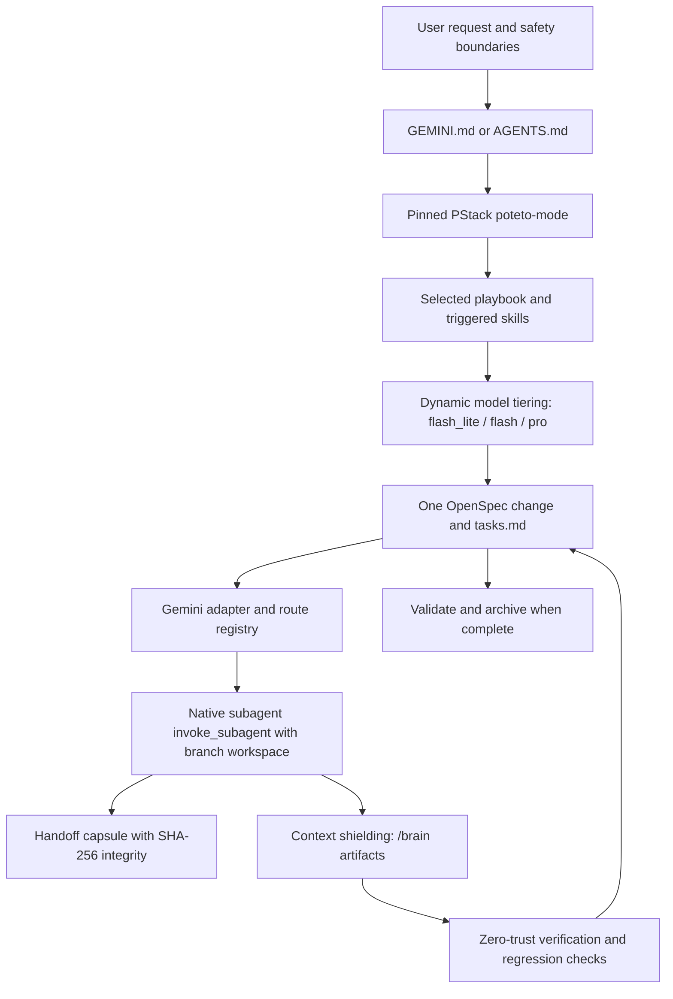

# Ps-openspec Gemini system reference

This document describes the Ps-openspec Gemini adaptation in this repository. It explains how tasks execute in Google Gemini and Antigravity, how PStack playbooks map to native Gemini tools and subagents, and how the system is installed and packaged.

## System boundary

Ps-openspec Gemini combines the pinned PStack plugin (573 files), OpenSpec, a native Gemini adapter (`orbitstack-gemini`), a route registry, and OrbitStack's lossless handoff and invariant-protection mechanisms.

## Authority and source of truth

| Concern | Authoritative source | Role |
|---|---|---|
| User intent | The current user request and later directives | Defines requested goals, constraints, and non-goals |
| Execution method | `bundle/pstack-upstream/` (commit `c742dd61706fbacc1b95f1a20b7b988cf096ce6c`) | Supplies `poteto-mode`, 23 playbooks, 24 principles, 58 skills |
| Gemini adaptation | `orbitstack-gemini/SKILL.md` | Maps PStack routing, model tiering, subagents, and artifacts to Gemini |
| Playbook mapping | `docs/pstack-openspec-route-map.json` | Maps each PStack playbook to OpenSpec actions, Gemini capabilities, and model tiers |
| Persistent task state | One active OpenSpec change | Stores intent, requirements, tasks, evidence, and archive history |
| Code relationship map | Code Review Graph | Identifies changed symbols, callers, and flows (derived data) |
| Historical behavior protection | OpenSpec invariant metadata and regression checks | Enforces preservation or explicit supersession of protected behaviors |

## Gemini native integration

### 1. Dynamic reasoning budget (`pstack-models` -> Gemini model tiers)

PStack emphasizes matching reasoning budget to task difficulty:
- `flash_lite`: Low-latency classification, route selection, linting, syntax checking, and git status parsing.
- `flash` (or `inherit`): Standard implementation, feature development, bug fixing, refactoring, and TDD cycles.
- `pro`: Deep architectural exploration (`/architect`), red-team interrogation (`/interrogate`), and Arena blind evaluation judging (`/arena`).

### 2. Lossless subagent handoff via native `invoke_subagent`

1. The parent agent extracts task metadata and generates a cryptographic capsule from OpenSpec:
   `node .orbitstack/scripts/pstack-handoff.mjs generate --change <change-id> --task <task-id>`
2. The subagent is launched via Gemini's native `invoke_subagent` with `Workspace='branch'` (or `'share'`). The dispatch prompt carries the mandatory standard header:
   `🚨 [MANDATORY EXECUTION STANDARD: ps-openspec (OrbitStack)]`
3. Reactive Wakeup: Parent agent avoids polling. The runtime resumes execution when the subagent finishes.
4. Return verification: The parent validates returned paths against declared write boundaries:
   `Get-Content returned-capsule.json | node .orbitstack/scripts/pstack-handoff.mjs verify-return --ack-task <id> --ack-digest <digest> --changed-path <paths>`
5. Zero-Trust verification: The parent independently re-runs acceptance checks in the main workspace before checking off tasks.

### 3. Context shielding and artifacts

- Subagents isolate heavy build, compilation, and scraping output.
- Multi-step reports, architectural analyses, and test traces are stored as structured artifacts in `<appDataDir>\brain\<conversation-id>`.
- Subagents reply with a high-density summary (1,000 to 2,000 tokens) pointing to the artifact, preventing parent context decay.

### 4. Native VS Code Diff review

- Code modifications prioritize the `vscode-review` MCP tool `review_diff_in_vscode`, presenting two-column diffs for user review before application.
- Fallback: `code --reuse-window --diff <base> <proposed>` if the MCP tool is not active.

## Installation and layout for Gemini

When installed via `scripts/install-to-harness.ps1 -SkillLocation gemini`:
- Upstream PStack mirror is deployed to `.orbitstack/pstack-upstream/`.
- Route registry and helper scripts deployed to `.orbitstack/`.
- Gemini adapter installed to `.gemini/skills/orbitstack-pstack-openspec/SKILL.md`.
- Target project `GEMINI.md` or `AGENTS.md` receives an adapter pointer without modifying existing user rules.
