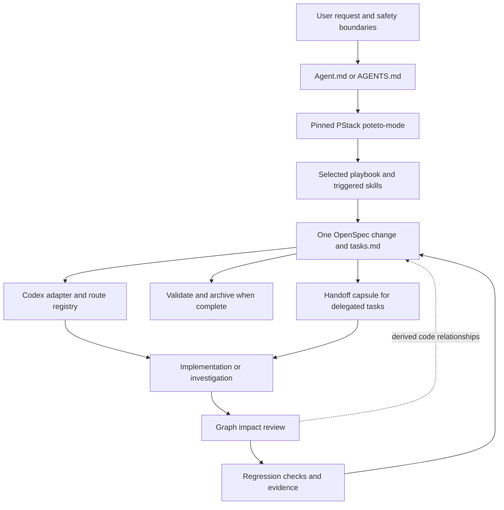

# Ps-openspec system reference

This document describes the Ps-openspec V2.00 system in this repository. It explains which component owns each decision, how a task moves from a user request to verified work, how the two OrbitStack extensions fill gaps in PStack, and how the system is installed and packaged.

## System boundary

Ps-openspec combines the pinned PStack plugin, OpenSpec, a Codex adapter, a route registry, and two OrbitStack extensions. PStack selects how an agent works. OpenSpec stores the only durable task state. The adapter connects those rules to Codex and names host capabilities that Codex cannot run directly.



The user request and safety boundaries control the work. PStack is the primary execution method. The Codex adapter maps PStack methods to Codex capabilities. OpenSpec records the task, its requirements, progress, and evidence. Code Review Graph supplies code relationships for review. It does not store task state or explain why a behavior is protected.

## Authority and source of truth

| Concern | Authoritative source | Role |
|---|---|---|
| User intent | The current user request and later directives | Defines the requested result and any explicit limits |
| Execution method | `bundle/pstack-upstream/` at the revision in `bundle/pstack-upstream.lock.json` | Supplies `poteto-mode`, playbooks, principles, skills, agents, scripts, and references |
| Codex adaptation | `orbitstack-codex/SKILL.md` | Maps PStack routing and OpenSpec use to the Codex host |
| Playbook mapping | `docs/pstack-openspec-route-map.json` | Maps each PStack playbook to its OpenSpec action, gate, host capability, supporting skills, and evidence |
| Persistent task state | One active OpenSpec change | Stores intent, behavior requirements, tasks, evidence, and archive history |
| Code relationship map | Code Review Graph | Identifies changed symbols, callers, and flows; remains derived data |
| Historical behavior protection | OpenSpec invariant metadata and regression checks | States what must remain true and how a future change may replace it |

The pinned PStack mirror contains 573 files, 58 skill directories, 24 principle skills, 23 playbooks, 2 agent definitions, and 12 automation files at the V2.00 pin. The lock file records the upstream repository, commit `c742dd61706fbacc1b95f1a20b7b988cf096ce6c`, plugin version `0.15.36`, and file count. The source mirror is immutable for this release. A PStack update requires changing the pin and verifying the new mirror as one deliberate release change.

`Agent.md` is the packaged primary instruction file. `AGENTS.md` is the compatible alias. If a target project already has `AGENTS.md`, the installer preserves its contents and appends one adapter pointer. If the file is absent, the installer copies the packaged baseline and adds the pointer. The installer does not replace project architecture facts, commands, or domain pipelines.

## What each layer does

### PStack routes work

Every task starts at PStack `poteto-mode`. The agent reads the mode, selects one of the 23 playbooks, reads the playbook, and reads each supporting skill or principle that the playbook triggers. Read-only questions use the Investigation playbook. Large cross-cutting work uses the `figure-it-out` fallback skill. That fallback is not a 24th playbook.

The route registry is the single mapping between the pinned playbooks and Codex. Each route records its source path, representative task fixture, OpenSpec action, PStack gate, Codex capability or fallback, durable task source, supporting-skill resolution policy, and verification evidence. The structural audit compares all 23 registry entries with the pinned playbook files. It also checks required fields, the fallback entry, the OpenSpec root, and global mirror consistency.

The route list is grouped by task type below. The JSON registry remains authoritative for the full mapping.

| Task class | PStack routes |
|---|---|
| Investigation and diagnosis | `investigation`, `runtime-forensics`, `trace-forensics` |
| Product and code changes | `bug-fix`, `feature`, `refactoring`, `prototype`, `visual-parity`, `authoring-a-skill`, `perf-issue`, `hillclimb` |
| Evaluation, coordination, and delivery | `eval`, `babysit`, `shipping`, `autonomous-run`, `orchestrate`, `autopilot-full`, `autopilot-stack`, `session-pickup`, `pause-safely`, `multi-phase-plan`, `worktree-cleanup`, `opening-a-pr` |

PStack defines the work method. OpenSpec is the durable record that method writes into when the work changes persistent project behavior. Reversible work within the request proceeds without routine confirmation. A genuine user decision, missing authority, explicit user gate, safety boundary, or irreversible action can still require a pause.

### OpenSpec records one task lifecycle

The installer resolves OpenSpec from the project root and verifies `openspec context --json`. If the project has no OpenSpec root, it runs the CLI initializer for the selected harness and verifies the root again. If an existing configuration fails to resolve, the installer stops rather than creating another root.

An implementation change uses one active change with these artifacts:

| Artifact | Stored information |
|---|---|
| `proposal.md` | Original request, later directives, scope, and intended result |
| `specs/` | Observable behavior, preserved behavior, and acceptance scenarios |
| `design.md` | Implementation boundaries, decisions, and risks when needed |
| `tasks.md` | PStack playbook steps, task progress, invariant dispositions, and evidence |

The selected PStack playbook steps are copied into the same `tasks.md` before task-specific steps. OpenSpec `tasks.md` is the only durable task checklist. A handoff capsule is generated from OpenSpec and Git; it is not a second task database. Completed changes are validated with `openspec validate --all --strict` and archived without rewriting past archive records.

### The Codex adapter maps host capabilities

`orbitstack-codex/SKILL.md` is the Codex entrypoint. It directs Codex to the pinned PStack tree, selects the route through the registry, verifies the OpenSpec root, and runs the selected workflow with Codex tools.

Some PStack instructions name Cursor-only agents, models, controls, or automations. The adapter must use an available Codex equivalent or identify the unavailable step and its fallback. It must not report that a Cursor-only capability ran in Codex. The manifest lists Codex, Gemini CLI, Claude Code, and Cursor as supported installation targets; that list does not mean each host exposes every PStack capability.

## The two OrbitStack extensions

OrbitStack retains only two additions to PStack. Other OrbitStack guides are compatibility pointers or are removed from the active execution path when they duplicate PStack.

### Lossless handoff preserves user intent

The handoff helper is `scripts/pstack-handoff.mjs`. It reads the active proposal and task metadata, resolves the selected route, and produces a capsule with:

- The original user request verbatim and later directives in order.
- The OpenSpec change and task IDs, selected playbook, copied steps, and supporting-skill paths.
- Read-only paths, writable paths, non-goals, protected invariant actions, prior verified work, and acceptance commands.
- The active branch, base commit, working-tree status, and a digest of tracked and untracked changes.
- SHA-256 snapshots of the instructions and PStack source files the worker must read.

The receiver acknowledges the task ID and capsule digest before editing. The parent verifies that acknowledgement, the returned changed paths, the instruction snapshots, and acceptance evidence. Workers use isolated branches or worktrees. The parent alone updates the shared OpenSpec change.

In the source repository, the helper path is `scripts/pstack-handoff.mjs`. In an installed project, it is `.orbitstack/scripts/pstack-handoff.mjs`.

```powershell
node scripts/pstack-handoff.mjs generate --change <change-id> --task <task-id> --root . | node scripts/pstack-handoff.mjs validate --root .
```

For a returned capsule, pass its JSON on standard input to `verify-return`. Include `--ack-task`, `--ack-digest`, `--root`, and one `--changed-path` argument for each modified file.

```powershell
Get-Content .\returned-capsule.json -Raw | node scripts/pstack-handoff.mjs verify-return --ack-task <task-id> --ack-digest <capsule-digest> --changed-path <path> --root .
```

### Invariant review protects accepted behavior

The second extension joins OpenSpec requirements with Code Review Graph and runnable checks. Each protected behavior uses an OpenSpec requirement with these fields:

| Field | Purpose |
|---|---|
| `Invariant ID` | Stable identifier such as `INV-HISTORICAL-REGRESSION-GUARD` |
| `Origin` | Change, request, or commit that established the behavior |
| `Code anchors` | Paths and symbols that implement the behavior |
| `Expected behavior` | The behavior a future change must preserve or replace |
| `Regression checks` | Commands that provide evidence for the behavior |

Before accepting a code change, the adapter asks Graph for minimal context, updates a missing or stale graph, and reviews changed symbols and affected flows. The invariant audit compares changed paths with OpenSpec code anchors. Affected invariants must be marked `preserve` or `supersede` in the task metadata.

For `preserve`, the task must name every regression check recorded by the invariant. For `supersede`, the active OpenSpec requirement must name the old invariant, define the replacement behavior, and include the matching replacement check. A missing or stale Graph falls back to `git diff`, path and symbol search, and the recorded regression checks. Graph remains a derived code map. OpenSpec remains the authority for requirements and task state.

Run the invariant audit from the source repository with the change, task, and changed paths:

```powershell
node scripts/audit-protected-invariants.mjs --root . --change <change-id> --task <task-id> --changed-path <path>
```

Repeat `--changed-path` for every changed path. In installed projects, use `.orbitstack/scripts/audit-protected-invariants.mjs`.

## Installation and repository layout

The root installers are `scripts/install-to-harness.ps1` and `scripts/install-to-harness.sh`. They require Node.js 20.19 or newer and OpenSpec 1.13.1 or newer. They accept a target project and a skill location. The supported locations are `agents`, `gemini`, `claude`, `cursor`, and `all`.

The installer resolves and verifies the target OpenSpec root before it writes the PStack files. It initializes OpenSpec only when the target has no valid root or lacks the selected OpenSpec skills. It installs the PStack tree, route registry, helper scripts, and adapter at these paths:

| Installed content | Project path |
|---|---|
| Pinned PStack source | `.orbitstack/pstack-upstream/` |
| Route registry | `.orbitstack/pstack-openspec-route-map.json` |
| Handoff and audit helpers | `.orbitstack/scripts/` |
| Adapter skill | The selected harness skill directory under `orbitstack-pstack-openspec/` |
| OpenSpec skills | The selected harness skill directory under `openspec-*` |
| Project rules | Existing `AGENTS.md` is preserved and receives one managed adapter pointer |

An existing PStack tree or adapter that exactly matches the release is left in place. A mismatched PStack tree or adapter requires `-Force` in PowerShell or `--force` in Bash. Both installers move that tree to a timestamped backup before replacing it. PowerShell also checks hashes for the route registry and helper files. It backs up a differing file only with `-Force`. Bash replaces those files on each run. Neither installer installs Node.js or OpenSpec, or edits shell startup files.

The V2.00 package builder is `scripts/package-bundle.ps1`. It stages the pinned PStack tree, adapter, installers, route documentation, OpenSpec specifications, and archived changes. It excludes the active OpenSpec change. A versioned ZIP must not already exist when the package is built.

## Verification and evidence limits

The repository provides these checks:

| Check | Command | What it establishes |
|---|---|---|
| OpenSpec contracts | `openspec validate --all --strict` | Active specs and changes meet the configured OpenSpec schema |
| Route inventory | `scripts/audit-pstack-openspec-routing.ps1` | All 23 pinned playbooks have complete route entries and the active OpenSpec root matches |
| Handoff and invariant behavior, from the source repository | `node --test scripts/tests/*.test.mjs` | Capsule integrity, acknowledgement, scope checks, invariant preservation, and explicit supersession rules |
| Package creation | `pwsh scripts/package-bundle.ps1 -OutDir dist` | Produces the versioned Ps-openspec ZIP when that versioned path is free |

The route evaluation document reports 23 of 23 route-classification matches. It does not report 23 end-to-end executions or prove that each new Codex thread loads the adapter. The source branch's active `pstack-first-lossless-handoff` OpenSpec change still has its blinded multi-agent behavior evaluation pending. The package builder does not include active changes, so that task record is present in the repository but absent from the ZIP. Do not treat route classification or unit checks as a replacement for that evaluation.

## Separate package in this repository

`packages/ai-harness/` is a separate patch-layer package in this repository. It is not the PStack route registry, the OpenSpec task store, or a dependency of the Ps-openspec installer. The Ps-openspec V2.00 package builder does not include that package.

## Source index

- [PStack route registry](pstack-openspec-route-map.json) records the exact mapping for every playbook.
- [Structural route audit](pstack-openspec-routing-audit.md) records what the audit checks and what its results prove.
- [Route evaluation](pstack-openspec-route-evaluation.md) records the route-classification method and its limits.
- [OpenSpec routing specification](../openspec/specs/orbitstack-pstack-routing/spec.md) defines the routing, handoff, and invariant contracts.
- [OpenSpec distribution specification](../openspec/specs/ps-openspec-distribution/spec.md) defines the V2.00 package and branch requirements.
