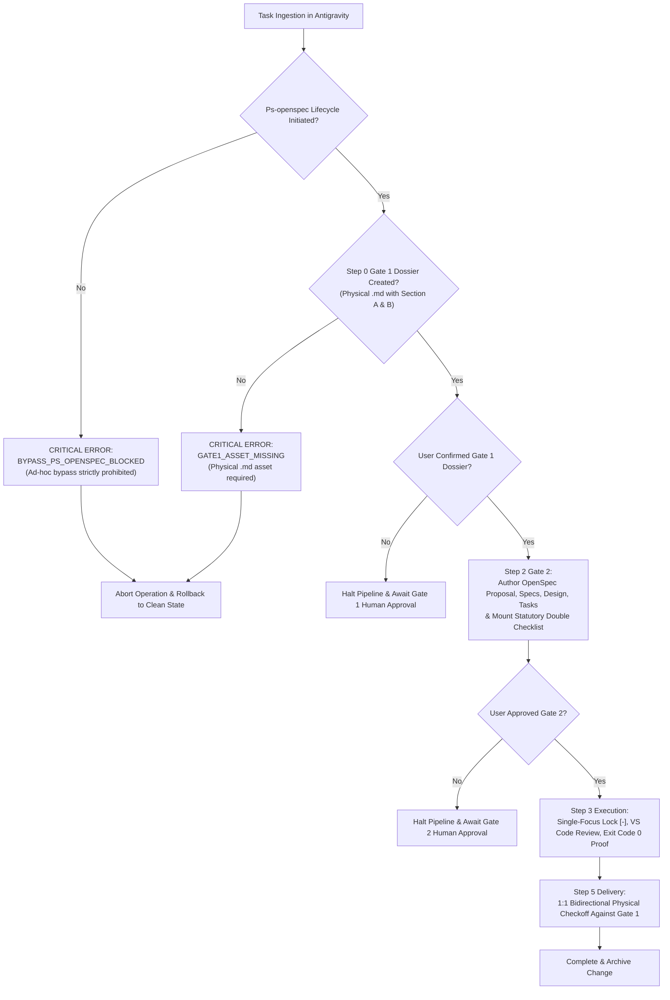

# Design: Antigravity Universal Ps-openspec Coverage & Zero-Bypass Enforcement

## Context & Motivation

In autonomous and semi-autonomous coding workflows, the most persistent vector for quality degradation is "selective governance bypass":
- An agent perceives a task as "trivial" (e.g., editing a typo, modifying an environment variable, adding a single test assertion) and decides to bypass the Ps-openspec lifecycle.
- Bypassing Step 0 Gate 1 means the agent acts without an explicit, verbatim record of user intent or a grounded fact fingerprint.
- Bypassing Step 2 Gate 2 means code modifications take place without a double checklist (mutating scope vs. leave-as-is commitment), without RFC 2119 specifications, and without user sign-off.
- The result is cumulative drift: undocumented changes, broken assumptions, accidental overwrites of locked invariants, and sudden regression cascades.

To eliminate this class of failure, this design introduces universal Ps-openspec governance and a hard zero-bypass static blocker across Antigravity.

## Architectural Principles & Invariants

1. **Universal Coverage (`ANTIGRAVITY_UNIVERSAL_COVERAGE_PROTOCOL`)**:
   - Every single task, command, and modification lifecycle inside Antigravity MUST be routed through Ps-openspec.
   - Task taxonomy coverage is total:
     - Features & capabilities
     - Bug fixes & regressions
     - Architectural refactoring
     - OpenSpec Explore & research
     - Security, legal & quality audits
     - Configuration, CI/CD & package management
     - Documentation & specification updates
   - No task is "too small" or "too urgent" to bypass governance.

2. **Zero-Bypass Static Blocker (`BYPASS_PS_OPENSPEC_BLOCKED`)**:
   - The mutating tool gateway checks for:
     1. Existence and cryptographic fingerprint of the Step 0 Gate 1 physical Markdown asset.
     2. Valid OpenSpec change directory with confirmed double checklist in Step 2.
   - If an agent attempts to invoke modifying tools (`write_file`, `edit_file`, mutating `run_command`) without these preconditions, the invocation is aborted with `BYPASS_PS_OPENSPEC_BLOCKED`.
   - Any dirty state is rolled back atomically.

3. **Mandatory Physical Gate Asset Ingestion (`PHYSICAL_GATE_ASSET_MANDATORY_INGESTION`)**:
   - Step 0 Gate 1 MUST produce a physical Markdown file on disk (`.md`) capturing Section A (verbatim user instruction with SHA-256) and Section B (deep forensic feedback and RTM).
   - Step 2 OpenSpec authoring MUST losslessly ingest this file into `proposal.md`, `specs/`, `design.md`, and `tasks.md`.

4. **Global Constitutional Supremacy (`GLOBAL_CONSTITUTIONAL_SUPREME_STATUS`)**:
   - Harmonize `GEMINI.md`, `skills/pstack-openspec/SKILL.md`, and `skills/ai-harness-openspec/SKILL.md` under this supreme doctrine.
   - All subagents, delegates, and background workers inherit this invariant without deviation.

5. **Universal Engineering Language Standard (`UNIVERSAL_GLOBAL_ENFORCEMENT_STANDARD`)**:
   - All rules, axioms, and blockers use 100% domain-neutral software engineering vocabulary.

## Decision & Evaluation Topology

## Blast Radius & Preservation

- **Modified Files**:
  - `GEMINI.md`: Add Axiom 50 `ANTIGRAVITY_UNIVERSAL_COVERAGE_AXIOM`.
  - `skills/pstack-openspec/SKILL.md`: Add Axiom 52.
  - `skills/ai-harness-openspec/SKILL.md`: Add Axiom 47.
  - `openspec/specs/orbitstack-pstack-routing/spec.md`: Codify new requirements.
  - `scripts/tests/gemini-adapter.test.mjs`: Add Test 42.
- **Preserved Invariants**:
  - PStack upstream vendor tree remains 100% read-only.
  - All existing 49 axioms and 41 tests in `gemini-adapter.test.mjs` remain intact.
