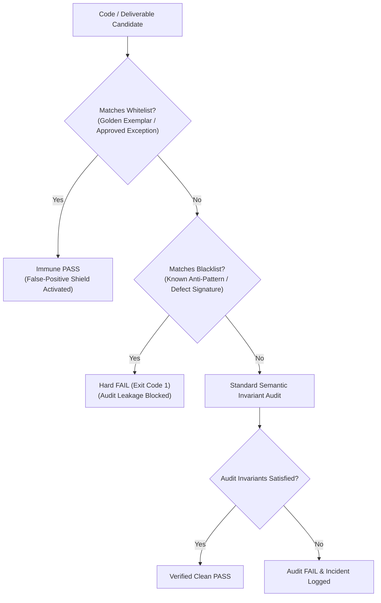

# Design: Project Dual Blacklist-Whitelist Audit System & Dual-Specimen Sanity Gate

## Context & Motivation
Audit engines frequently oscillate between two catastrophic extremes:
1. False Positives (误报): Naive heuristic checks misinterpret legitimate domain exceptions, custom styling, or human-approved patterns as bugs, leading agents to break working code.
2. False Negatives (漏报): Subtle structural defects, exogenous defaults, and recurring historical regressions escape undetected because audit rules lack negative mutant test coverage and rigorous blacklist pattern definitions.

This design introduces a formal, dual-bipolar registry structure and a verification gate to achieve both high precision (no false alarms) and high recall (no escapes).

## Architectural Principles & Invariants
1. **Dual Blacklist-Whitelist Architecture (`PROJECT_DUAL_BLACK_WHITE_REGISTRY_AXIOM`)**:
   - **Whitelist (Golden Exemplars & Approved Patterns)**:
     - Codifies approved syntactic structures, intentional exceptions, and golden specimens.
     - Holds supreme immunity (`WHITELIST_SUPREME_IMMUNITY_AXIOM`): matching patterns bypass negative heuristics.
     - Prevents unwanted refactorings (`FALSE_POSITIVE_OVERHAUL_BLOCKED`).
   - **Blacklist (Known Anti-Patterns & Defect Signatures)**:
     - Codifies all historical regressions, forbidden exogenous defaults, and layout discrepancies.
     - Enforces deterministic exit code 1 (`BLACKLIST_MANDATORY_INTERCEPTION_AXIOM`).
     - Detects leakage immediately (`AUDIT_LEAKAGE_DETECTED`).
2. **Dual-Specimen Sanity Gate (`DUAL_SPECIMEN_SANITY_GATE`)**:
   - Any audit rule change must be proven against two disjoint test suites:
     - **Positive Specimens (Golden Master Set)**: Must produce 100% PASS (Zero False Positives).
     - **Negative Mutants (Fault Injection Set)**: Must produce 100% FAIL (Zero False Negatives).
   - Rules failing either condition trigger `UNVERIFIED_RULE_MUTATION_BLOCKED`.

## Decision & Evaluation Topology

## Blast Radius & Preservation
- Modified files:
  - `GEMINI.md` (Axiom 45 added)
  - `skills/pstack-openspec/SKILL.md` (Axiom 47 added)
  - `skills/ai-harness-openspec/SKILL.md` (Axiom 42 added)
  - `openspec/specs/orbitstack-pstack-routing/spec.md`
  - `scripts/tests/gemini-adapter.test.mjs` (Test 37 added)
- Preserved:
  - All existing 44 axioms and invariants in `GEMINI.md`.
  - PStack upstream vendor tree remains untouched.
