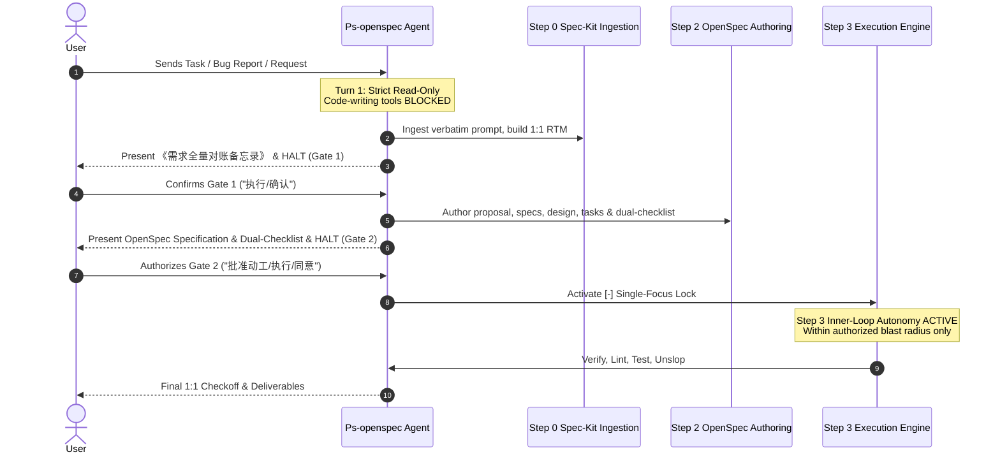

# Design: Statutory Dual-Gate Entry Precondition & Anti-Premature Execution Enforcement

## Context & Motivation
Session `7f4d4b46-78e6-435a-aa29-f0d6ec194caa` suffered from a serious process failure: upon receiving a multi-part defect report and architecture change request (Step 21502), the agent skipped Step 0 Gate 1 (Requirement Confirmation) and Step 2 Gate 2 (OpenSpec Specification & Dual-Checklist authorization). It jumped straight into writing ad-hoc scripts, modifying code, and executing pipelines unilaterally.
This stemmed from an unconstrained interpretation of "PStack autonomy", conflating execution autonomy in Step 3 with permission to bypass requirement comprehension and human authorization at task entry.

## Architectural Principles & Invariants
1. **Statutory Dual-Gate Entry Precondition Axiom (`STATUTORY_DUAL_GATE_ENTRY_PRECONDITION_AXIOM`)**:
   - **Step 0 Gate 1**: Initial turn is strictly read-only / analysis-only. The agent MUST output the full Spec-Kit Requirement Confirmation Dossier and halt. Absolutely zero file modifications, code writing, or pipeline execution.
   - **Step 2 Gate 2**: OpenSpec specification and dual-checklist MUST be presented and approved before writing implementation code.
2. **PStack Autonomy Spatiotemporal Scope Disambiguation**:
   - Step 0 (Ingestion): Autonomy = 0. Human authority is absolute.
   - Step 1 (Anchor & Explore): Read-only exploration. No implementation code.
   - Step 2 (Legislative Propose): Autonomy = 0. Human authorization is mandatory.
   - Step 3 (Single-Focus Execution): Autonomy is fully granted within the blast radius defined by the approved dual-checklist and active `[-]` task.
3. **Anti-Premature Execution Machine Circuit Breaker (`PREMATURE_EXECUTION_BLOCKED`)**:
   - Any agent attempting to write implementation code before Gate 1 and Gate 2 are satisfied is deemed in violation of system invariants.

## Sequence & Lifecycle Architecture

## Blast Radius & Preservation Invariants
- Modified files:
  - `GEMINI.md` (Axiom 44 added)
  - `skills/pstack-openspec/SKILL.md` (Axiom 35 added / updated)
  - `skills/ai-harness-openspec/SKILL.md` (Step 0 & 2 gates reinforced)
  - `orbitstack-gemini/SKILL.md`
  - `docs/pstack-openspec-route-map.json`
  - `scripts/tests/gemini-adapter.test.mjs` (Test 36 added)
- Preserved:
  - All existing 43 axioms and locked blocks in `GEMINI.md`.
  - PStack upstream vendor tree (`pstack-upstream/`) remains strictly read-only.
