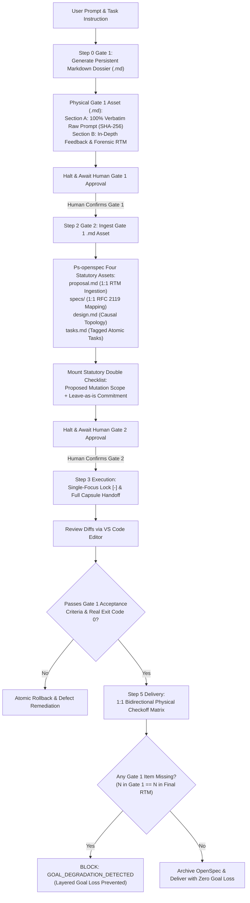

# Design: Gate 1 Markdown Materialization & End-to-End Zero Goal Loss Axiom

## Context & Motivation

A critical vulnerability in autonomous multi-agent development is "Layered Goal Loss" (层层目标丢失):
- In Step 0 (Gate 1), the user and agent conduct an extensive interview, clarifying deep context, hard constraints, edge cases, and acceptance metrics.
- In Step 2 (Gate 2), when drafting OpenSpec artifacts (`proposal.md`, `specs/`, `design.md`, `tasks.md`), the agent compresses or summarizes the Gate 1 agreements, losing critical nuances, constraints, and negative boundaries.
- In Step 3 (Execution), the execution agent (or a delegated subagent) executes code based solely on generic task titles, detached from Gate 1's detailed feedback.
- At Delivery, the output passes naive unit tests but fails the user's original holistic intent.

This design introduces an unbroken, verifiable chain of custody (Chain of Custody Invariant) from Gate 1 to Step 5 Delivery, backed by physical file persistence and automated omission blockers.

## Architectural Principles & Invariants

1. **Gate 1 Markdown Materialization (`GATE1_MARKDOWN_MATERIALIZATION_PROTOCOL`)**:
   - Gate 1 cannot remain ephemeral conversation text. It MUST be saved as a persistent Markdown file (`.md`) in the project/brain artifact tree.
   - Dual-Section Mandatory Layout:
     - **Section A: Raw Manager Instruction (`来自于管理者的任务说明原文`)**: 100% verbatim capture of raw prompt, frozen with SHA-256 fact fingerprint.
     - **Section B: Gate 1 In-Depth Feedback (`第一门禁反馈`)**: Forensic root-cause analysis, fact reconciliation, baseline comparisons, and explicit acceptance criteria.
   - Execution halts until the user explicitly confirms Gate 1.

2. **Gate 2 OpenSpec Zero Goal Loss Inheritance (`GATE2_OPENSPEC_ZERO_GOAL_LOSS_INHERITANCE`)**:
   - Step 2 OpenSpec is strictly grounded in the confirmed Gate 1 Markdown asset.
   - `proposal.md` must link to and ingest the Gate 1 Markdown file.
   - Every consensus item and constraint from Gate 1 must map 1:1 to an RFC 2119 requirement in `specs/`.
   - Every task in `tasks.md` must be tagged with its corresponding Gate 1 requirement ID (`<!-- rtm: REQ-XX -->`).

3. **Execution-Phase Goal Invariance Lock (`EXECUTION_PHASE_GOAL_INVARIANCE_LOCK`)**:
   - When entering Step 3 (or delegating to subagents), the execution context must carry the full Gate 1 Markdown file and Gate 2 specs via the Four-in-One Handoff Capsule (`pstack-handoff.mjs`).
   - A single-focus task (`[-]`) can only be completed (`[x]`) when the specific acceptance criteria defined in Gate 1 for that requirement are verified with real exit code 0.

4. **Layered Goal Degradation Circuit Breaker (`GOAL_DEGRADATION_DETECTED` & `GATE1_GOAL_OMISSION_BLOCKED`)**:
   - Static analysis verifies that $N$ requirements in Gate 1 yield $N$ spec clauses in Gate 2 and $N$ verified rows in Step 5.
   - Any omission or contradiction between downstream implementation and the Gate 1 Markdown file immediately triggers `GOAL_DEGRADATION_DETECTED` and halts execution.

5. **Universal Goal Preservation Standard (`UNIVERSAL_GOAL_PRESERVATION_STANDARD`)**:
   - All rules and assertions use pure computer science, formal specification, and distributed workflow concepts, remaining 100% domain-neutral.

## Decision & Evaluation Topology

## Blast Radius & Preservation

- **Modified Files**:
  - `GEMINI.md`: Add Axiom 49 `GATE1_MATERIALIZATION_&_END_TO_END_GOAL_PRESERVATION_AXIOM`.
  - `skills/pstack-openspec/SKILL.md`: Add Axiom 51.
  - `skills/ai-harness-openspec/SKILL.md`: Add Axiom 46.
  - `openspec/specs/orbitstack-pstack-routing/spec.md`: Codify new requirements.
  - `scripts/tests/gemini-adapter.test.mjs`: Add Test 41.
- **Preserved Assets**:
  - PStack upstream vendor tree remains 100% read-only.
  - All existing 48 axioms and 40 tests in `gemini-adapter.test.mjs` remain intact.
