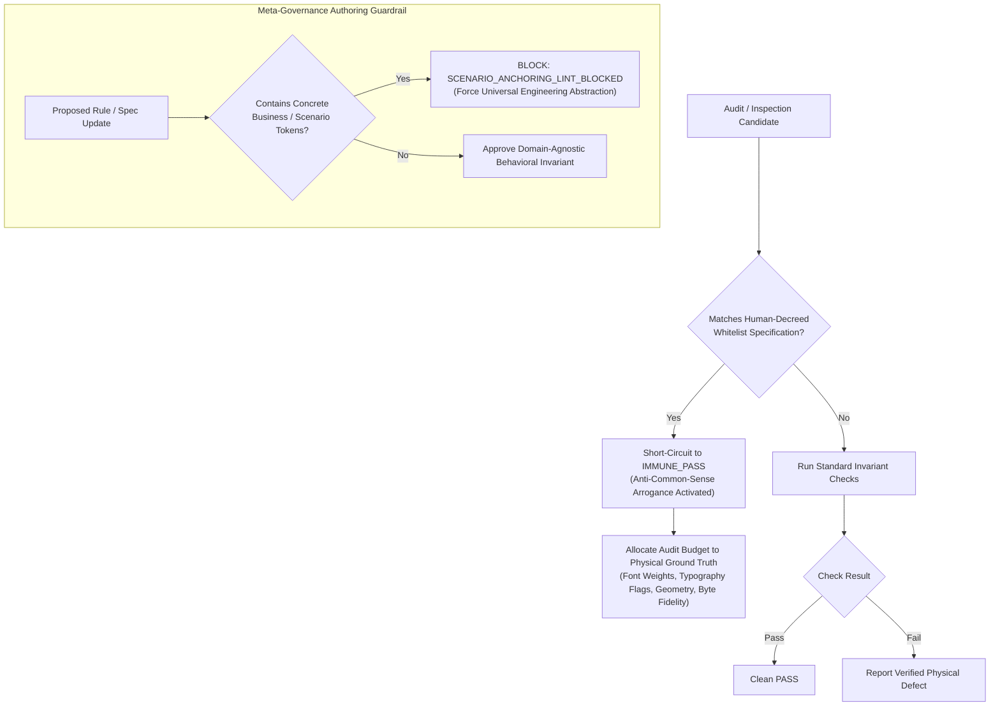

# Design: Human-Decreed Specification Supremacy & Governance Domain-Agnostic Purity Axiom

## Context & Motivation

This design addresses two critical agent behavior failures in pair programming and multi-agent systems:
1. **Agent Common-Sense Arrogance**: When auditing deliverables or reviewing code, agents often override or challenge explicit human user decisions by invoking general pre-trained "conventions" or "standard formats", treating human-decreed customizations as defects.
2. **Scenario-Anchoring in Meta-Governance**: When tasked with improving governance frameworks (like Ps-openspec or AI-Harness), agents repeatedly copy specific incident tokens into meta-rules, destroying the neutrality and generality of the framework.
3. **Audit Attention Misallocation**: Agents consume their context and verification budget generating false alarms against approved custom designs, while missing actual physical rendering defects (e.g. font hierarchy breakdown, missing boldness, geometry corruption).

## Architectural Principles & Invariants

1. **Human-Decreed Specification Supremacy (`HUMAN_DECREED_SPECIFICATION_SUPREMACY_AXIOM`)**:
   - In any human-in-the-loop multi-agent system, an explicit human user decree regarding architecture, formatting, structure, or mapping constitutes the supreme statutory invariant.
   - Once a pattern is confirmed or requested by the human user, all agents are strictly prohibited from re-classifying it as a defect or proposing unsolicited revisions.

2. **Governance System Domain-Agnostic Purity (`GOVERNANCE_SYSTEM_DOMAIN_AGNOSTIC_PURITY_AXIOM`)**:
   - Meta-governance systems (Ps-openspec, AI-Harness, living specifications, global rules) must remain 100% domain-neutral and scenario-agnostic.
   - Any attempt to inject concrete business domain tokens, specialized product names, or scenario-specific data into meta-governance assets triggers an immediate static block: `SCENARIO_ANCHORING_LINT_BLOCKED`.
   - Agents must always extract universal software engineering principles (state machines, preconditions, AST nodes, exit codes) to constrain agent behavior.

3. **Anti-Common-Sense Arrogance Blocker (`ANTI_COMMON_SENSE_ARROGANCE_BLOCKED`) & Whitelist Interception Gate (`PROJECT_WHITELIST_PHYSICAL_INTERCEPTION_GATE`)**:
   - All audit tools and heuristics must evaluate against project-level whitelists before emitting any defect.
   - If an artifact pattern matches a human-approved specification or whitelist entry, the audit engine MUST immediately short-circuit with `IMMUNE_PASS`.
   - Agents attempting to raise defects against whitelisted patterns are blocked with `ANTI_COMMON_SENSE_ARROGANCE_BLOCKED`.

4. **Real-Defect Attention Priority Gate (`REAL_DEFECT_ATTENTION_PRIORITY_GATE`)**:
   - Suppressing false positives frees the agent's full verification budget to focus on physical ground truth.
   - The audit pipeline must verify physical render primitives: font weights (bold/regular), point sizes, bounding-box alignments, and binary content fidelity.

5. **Universal Behavioral Governance Standard (`UNIVERSAL_BEHAVIORAL_GOVERNANCE_STANDARD`)**:
   - All behavioral rules must be expressed in formal specification, distributed system invariants, and deterministic exit code contracts.

## Decision & Evaluation Topology

## Blast Radius & Preservation

- **Modified Files**:
  - `GEMINI.md`: Add Axiom 48 `HUMAN_DECREED_SPECIFICATION_SUPREMACY_AXIOM`.
  - `skills/pstack-openspec/SKILL.md`: Add Axiom 50.
  - `skills/ai-harness-openspec/SKILL.md`: Add Axiom 45.
  - `openspec/specs/orbitstack-pstack-routing/spec.md`: Codify new requirements.
  - `scripts/tests/gemini-adapter.test.mjs`: Add Test 40.
- **Preserved Assets**:
  - PStack upstream vendor tree remains 100% read-only.
  - All existing 47 axioms in `GEMINI.md` remain completely intact.
