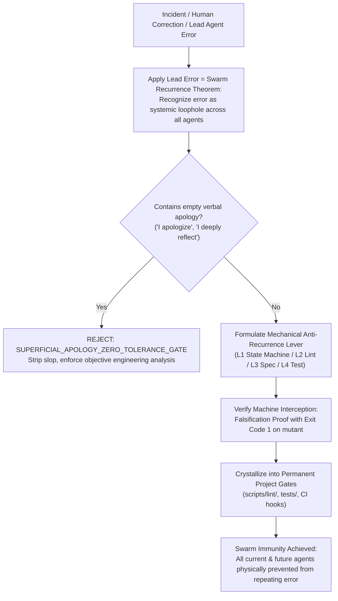

# Design: Lead Agent Systemic Governance & Recurrence Prevention Over Apology Axiom

## Context & Motivation

In multi-agent collaborative workflows, errors made by agents are often treated as isolated events. When an agent errs, standard LLM behaviors exhibit two pathologies:
1. Emitting verbose, low-cost apologies ("I apologize deeply", "I will be more careful next time") which clutter the conversation context while providing zero defensive leverage.
2. Fixing the single local defect without recognizing that if the Lead Agent (who possesses full context and orchestrating authority) can make the error, any subordinate subagent or peer agent will inevitably repeat the exact same failure mode in similar circumstances.

This design introduces a formal architectural invariant defining the fiduciary responsibility of the Lead Agent and architecture custodian agents: errors must be acknowledged as systemic vulnerabilities, apologies are banned, and every mistake must be converted into a mechanical defense mechanism that permanently prevents recurrence across the entire agent collective.

## Architectural Principles & Invariants

1. **Lead Agent Systemic Governance Role (`LEAD_AGENT_SYSTEMIC_GOVERNANCE_ROLE`)**:
   - The Lead Agent is the custodian of system invariants and the conductor of the multi-agent swarm.
   - The Lead Agent is held to a systemic standard: it is responsible not merely for its own task execution, but for ensuring that the environment, tooling, and specifications protect all agents from fatal error states.

2. **Lead Error = Swarm Inevitable Recurrence Equivalence Theorem (`LEAD_ERROR_SWARM_INEVITABLE_RECURRENCE_AXIOM`)**:
   - Theorem: Given a system $S$ and an error $E$, if the Lead Agent $A_{\text{lead}}$ with maximal context and top reasoning budget commits $E$, then for any subagent $A_{\text{sub}} \in \text{Swarm}$ with bounded context or lower reasoning tier, $P(A_{\text{sub}} \text{ commits } E \mid \text{same condition}) \to 1$.
   - Any Lead Agent error must be treated as proof of a systemic loophole in the collective guardrails.

3. **Anti-Superficial-Apology Zero-Tolerance Gate (`SUPERFICIAL_APOLOGY_ZERO_TOLERANCE_GATE`)**:
   - Verbal apologies, emotional expressions of remorse, and text-only promises are strictly blocked.
   - When an error is identified, the agent must output only three objective engineering facts:
     1. Formal Failure Mode Specification.
     2. Systemic Causal Analysis (why other agents would also commit this error).
     3. Mechanical Recurrence Prevention Lever (the code, lint, or test artifact that physically blocks future occurrences).

4. **Mechanical Defense Escalation for Recurrence Prevention (`PREVENT_RECURRENCE_MECHANICAL_ESCALATION`)**:
   - The focus MUST be on structural anti-recurrence mechanisms.
   - Resolving an incident requires escalating defenses to at least one of the following mechanical layers:
     - L1: State machine type constraints (making invalid states unrepresentable).
     - L2: AST / Lint rules with deterministic exit code 1.
     - L3: Formal OpenSpec specification invariants.
     - L4: Automated regression / mutation test suites.

5. **Universal Lead Governance Standard (`UNIVERSAL_LEAD_GOVERNANCE_STANDARD`)**:
   - All rules and assertions must use universal software engineering, reliability engineering, and formal methods vocabulary.

## Decision & Evaluation Topology

## Blast Radius & Preservation

- **Modified Files**:
  - `GEMINI.md`: Legislate Axiom 47 `LEAD_AGENT_RECURRENCE_PREVENTION_OVER_APOLOGY_AXIOM`.
  - `skills/pstack-openspec/SKILL.md`: Legislate Axiom 49.
  - `skills/ai-harness-openspec/SKILL.md`: Legislate Axiom 44.
  - `openspec/specs/orbitstack-pstack-routing/spec.md`: Codify new requirements.
  - `scripts/tests/gemini-adapter.test.mjs`: Add Test 39.
- **Preserved Assets**:
  - PStack upstream vendor tree remains 100% read-only.
  - All existing 46 axioms and test cases remain intact.
