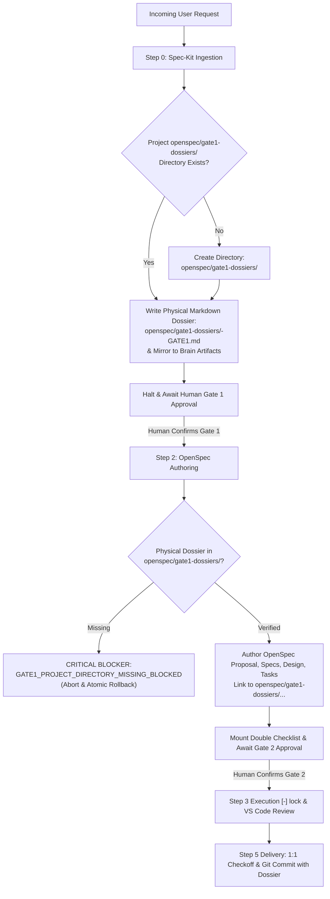

# Design: Project-Canonical OpenSpec Gate 1 Dossier Directory Invariant

## Context & Motivation

Historically, Step 0 Gate 1 artifacts were treated either as conversational text or stored inside the agent's host-local brain directory (`<appDataDir>\brain\<conversation-id>\`). While local brain storage solved amnesia within a single workstation and session, it suffered from severe systemic drawbacks:
1. **Repository Disconnect**: Gate 1 intent agreements, forensic feedback, and 1:1 RTMs were missing from the project's Git repository.
2. **Cross-Agent Blindness**: Fresh subagents, remote peer agents, or agents spawned in new sessions could not independently inspect the project's historical Gate 1 dossiers from source control.
3. **Inconsistent Naming & Layout**: Projects lacked a uniform structural contract specifying where pre-change requirement dossiers live.

To resolve this, this design standardizes the directory layout under `openspec/`:
```text
<project-root>/
  openspec/
    gate1-dossiers/          <-- Statutory dedicated directory for Step 0 Gate 1 dossiers
      YYYY-MM-DD-<slug>-GATE1.md
    changes/
      <change-id>/
    specs/
    config.yaml
```

## Architectural Principles & Invariants

1. **Project Canonical Directory Standard (`PROJECT_OPENSPEC_GATE1_DIRECTORY_SPECIFICATION`)**:
   - Every project governed by Ps-openspec must have `openspec/gate1-dossiers/` (or `openspec/gate1/`).
   - The directory is under Git version control.
   - It acts as the project's immutable chronological ledger of Gate 1 agreements.

2. **Gate 1 Dossier Project Physical Storage Contract (`GATE1_DOSSIER_PROJECT_STORAGE_CONTRACT`)**:
   - In Step 0 Gate 1, when the agent formulates its response, it MUST write the physical `.md` document to `<project-root>/openspec/gate1-dossiers/<YYYY-MM-DD-slug>-GATE1.md`.
   - The file MUST maintain Section A (100% verbatim raw instruction + SHA-256) and Section B (deep forensic feedback + 1:1 RTM).

3. **Missing Project Gate 1 Directory Circuit Breaker (`GATE1_PROJECT_DIRECTORY_MISSING_BLOCKED`)**:
   - Pre-condition gate in tool invocations and OpenSpec transitions.
   - If `openspec/gate1-dossiers/` does not exist or the dossier is missing from the project tree, the system halts with `GATE1_PROJECT_DIRECTORY_MISSING_BLOCKED`.

4. **Native Project Asset Inheritance (`GATE1_TO_OPENSPEC_PROJECT_INHERITANCE`)**:
   - Step 2 OpenSpec `proposal.md` references the dossier via `openspec/gate1-dossiers/...` rather than host-local brain paths.
   - 1:1 goal preservation is verifiable directly within the repository.

5. **Universal Directory Governance Standard (`UNIVERSAL_GATE1_DIRECTORY_STANDARD`)**:
   - 100% domain-neutral and scenario-agnostic software engineering terminology.

## Decision & Evaluation Topology



## Blast Radius & Preservation

- **Modified Files**:
  - `GEMINI.md`: Add Axiom 51 `PROJECT_CANONICAL_GATE1_DIRECTORY_AXIOM`.
  - `skills/pstack-openspec/SKILL.md`: Add Axiom 53.
  - `skills/ai-harness-openspec/SKILL.md`: Add Axiom 48.
  - `openspec/specs/orbitstack-pstack-routing/spec.md`: Codify new requirements.
  - `scripts/tests/gemini-adapter.test.mjs`: Add Test 43.
  - `openspec/gate1-dossiers/`: Create directory and save initial dossier.
- **Preserved Assets**:
  - PStack upstream vendor tree remains 100% read-only.
  - All existing 50 axioms and 42 tests in `gemini-adapter.test.mjs` remain intact.
