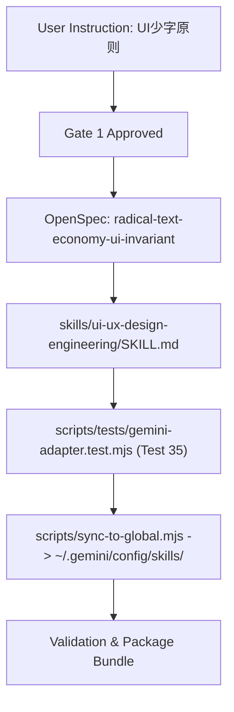

# Design: UI Radical Text Economy Invariant (少字原则)

## Context & Motivation
Large language models have an inherent tendency towards verbal verbosity. When applied to UI engineering, this manifests as "explanatory bloat": adding verbose subtitles beneath card titles, lengthy helper text under inputs, and redundant descriptive prose. This clutters the visual canvas, eliminates whitespace, and creates amateurish "AI-slop" aesthetics.
To solve this permanently, we elevate the user's principle—"宁可不写字，也要避免产生过多的文本说明影响视觉" (Radical Text Economy)—into a statutory invariant of `ui-ux-design-engineering`.

## Design Principles & Invariants
1. **Radical Text Economy Axiom (`RADICAL_TEXT_ECONOMY_AXIOM`)**:
   - Visual affordance (spatial geometry, typographic hierarchy, iconography, semantic color tokens) must precede textual crutches.
   - Text is treated as a finite, high-cost visual budget: "宁可不写字，也绝不让多余文本破坏视觉".
2. **Microcopy Minimalism**:
   - Button and action labels strictly limited to 1-3 words/characters.
   - Zero-prose rule for operational cards: operational UI cards must not contain descriptive paragraphs.
   - High-contrast badges and status dots replace verbose status explanations.
3. **Anti-Textual-AI-Slop Gate**:
   - Explicitly listed under the Anti-AI-Slop section as a hard anti-pattern alongside purple gradients and blur abuse.

## Architecture & Data Flow

## Blast Radius & Preservation
- Modified file: `skills/ui-ux-design-engineering/SKILL.md` (adding Section VI and enhancing Section I).
- Modified test: `scripts/tests/gemini-adapter.test.mjs` (adding Test 35).
- Preserved: All existing design token scales, color palettes, and WCAG AA rules remain completely intact.
