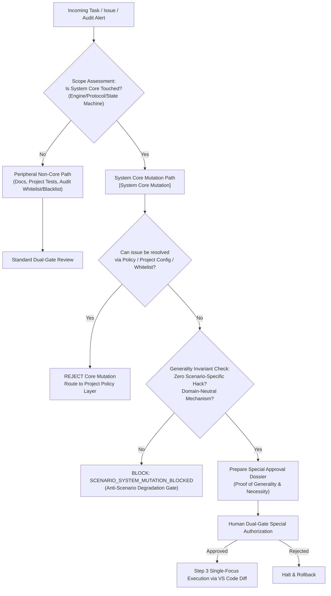

# Design: System Core Mutation Governance & Generality Preservation Axiom

## Context & Motivation

In agent-driven development, agents often encounter local edge cases, unique customer formatting requests, or false alarms during audit. Under pressure to "make it pass", an agent may take the path of least resistance: injecting specific `if (scenario === 'X')` branches or monkey-patching global engines and pipelines.
This produces fatal architectural erosion:
- Core systems lose domain neutrality and degrade into single-scenario bespoke utilities.
- Platform generality is sacrificed, causing breakage across parallel or future workloads.
- Audit false positives pollute core engines rather than being handled by project-level whitelists/blacklists.

This design establishes an enforceable architectural barrier separating System Core mechanisms from Peripheral policies, backed by mandatory dual-gate approval and automated blocking invariants.

## Architectural Principles & Invariants

1. **Two-Tier Mutation Classification (`SYSTEM_MUTATION_CLASSIFICATION_AXIOM`)**:
   - **Tier 1: System Core (`[System Core Mutation]`)**:
     - Scope: Execution engines, protocol drivers, global routing tables, core state machines, cross-project adapters, shared architectural baselines.
     - Property: Highly generalized, parameterizable, domain-neutral.
   - **Tier 2: Peripheral Non-Core (`[Peripheral Non-Core]`)**:
     - Scope: Documentation (`.md`), project-specific unit/integration tests, project-level Audit Graph rules (whitelists/blacklists), local configuration overrides.
     - Property: Localized, project-scoped, policy-driven.
   - Any proposed change in Step 2 Dual-Checklist MUST explicitly tag each modified asset with its tier.

2. **Statutory Dual-Gate Special Approval Gate (`SYSTEM_CORE_MUTATION_SPECIAL_APPROVAL_GATE`)**:
   - Any mutation classified as `[System Core Mutation]` triggers a special approval protocol:
     - In Step 0 Gate 1: Must be explicitly highlighted in the dossier under a dedicated section `【系统核心机制拟变专项说明】`.
     - In Step 2 Gate 2: Must prove why the requirement cannot be satisfied in Tier 2 (peripheral/policy layer), and provide a formal generality invariant proof demonstrating zero negative impact on other scenarios.
     - Requires explicit human authorization before executing Step 3.

3. **Generality Preservation & Anti-Scenario Degradation (`GENERALITY_PRESERVATION_AXIOM` & `SCENARIO_SYSTEM_MUTATION_BLOCKED`)**:
   - The system core MUST remain 100% domain-neutral and scenario-agnostic.
   - Injecting scenario-specific identifiers, single-business hardcoded strings, or bespoke workarounds into Tier 1 core engines triggers an immediate static block: `SCENARIO_SYSTEM_MUTATION_BLOCKED`.

4. **Mechanism-Policy Orthogonal Decoupling (`MECHANISM_POLICY_ORTHOGONAL_DECOUPLING`)**:
   - Engines SHALL only expose generic, composable mechanisms (options, callbacks, plugin points, configuration schemas).
   - Calling hosts and client projects SHALL supply concrete business policy.
   - Edge cases and audit false-positives MUST be resolved in project whitelists, never by adulterating core engine logic.

5. **Universal System Integrity Standard (`UNIVERSAL_SYSTEM_INTEGRITY_STANDARD`)**:
   - All definitions, constraints, and audit assertions SHALL use pure computer science and software architecture vocabulary (state machines, preconditions, RFC 2119 keywords, static types, exit codes).

## Decision & Evaluation Topology

## Blast Radius & Preservation

- **Modified Files**:
  - `GEMINI.md`: Add Axiom 46 `SYSTEM_CORE_MUTATION_GOVERNANCE_&_GENERALITY_PRESERVATION_AXIOM`.
  - `skills/pstack-openspec/SKILL.md`: Add Axiom 48.
  - `skills/ai-harness-openspec/SKILL.md`: Add Axiom 43.
  - `openspec/specs/orbitstack-pstack-routing/spec.md`: Add system core mutation requirements.
  - `scripts/tests/gemini-adapter.test.mjs`: Add Test 38.
- **Preserved Assets**:
  - PStack upstream vendor tree (`bundle/pstack-upstream/`) remains strictly read-only.
  - All existing 45 axioms and living specs remain completely intact.
