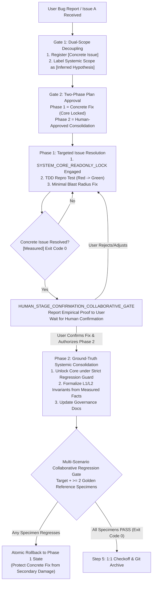

# Design: Concrete Issue Priority & Phased Systemic Consolidation Axiom

## Context & Motivation

In agent-assisted engineering workflows under Ps-openspec, an insidious pathology frequently recurs:
- **Premature Core Churn & Abstract Hallucination**: When a user reports a concrete failure (e.g. Issue A in scenario X), an undisciplined agent often bypasses direct reproduction and instrumented diagnosis. Instead, it deduces an abstract, speculative "root cause" in the shared system core or framework architecture.
- **The Core-Modification Rabbit Hole**: Believing its own abstract hypothesis, the agent aggressively modifies base classes, shared utilities, and global governance documentation. Meanwhile, the actual concrete Issue A remains completely unverified and unresolved.
- **Cascading Regressions & User Frustration**: The sweeping modifications break implicit invariants relied upon by other scenarios, creating secondary breakages. The user is left with an unresolved bug and a degraded codebase.

This design introduces a formal two-phase execution lifecycle and dual-scope gating mechanism that strictly prioritizes concrete issue resolution within a minimal blast radius before permitting any human-authorized systemic consolidation.

## Alignment with Lauren Tan (@poteto) Upstream Principles

This design synthesizes four foundational principles from `pstack-upstream`:
1. **`principle-sequence-verifiable-units`**: Work must be ordered as a sequence of small, verifiable units. The failing repro test must turn green first before any refactoring or generalization begins.
2. **`blast-radius`**: "Writeups are worthless without proof." Changes must be bounded to the minimal blast radius necessary to prove the one safety fact that fixes the issue.
3. **`principle-fix-root-causes`**: Upstream explicitly mandates: *"Reproduce first... Instrument, do not guess."* Root cause analysis is only legitimate when anchored in measured execution traces, not speculation.
4. **`correct`**: *"Fix the mistake now, prove it fails on past mistake, then consolidate at the highest level."* Tactical resolution precedes strategic consolidation.

## Architectural Principles & Invariants

1. **Gate 1 & Gate 2 Dual-Scope Decoupling (`GATE1_DUAL_SCOPE_DECOUPLING_RULE`)**:
   - In Gate 1 and Gate 2, every task input is classified into:
     - `[Concrete Issue]`: Specific failure symptoms, reproducible test case, and independent target acceptance metric.
     - `[Systemic Scope]`: Hypothesized low-level root causes, explicitly labeled as unverified hypotheses (`[Inferred Hypothesis]`) that cannot displace the concrete fix.

2. **Phase 1 Targeted Resolution & Core Read-Only Lock (`PHASE1_TARGETED_RESOLUTION_&_CORE_IMMUNITY_LOCK`)**:
   - The agent must implement a reproduction test and resolve the concrete issue within minimal boundaries.
   - Shared system engines, core pipelines, and global meta-documentation are locked under `SYSTEM_CORE_READONLY_LOCK`.
   - Completion requires real exit code 0 (`[Measured] Exit Code 0`) on the target issue.

3. **Human Stage Confirmation Collaborative Gate (`HUMAN_STAGE_CONFIRMATION_COLLABORATIVE_GATE`)**:
   - Following Phase 1, the agent reports the empirical fix evidence to the user and pauses.
   - Proceeding to Phase 2 systemic consolidation requires explicit human confirmation.

4. **Phase 2 Ground-Truth-Driven Consolidation & Regression Net (`PHASE2_GROUND_TRUTH_SYSTEMIC_CONSOLIDATION_&_REGRESSION_NET`)**:
   - Systemic changes (lint rules, type invariants, state machine constraints, shared engine enhancements) are deduced from the empirical facts established in Phase 1.
   - Must pass the Multi-Scenario Collaborative Regression Gate ($\ge 2$ distinct golden reference specimens).
   - Any regression in reference specimens triggers an immediate atomic rollback to the Phase 1 state.

5. **Universal Concrete-First Consolidation Standard (`UNIVERSAL_CONCRETE_FIRST_CONSOLIDATION_STANDARD`)**:
   - 100% domain-neutral and scenario-agnostic software engineering terminology.

## Decision & Execution Topology

## Blast Radius & Preservation

- **Modified Files**:
  - `GEMINI.md`: Add Axiom 54 `CONCRETE_ISSUE_FIRST_&_PHASED_SYSTEMIC_CONSOLIDATION_AXIOM`.
  - `skills/pstack-openspec/SKILL.md`: Add Axiom 56.
  - `skills/ai-harness-openspec/SKILL.md`: Add Axiom 51.
  - `openspec/specs/orbitstack-pstack-routing/spec.md`: Codify new requirements.
  - `scripts/tests/gemini-adapter.test.mjs`: Add Test 46.
- **Preserved Assets**:
  - Upstream vendor tree `pstack-upstream` remains strictly read-only.
  - Existing 53 axioms and 45 tests remain fully preserved.
  - Gate 1 dossiers directory structure remains untouched.
