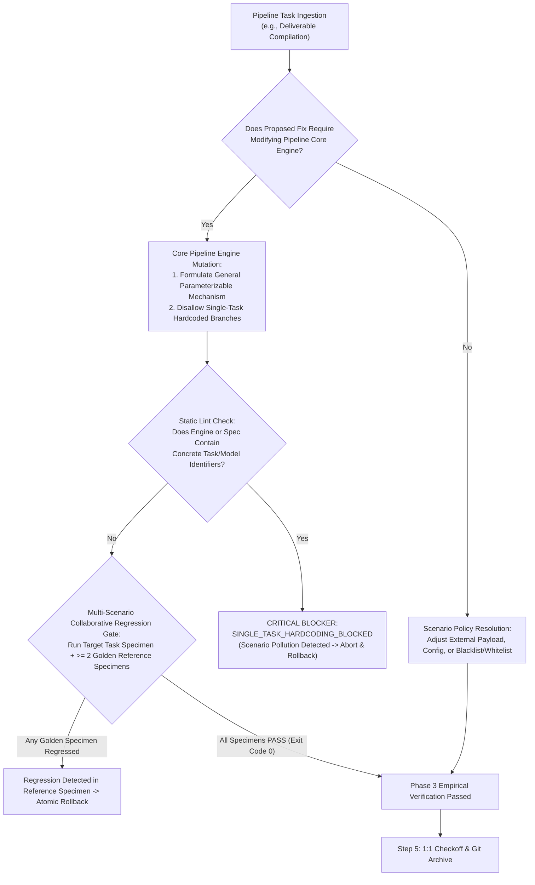

# Design: Pipeline Core Generality Invariant & Anti-Single-Task Hardcoding Axiom

## Context & Motivation

Pipeline engines (batch processors, multi-format documentation compilers, delivery automation harnesses) represent shared core infrastructure:
- When a failure occurs during the processing of a specific input instance (e.g. Model A), an undisciplined agent often modifies the pipeline engine's shared layout or formatting algorithm specifically to make Model A pass.
- In doing so, the agent introduces hardcoded constants or specialized branches keyed to Model A (`if (id === 'ModelA')`), inadvertently regressing Models B, C, and D, and cluttering core engine logic with ephemeral business terms.
- Additionally, the agent writes documentation or commit messages such as "Fix Model A layout", injecting domain-specific pollution into the meta-governance system.

This design introduces a formal separation of concerns and an automated multi-specimen regression gate to permanently protect pipeline core engines.

## Architectural Principles & Invariants

1. **Pipeline Core Generality Invariant (`PIPELINE_CORE_GENERALITY_&_MULTI_SCENARIO_INVARIANCE_AXIOM`)**:
   - Shared pipeline components operate at Layer 1/Layer 2 of the trust pyramid.
   - Core pipeline code must never be modified solely to satisfy a single task instance.
   - Any engine change must represent a general capability improvement that correctly handles a class of inputs across all existing and future pipeline runs.

2. **Zero Scenario-Pollution in Core & Documentation (`ZERO_SCENARIO_POLLUTION_IN_SYSTEM_CORE_&_DOCS_AXIOM`)**:
   - Absolute ban on single-task identifiers, specific product model codes, or concrete scenario names in:
     - Core scripts and templates (`scripts/`, `src/core/`, `web/templates/`);
     - Meta-governance rules and playbooks (`GEMINI.md`, `skills/`);
     - System-level change proposals and living specifications.
   - Violation triggers static blocker `SINGLE_TASK_HARDCODING_BLOCKED`.

3. **Multi-Scenario Collaborative Regression Gate (`MULTI_SCENARIO_COLLABORATIVE_REGRESSION_GATE`)**:
   - Whenever a pipeline engine is touched, the verifier executes a multi-specimen sanity matrix:
     1. Target instance verification (must pass with exit code 0);
     2. Golden specimen 1 verification (distinct model/type, must pass with exit code 0);
     3. Golden specimen 2 verification (distinct model/type, must pass with exit code 0).
   - If any golden specimen exhibits visual difference, parse failure, or non-zero exit code, the change is aborted and rolled back.

4. **Task Fact Parameterization (`TASK_FACT_PARAMETERIZATION_&_ENGINE_DECOUPLING_AXIOM`)**:
   - Concrete attributes (model names, specific values, local flags) are strictly passed as external parameters in data payloads.
   - Core engines consume parameters generically without branching on instance names.

5. **Universal Pipeline Generality Standard (`UNIVERSAL_PIPELINE_GENERALITY_STANDARD`)**:
   - 100% domain-neutral and scenario-agnostic software engineering terminology.

## Decision & Evaluation Topology

## Blast Radius & Preservation

- **Modified Files**:
  - `GEMINI.md`: Add Axiom 53 `PIPELINE_CORE_GENERALITY_&_ANTI_SINGLE_TASK_HARDCODING_AXIOM`.
  - `skills/pstack-openspec/SKILL.md`: Add Axiom 55.
  - `skills/ai-harness-openspec/SKILL.md`: Add Axiom 50.
  - `openspec/specs/orbitstack-pstack-routing/spec.md`: Codify new requirements.
  - `scripts/tests/gemini-adapter.test.mjs`: Add Test 45.
- **Preserved Assets**:
  - PStack upstream vendor tree remains 100% read-only.
  - All existing 52 axioms and 44 tests in `gemini-adapter.test.mjs` remain intact.
  - Existing project-canonical `openspec/gate1-dossiers/` directory structure remains intact.
