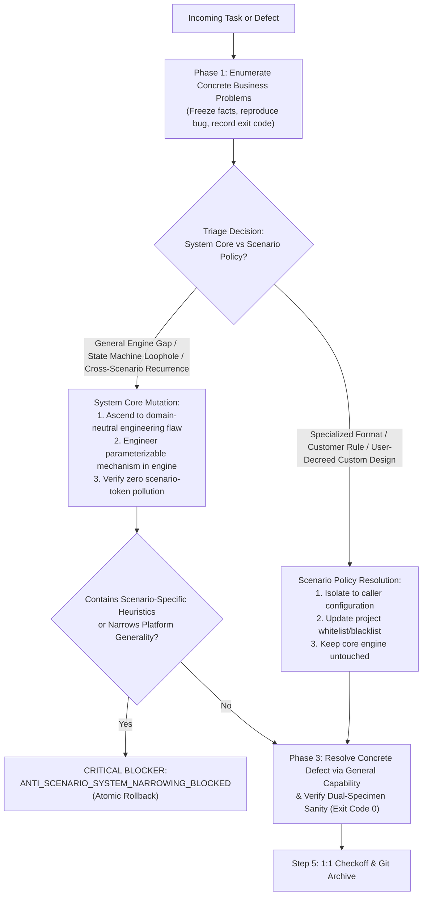

# Design: Tri-Phase Global Task Execution Strategy & System Mutation vs Scenario Triage

## Context & Motivation

A critical paradox in AI-driven software engineering is the balance between **thorough root-cause resolution** and **platform generality preservation**:
- If an agent only fixes the local symptom ("创可贴"), the codebase accumulates brittle workarounds, and identical bugs resurface across other modules.
- If an agent eagerly modifies core infrastructure to resolve a local quirk ("情境化改底层"), it pollutes universal engines with business-specific heuristics, destroying orthogonal decoupling and breaking other scenarios.

This design introduces a rigorous 3-phase execution cycle backed by an objective triage state machine to permanently resolve this paradox.

## Architectural Principles & Invariants

1. **Tri-Phase Global Task Execution Strategy (`TRI_PHASE_GLOBAL_TASK_EXECUTION_STRATEGY`)**:
   - **Phase 1 (Concrete Problem Enumeration - 业务问题具象化)**: Exhaustively capture and reproduce the concrete defect, recording input specimens, error traces, and expected vs observed behavior.
   - **Phase 2 (Universal Systemic Abstraction - 通用问题抽象与底层解决)**: Ascend from the concrete instance to the underlying class of defect (e.g. state machine gap, AST parsing blind spot, missing lifecycle hook) and engineer a general, parameterizable mechanism in system core to eliminate the vulnerability across all scenarios.
   - **Phase 3 (Empirical Verification & Concrete Resolution - 通用修改解决具体问题与实测核销)**: Apply the generalized capability to solve the original concrete issue and verify with real exit code 0 evidence against both the target case and golden benchmark suites.

2. **System Mutation vs Scenario Policy Triage Protocol (`SYSTEM_MUTATION_VS_SCENARIO_POLICY_TRIAGE_AXIOM`)**:
   - Explicit binary decision topology:
     | Metric | Mutate System Core (`[System Core]`) | Resolve in Scenario Policy (`[Scenario Policy]`) |
     | :--- | :--- | :--- |
     | **Failure Scope** | Affects or can occur across multiple/all scenarios | Restricted to a single document, customer, or project rule |
     | **Root Origin** | Structural engine gap, state machine loophole, missing hook | Specialized business formatting, custom terminology, user design exception |
     | **Mechanism Nature** | 100% parameterizable, orthogonal, domain-neutral | Specific business policy, constant table, caller configuration |
     | **Target Layer** | `scripts/`, `src/core/`, global dispatchers, living specs | Caller scripts, project config, project whitelist/blacklist |

3. **Anti-Scenario System Narrowing Blocker (`ANTI_SCENARIO_SYSTEM_NARROWING_BLOCKED`)**:
   - Hard static gate: Any PR, commit, or subagent handoff attempting to introduce concrete scenario identifiers or single-case branches into core engines is rejected with exit code 1.

4. **Universal Task Strategy Governance Standard (`UNIVERSAL_TASK_STRATEGY_GOVERNANCE_STANDARD`)**:
   - 100% domain-neutral and scenario-agnostic software engineering terminology.

## Decision & Evaluation Topology

## Blast Radius & Preservation

- **Modified Files**:
  - `GEMINI.md`: Add Axiom 52 `TRI_PHASE_GLOBAL_TASK_EXECUTION_AXIOM`.
  - `skills/pstack-openspec/SKILL.md`: Add Axiom 54.
  - `skills/ai-harness-openspec/SKILL.md`: Add Axiom 49.
  - `openspec/specs/orbitstack-pstack-routing/spec.md`: Codify new requirements.
  - `scripts/tests/gemini-adapter.test.mjs`: Add Test 44.
- **Preserved Assets**:
  - PStack upstream vendor tree remains 100% read-only.
  - All existing 51 axioms and 43 tests in `gemini-adapter.test.mjs` remain intact.
  - Existing project-canonical `openspec/gate1-dossiers/` directory structure remains intact.
