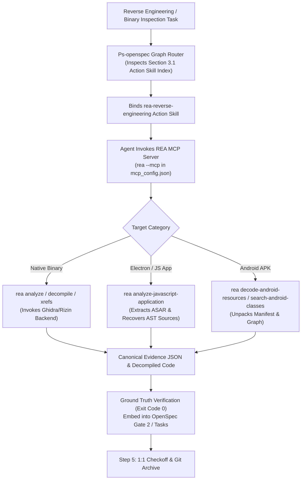

# Design: Integrate REA Reverse Engineering Action Skill & MCP Layer

## Context & Motivation

Ps-openspec reserves Section 3 for **Graph-Driven Methodology Governance (基于 Graph 的方法论技能关联拓扑与布控治理网)** and explicitly defines the **Action Skill Layer (原子技能操作层 / 工具手脚层)**:
- High-star, specialized engineering capabilities (e.g. `desktop-exe-development` for Tauri v2, `ui-ux-design-engineering` for VoltAgent) are codified as standardized atomic skills so agents do not reinvent ad-hoc scripts or wander aimlessly.
- Reverse engineering (RE) is an essential capability for auditing proprietary dependencies, recovering protocol schemas, inspecting compiled assets, and analyzing closed-source binaries.
- **REA (Reverse Engineer Anything)** (`morluto/rea` / `rea-agents`) is the cutting-edge agent-first reverse-engineering suite, featuring:
  - Stdio MCP Server integration (`rea --mcp`), directly exposing 50+ reverse engineering tools to AI coding agents;
  - Multi-target coverage: Native binaries (linking Ghidra/Hopper/IDA/Rizin), JavaScript/Electron apps, Android APKs, and Web bundles;
  - Evidence-backed outputs: Producing canonical Evidence JSON, recovered callgraphs, and verified decompiled sources.

This design integrates REA as a premier Action Skill within Ps-openspec and registers its MCP server across the global agent environment.

## Architectural Principles & Invariants

1. **REA MCP Server Integration (`REA_MCP_SERVER_INTEGRATION`)**:
   - Registered under `mcpServers.rea` in `C:\Users\Administrator\.gemini\antigravity\mcp_config.json` and `C:\Users\Administrator\.gemini\config\mcp_config.json`.
   - Command: `rea`, Args: `["--mcp"]`.
   - Exposes native analysis, decompilation, cross-reference tracing, and asset recovery tools.

2. **Standardized Action Skill Governance (`REA_ACTION_SKILL_GOVERNANCE`)**:
   - Location: `skills/rea-reverse-engineering/SKILL.md`.
   - Adheres to standard Antigravity skill structure (YAML frontmatter + step-by-step SOP).
   - Enforces minimal blast radius and evidence-backed verification.

3. **Constitutional Indexing (`ACTION_SKILL_LAYER_INDEXING`)**:
   - Formally indexed in Section 3.1 of `GEMINI.md` and `skills/pstack-openspec/SKILL.md`.
   - Searchable via Graph Routing so agents automatically bind REA when handling reverse-engineering tasks.

4. **Evidence-Backed Fact Grounding (`EVIDENCE_BACKED_REVERSE_ENGINEERING`)**:
   - In accordance with Layer 4 (External Witness) and Poteto's `blast-radius` principle: agents must never guess binary control flow. Every claim must cite concrete symbol names, decompiler output, or Evidence JSON.

5. **Universal Tooling & Domain Neutrality (`DOMAIN_NEUTRALITY_STANDARD`)**:
   - 100% domain-neutral and scenario-agnostic software engineering terminology.

## Decision & Execution Topology

## Blast Radius & Preservation

- **Modified Files**:
  - `mcp_config.json`: Register `rea` MCP server.
  - `skills/rea-reverse-engineering/SKILL.md`: New Action Skill file.
  - `GEMINI.md`: Index REA in Section 3.1.
  - `skills/pstack-openspec/SKILL.md`: Index REA in Section 3.1.
  - `openspec/specs/orbitstack-pstack-routing/spec.md`: Codify requirements.
  - `scripts/tests/gemini-adapter.test.mjs`: Add Test 47.
- **Preserved Assets**:
  - `pstack-upstream` remains strictly read-only.
  - Existing 54 axioms and 46 tests remain fully green.
  - All existing MCP servers in `mcp_config.json` remain untouched.
