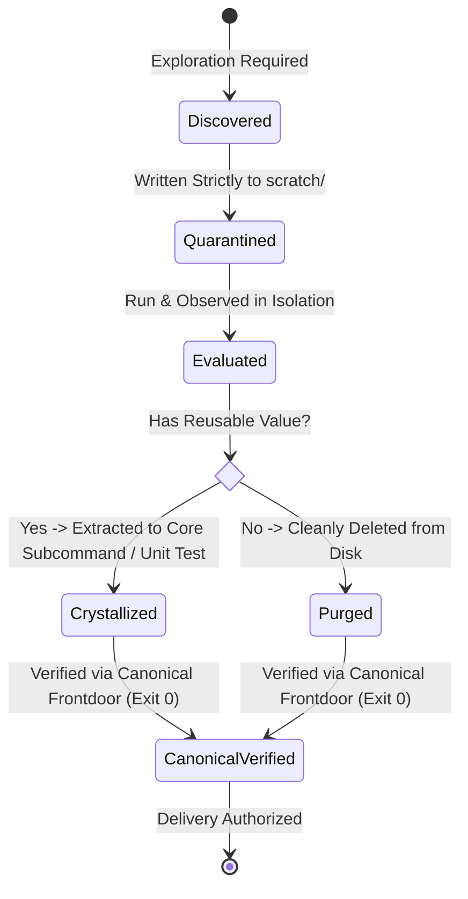
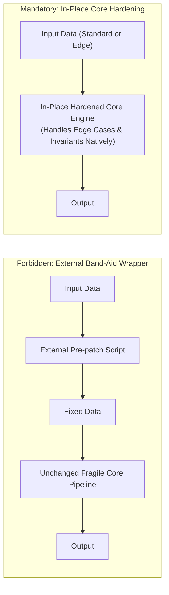

# Design Document: Canonical Entrypoint Invariance & Anti-Script Proliferation Governance

## 1. Architectural Topology & Rationale

### 1.1 The Anti-Pattern: Bypassing & Script Proliferation vs Canonical Path

```mermaid
flowchart TD
    subgraph AntiPattern["Anti-Pattern: Bypassing & Script Proliferation (Forbidden)"]
        UserReq["Task Request / Defect"] --> AgentAdHoc["Agent Ad-hoc Exploration"]
        AgentAdHoc --> LooseScript1["Loose Script: test_fix.py (in root)"]
        AgentAdHoc --> LooseScript2["Loose Script: run_patch.js (in src/)"]
        AgentAdHoc --> BypassCall["Bypass Frontdoor -> Call Private Internal Subroutine"]
        LooseScript1 -.->|"Island Pseudo-Pass (Fake Exit 0)"| FakeDone["Claim Done (Core Broken)"]
        LooseScript2 -.->|"Untracked Tech Debt"| Clutter["Repo Clutter & Drift"]
    end

    subgraph CanonicalPattern["Canonical Pattern: Single Canonical Frontdoor & In-Place Hardening (Axiom 55)"]
        UserReq2["Task Request / Defect"] --> CanonicalFrontdoor["Canonical Entrypoint\n(e.g. CLI Dispatcher / MCP Gateway)"]
        CanonicalFrontdoor --> CoreEngine["Core Pipeline / Workflow Engine"]
        CoreEngine -->|"In-Place Hardened"| CoreEngine
        CoreEngine --> VerifiedOutput["Production Output + Real Exit Code 0 [Measured]"]

        subgraph ScratchSanctuary["Controlled Exploration Quarantine"]
            Scratch["Sandboxed scratch/"] -->|"Crystallize into Core Subcommand / Test Suite"| CanonicalFrontdoor
            Scratch -->|"Purge Throwaways"| CleanState["Clean Repository"]
        end
    end
```

### 1.2 State Machine of Temporary Scripts (Quarantine & Crystallize Lifecycle)

---

## 2. In-Place Core Hardening vs External Wrapper Anti-Pattern

1. **Root Source Elimination**: If the core engine cannot parse a new parameter or crashes on an edge input format, the fix MUST be applied directly inside the core engine and its canonical dispatcher.
2. **Zero Outer Wrappers**: Constructing a separate outer script to "clean up parameters before calling the core" is strictly prohibited. The core must own its parsing, normalization, and failure handling.

---

## 3. Layer 1 Constitutional Axiom Codification (Axiom 55)

We define **Axiom 55** in the Ps-openspec & AI-Harness engineering constitution:
> **Axiom 55: Canonical Entrypoint Invariance & Anti-Script Proliferation Axiom (`CANONICAL_ENTRYPOINT_&_ANTI_SCRIPT_PROLIFERATION_AXIOM`)**
> 1. **Canonical Entrypoint Exclusivity**: Every workflow, pipeline, and execution interface must declare and maintain exactly one authoritative frontdoor. All invocations, operational commands, and regression test suites must enter through this canonical frontdoor. Bypassing the frontdoor to invoke internal deep subroutines is strictly prohibited.
> 2. **Anti-Script Proliferation & Scratch Quarantine**: Scattering ad-hoc, throwaway, or one-off scripts across the repository root or business source directories is prohibited. Exploration scripts must remain strictly quarantined in `scratch/`. Before delivery, temporary scripts must be either crystallized into canonical commands/tests or cleanly purged.
> 3. **In-Place Core Hardening**: All workflow defects and parameter expansions must be hardened in-place within the canonical dispatcher and core pipeline. External wrapper scripts pretending to fix defects are prohibited.
> 4. **Canonical Empirical Witness**: Verification checkoffs require `[Measured]` exit code 0 produced exclusively through the canonical entrypoint.

---

## 4. Layer 2 Automated Linter & Guardrail Architecture

To ensure mechanical enforcement, an automated validation suite (`tests/canonical-entrypoint-governance.test.mjs`) will execute four deterministic checks:
1. **Loose Script Audit (`check_no_loose_scripts`)**: Scans root and production directories for unmanaged temporary scripts (`temp_*.js`, `patch_*.py`, etc.), asserting zero loose files.
2. **In-Place Hardening Audit (`check_in_place_hardening`)**: Verifies that workflow improvements are localized to canonical dispatchers and engines without external wrapper scripts.
3. **Canonical Routing Audit (`check_canonical_routing`)**: Verifies that test suites and caller flows route through canonical gateways.
4. **Domain Neutrality & Universal Terminology Audit (`check_domain_neutrality`)**: Enforces pure software engineering vocabulary with zero domain-specific token leakage across the living specs and documentation.
