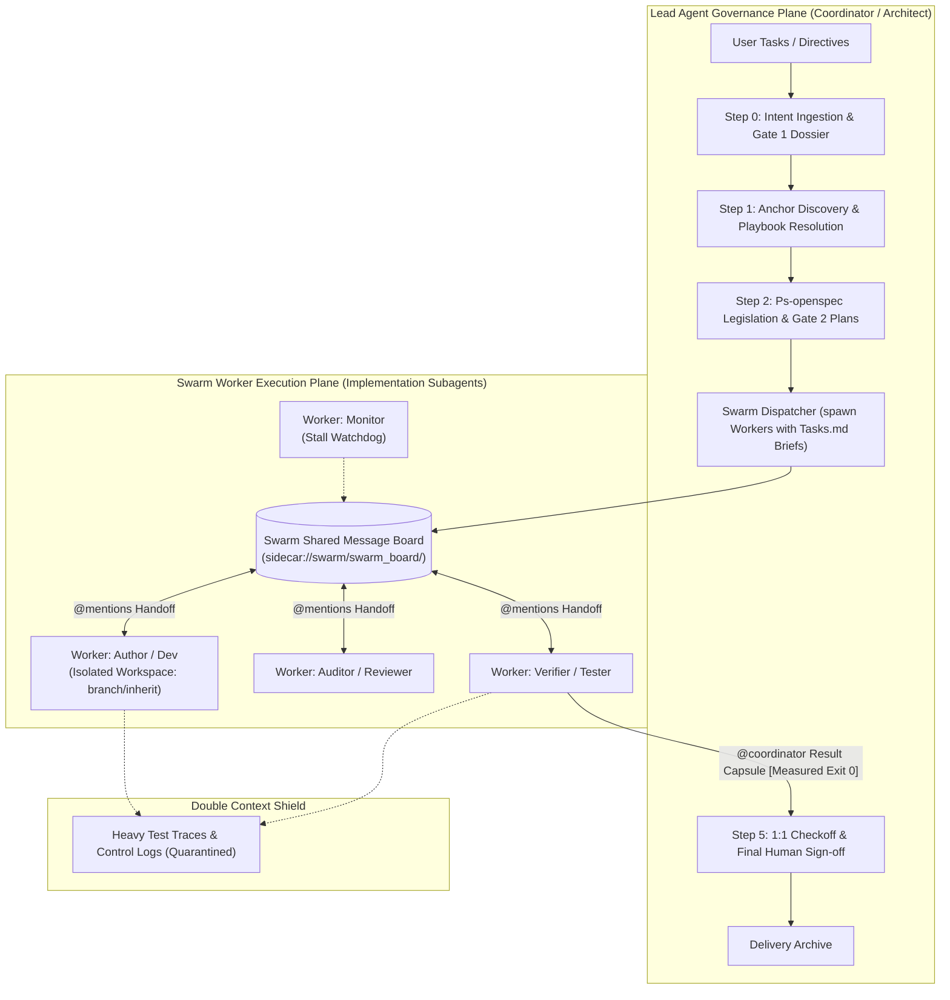
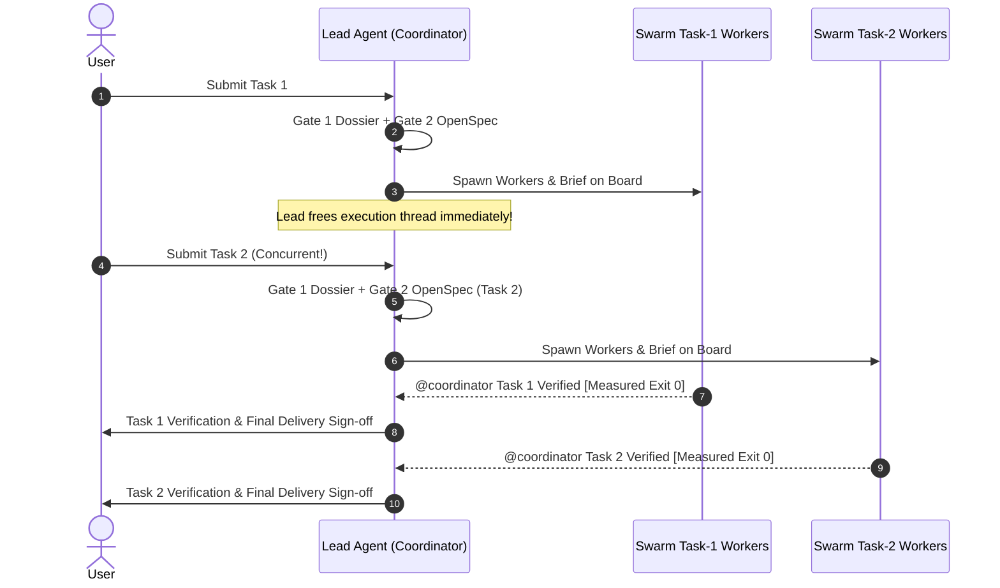

# Design Document: Lead Agent Orchestration & Swarm Subagent Execution Physical Decoupling

## 1. Architectural Topology & Rationale

### 1.1 Dual-Plane Topology: Governance vs Execution

### 1.2 High-Concurrency Multi-Task Pipelining

---

## 2. Invariant Definition (Axiom 56)

> **Axiom 56: Lead Agent Orchestration & Swarm Execution Decoupling Axiom (`LEAD_AGENT_ORCHESTRATION_&_SWARM_EXECUTION_DECOUPLING_AXIOM`)**
> 1. **Lead Agent Governance Purity**: The Lead Agent must operate strictly as the system architect and client coordinator. Its responsibilities are confined to Step 0 intent intake, Step 1 architectural anchor, Step 2 OpenSpec legislation and Gate 2 plan presentation, Swarm dispatch, and Step 5 bidirectional verification. The Lead Agent is forbidden from performing direct Step 3 code modifications.
> 2. **Mandatory Swarm Delegation**: All concrete implementation tasks in Step 3 (code authoring, refactoring, test execution, error debugging) must be delegated to Swarm Workers.
> 3. **High-Concurrency Availability**: The Lead Agent must maintain an ultra-lightweight context to enable rapid, concurrent task acceptance and pipelining without stalling or waiting synchronously.
> 4. **Bidirectional OpenSpec Binding**: Swarm briefs must directly derive from OpenSpec `tasks.md`, and task sign-off requires verified empirical proof (`[Measured]` exit code 0) returned by the Worker.

---

## 3. Layer 2 Automated Linter & Guardrail Architecture

The automated validation suite (`tests/lead-agent-swarm-decoupling.test.mjs`) verifies:
1. **Constitutional Invariant Registry**: Verifies that `GEMINI.md`, `skills/pstack-openspec/SKILL.md`, and `skills/ai-harness-openspec/SKILL.md` contain the complete Axiom 56 rules and blockers.
2. **OpenSpec Spec Parity**: Verifies all 5 RFC 2119 requirements and scenario blocks.
3. **Role Boundary Audit**: Asserts structural decoupling between Lead Agent governance and Swarm Worker implementation.
4. **Domain Neutrality & Anti-Scenario Leakage**: Verifies pure software engineering terminology across all Axiom 56 assets.
