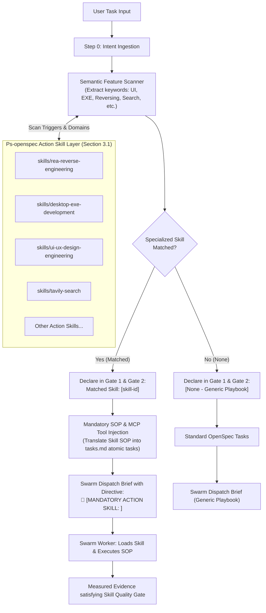
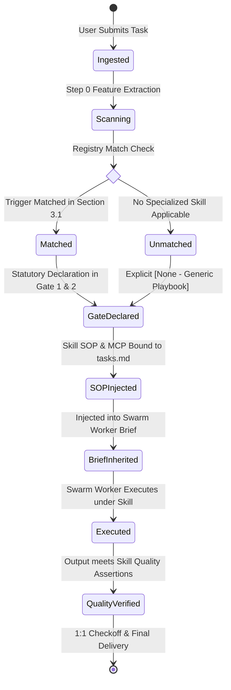

# Design Document: Action Skill Layer Proactive Discovery & Mandatory Adoption Governance

## 1. Architectural Topology & Rationale

### 1.1 Task-Time Semantic Discovery & Mandatory Adoption Flowchart

### 1.2 State Machine of Skill Adoption Lifecycle

---

## 2. Invariant Definition (Axiom 57)

> **Axiom 57: Action Skill Proactive Discovery & Mandatory Adoption Axiom (`ACTION_SKILL_PROACTIVE_DISCOVERY_&_MANDATORY_ADOPTION_AXIOM`)**
> 1. **Pre-Execution Skill Scanning**: Upon receiving any task, the agent must perform an automated semantic scan across Ps-openspec's Action Skill Layer (Section 3.1 in `GEMINI.md`). The agent must evaluate whether a specialized skill covers the domain.
> 2. **Statutory Skill Match Declaration**: Gate 1 dossiers and Gate 2 proposals must include an explicit section declaring either the matched skill or `[None - Standard Engineering Playbook]`. Silent omission is prohibited.
> 3. **Mandatory Active Adoption**: When an Action Skill matches, the agent is strictly prohibited from bypassing it to write fragile ad-hoc workarounds. The agent must inject the skill's SOPs, toolchains, and quality assertions into `tasks.md`.
> 4. **Swarm Brief Inheritance**: The Lead Agent must pass the matching Action Skill directive (`🚨 [MANDATORY ACTION SKILL: <name>]`) into Swarm briefs, ensuring compliance end-to-end.

---

## 3. Layer 2 Automated Linter & Guardrail Architecture

The automated validation suite (`tests/action-skill-discovery-governance.test.mjs`) verifies:
1. **Constitutional Invariant Registry**: Verifies that `GEMINI.md`, `skills/pstack-openspec/SKILL.md`, and `skills/ai-harness-openspec/SKILL.md` contain the complete Axiom 57 rules and blockers.
2. **OpenSpec Spec Parity**: Verifies all 5 RFC 2119 requirements and scenario blocks.
3. **Semantic Matching Simulator**: Tests candidate queries against the Action Skill registry to assert correct discovery.
4. **Domain Neutrality & Anti-Scenario Leakage**: Verifies pure software engineering terminology across all Axiom 57 assets.
