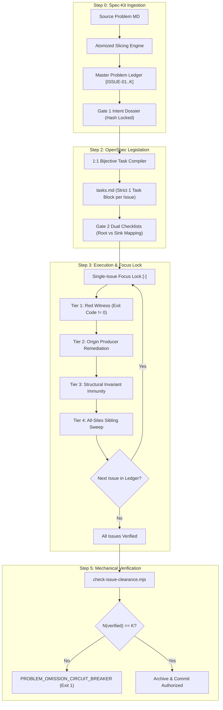
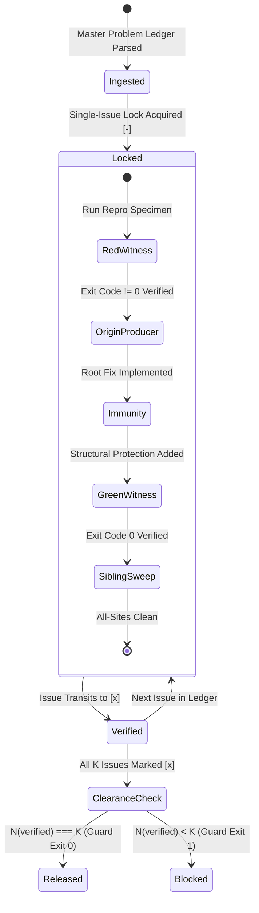

# Technical Design: Problem Ledger Ingestion and Zero-Omission Deep Remediation Architecture

## 1. Architectural Overview & Problem Statement

In automated AI engineering workflows, defect remediation from structured audit documents ("Problem MDs") experiences two critical modes of failure:
1. **Superficial Symptom Patching**: Agents default to inserting local null checks, try-catch wrappers, or fallback defaults at consumer sinks rather than penetrating data flows to the origin producer.
2. **Silent Issue Omission**: When addressing multiple issues ($K \ge 3$), agents expend substantial context on the initial 1~2 issues, experience cognitive saturation, and terminate prematurely while reporting false completion due to a superficially green test suite.

This design introduces a formal, closed-loop subsystem in Ps-openspec:

---

## 2. Component Specifications

### 2.1 Master Problem Ledger Schema
The Master Problem Ledger in the Gate 1 dossier enforces a rigid schema:
- `id`: Regex `^\[ISSUE-\d{2}\]$`
- `title`: Concise noun phrase
- `anchor`: `file:///path/to/source#Lxx`
- `witness`: Command executing a reproducer test that fails prior to code modification
- `role`: Canonical causal classification (`[Root Source]` or `[Consumer Sink]`)
- `acceptance`: Deterministic exit code 0 assertion

### 2.2 Issue-to-Task Bijective Invariant
In `tasks.md`, each issue `[ISSUE-xx]` is compiled into an independent task group containing:
1. `[ISSUE-xx-RED]`: Reproduce with failing test (Exit Code $\ne 0$).
2. `[ISSUE-xx-ROOT]`: Root cause fix at Origin Producer.
3. `[ISSUE-xx-IMMUNITY]`: Structural typing, statechart model, or AST rule.
4. `[ISSUE-xx-GREEN]`: Verified reproducer pass (Exit Code 0).
5. `[ISSUE-xx-SWEEP]`: All-sites sibling sweep.

Any consolidation of disparate issues under a single task header is prohibited and flagged by static linting.

### 2.3 Mechanical L2 Clearance Guard (`scripts/check-issue-clearance.mjs`)
The clearance guard operates mechanically without LLM subjectivity:
1. Locates the active change's Gate 1 dossier (`openspec/gate1-dossiers/*-GATE1.md` or change proposal).
2. Extracts all canonical issue IDs: `matches = content.match(/\[ISSUE-\d{2}\]/g)`.
3. Eliminates duplicate occurrences to determine target count $K$.
4. Scans the test suite (`tests/` and test outputs) to confirm each `[ISSUE-xx]` is referenced in a discrete test assertion block.
5. If any `[ISSUE-xx]` lacks a verified test assertion, exits with status 1 and prints `PROBLEM_OMISSION_CIRCUIT_BREAKER`.
6. Registered in `package.json` under `"guard:issue-clearance"`.

---

## 3. Invariant State Transitions

