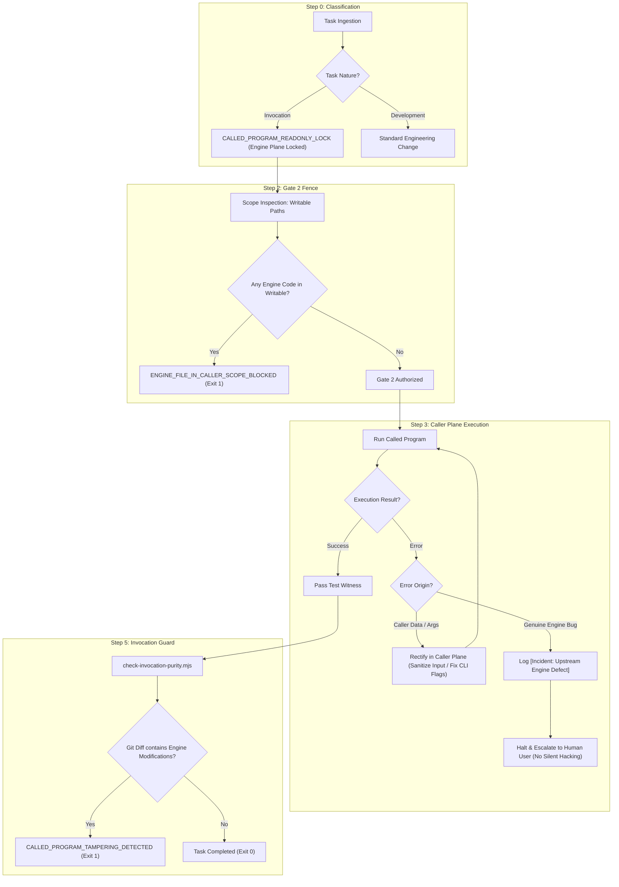
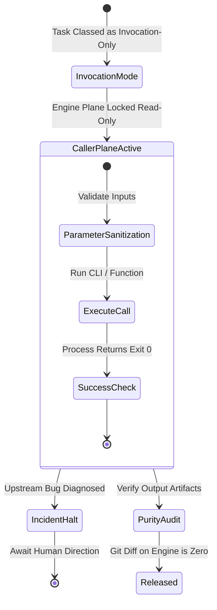

# Technical Design: Called Program Immutability and Invocation Purity Governance

## 1. Architectural Overview & Problem Analysis

In AI agent engineering workflows, agents are frequently tasked with using or running pre-existing tools, pipelines, CLIs, or services to accomplish a user goal. When friction or exceptions occur during execution, agents exhibit a hazardous cognitive bias:
**Task-Expediency Hacking**: The agent modifies the shared program's functional code (e.g. disabling input validation, hacking default parameters, or hardcoding return values) just to coerce the immediate task into passing.

This design introduces an architectural firewall separating the **Caller Plane** from the **Engine Plane**:



---

## 2. Component Specifications

### 2.1 Caller Plane vs. Engine Plane Physical Separation
- **Engine Plane (Read-Only)**:
  - Source files defining the program's functions, validation schemas, algorithms, libraries, and core engines.
  - Locked under `CALLED_PROGRAM_READONLY_LOCK`. Any write attempt triggers `UNAUTHORIZED_ENGINE_TAMPERING_BLOCKED`.
- **Caller Plane (Permitted)**:
  - Invocation scripts, CLI command invocations, input data files, transformation mappings, and caller-side environment variables.

### 2.2 Error Triage & Escalation Protocol
When an invocation task encounters an error:
1. **Diagnosis**: Determine if the failure is caused by malformed input arguments, non-compliant input data, or a genuine upstream engine defect.
2. **Caller Remediation**: If caused by caller inputs, sanitize the input files or adjust parameters.
3. **Upstream Defect Escalation**: If caused by a bug in the engine, write a diagnostic report:
   ```markdown
   [Incident: Upstream Engine Defect]
   - Engine: <path/to/engine>
   - Repro Command: <command>
   - Failure Stack: <stack trace>
   - Status: Blocked pending independent Bug-Fix change
   ```
   Do not modify engine code. Pause execution for user decision.

### 2.3 Mechanical L2 Invocation Purity Guard (`scripts/check-invocation-purity.mjs`)
- Autonomous Node.js CLI script.
- Inspects Git staged and unstaged diffs for tasks labeled as invocation tasks.
- Verifies that zero modifications exist within protected engine directories.
- Provides mutation testing ensuring that modifying an engine file triggers an Exit Code 1 failure.
- Registered under `npm run guard:invocation-purity`.

### 2.4 State Transitions


