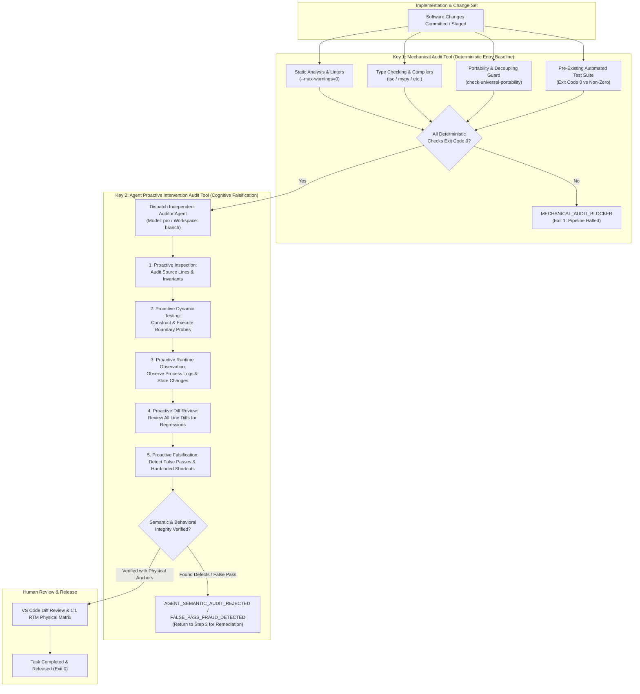

# Technical Design: Dual Audit Tooling Governance: Mechanical Audit and Agent Proactive Intervention Audit

## 1. Architectural Overview & Problem Analysis

In automated software engineering and agentic workflows, audit processes frequently fall victim to two diametrically opposed extremes:
1. **Blind Trust in Mechanical Green Lights**: Assuming that because a test suite exited with code 0 or a linter had zero errors, the software is guaranteed to be correct. In reality, trivial assertions (`assert.ok(true)`), bypassed edge checks, and hardcoded conditional branches (`if (input === 'x') return 'y'`) regularly create false passes.
2. **Unanchored Conversational LLM Auditing**: Relying on an agent to "chat" about whether code looks good. Without mechanical ground truths and without active inspection of physical code lines and dynamic runtime execution, conversational auditing rapidly degrades into polite compliance and hallucinated correctness.

To eliminate both vulnerabilities, this architecture formalizes a **Two-Tier Dual-Key Verification Pipeline**:
- **Mechanical Audit (Key 1 - The Objective Foundation)**: Pure deterministic, automated, script/compiler-driven gate. Zero model inference. Binary pass/fail based on process exit codes.
- **Agent Proactive Intervention Audit (Key 2 - The Cognitive Probing Engine)**: Proactive inspection, dynamic boundary probing, runtime state observation, diff review, and falsification attacks executed actively by the agent.

---

## 2. Component Specifications

### 2.1 Mechanical Audit Tool (Deterministic Gate)
- **Zero-Inference Rule**: The mechanical audit tool never queries an LLM or probabilistic model. It runs standard OS processes and reads exit codes.
- **Strict Invariants**:
  1. Compilers/linters executed with `--max-warnings=0`.
  2. Test suites must produce genuine `Exit Code 0`.
  3. Universal portability guard verifies zero hardcoded single-machine paths.
  4. Packaging and domain neutrality guards verify zero scenario leaks.
- **Failure Reaction**: Any failure terminates execution with `MECHANICAL_AUDIT_BLOCKER`.

### 2.2 Agent Proactive Intervention Audit Tool (Cognitive Probing Engine)
- **Active Behavior Mandate**: The agent must not wait passively or merely echo mechanical outputs. It executes five distinct active operations:
  1. `Proactive Code Inspection`: Reads physical source files, verifies logic paths, and captures line ranges (`file:///path#Lxx-Lyy`).
  2. `Proactive Dynamic Testing`: Crafts dynamic test commands (CLI, curl, node scripts, sub-processes) with boundary/adversarial inputs, runs them, and captures real outputs.
  3. `Proactive Runtime Observation`: Inspects stdout/stderr, execution logs, and state storage to confirm state transitions match expected statecharts.
  4. `Proactive Line-by-Line Diff Review`: Audits the full Git diff to ensure no unexpected modifications, commented-out assertions, or temporary debugging artifacts remain.
  5. `Proactive False-Pass Falsification`: Specifically audits whether passing tests are trivially satisfied by hardcoded branches (`if (input === ...) return ...`) or empty assertions (`assert.ok(true)`).

### 2.3 Dual-Key Gate Sequential Contract
- Sequential enforcement: Key 1 must be 100% green before Key 2 is dispatched.
- Key 2 cannot override a failing Key 1 (e.g. an agent cannot claim "the linter warning is harmless").
- Key 1 cannot override a failing Key 2 (e.g. exit code 0 does not excuse hardcoded shortcut branches).

### 2.4 Pure Universal Software Engineering Abstraction
- All definitions strictly use generic software terminology:
  - Artifacts: source code, modules, interfaces, packages, configuration files.
  - Data: payloads, inputs, parameters, outputs, schemas, states.
  - Execution: processes, commands, exit codes, exceptions, timeouts, logs.
  - Verification: static analysis, compilers, unit tests, dynamic probes, invariant assertions.
- Scenario-specific terms (e.g. domain business entities, chemical records, regulatory forms) are strictly excluded from all specifications, rules, scripts, and tests.

---

## 3. Statutory Invariants & Failure Codes

| Invariant Code | Violation Condition | Remediation Action |
| :--- | :--- | :--- |
| `MECHANICAL_AUDIT_BLOCKER` | Linter warning, compiler error, non-zero test exit code, or hardcoded host path | Resolve mechanical defect in code until deterministic checks exit 0 |
| `AGENT_SEMANTIC_AUDIT_REJECTED` | Agent discovers logic flaw, broken invariant, or missing edge handling | Re-open implementation in Step 3 to fix root causal defect |
| `FALSE_PASS_FRAUD_DETECTED` | Hardcoded shortcut branch or trivial assertion detected in code/test | Replace shortcut with genuine general business logic and robust assertions |
| `DUAL_KEY_AUDIT_BYPASS_BLOCKED` | Attempting to release code without running both Key 1 and Key 2 | Execute complete two-key sequential audit pipeline |
| `DOMAIN_SCENARIO_POLLUTION_BLOCKED` | Domain-specific or scenario-bound tokens detected in generic audit rules | Purge scenario tokens; re-express in pure universal engineering terms |
