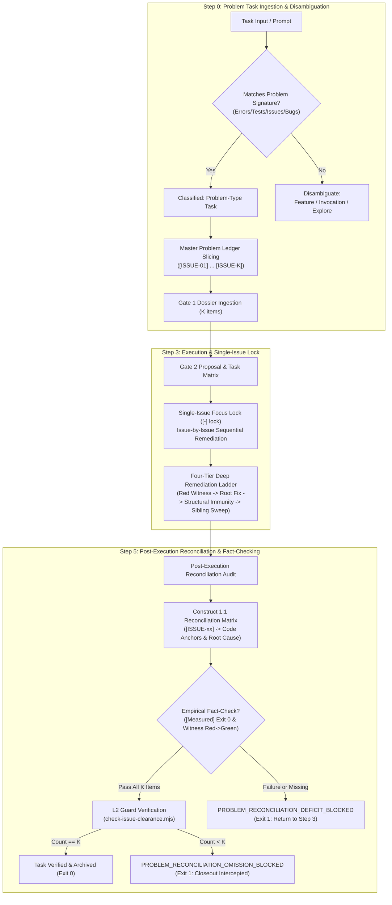
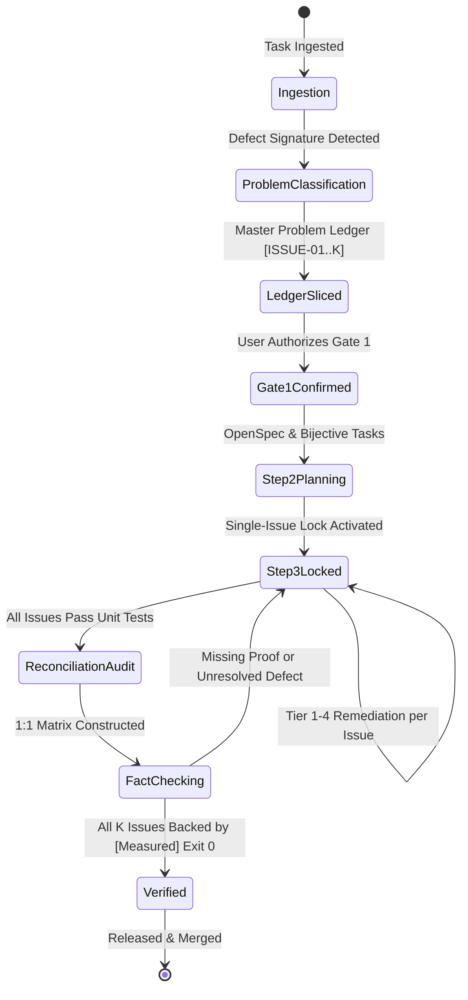

# Technical Design: Problem Task Boundary Definition and Post-Execution Fact-Checking Reconciliation Governance

## 1. Architectural Overview & Problem Analysis

In AI agent engineering workflows, when handling bug reports, audit findings, or regression issues, two cognitive hazards frequently emerge:
1. **Taxonomy & Boundary Blindness**: The agent does not recognize that a user prompt involves bug remediation, treating it as an open-ended feature modification or one-off refactoring, which bypasses the strict controls of Axiom 64.
2. **Post-Execution Assertion Erosion**: The agent completes changes for some issues, assumes everything is resolved, and declares victory without performing a comprehensive line-by-line reconciliation audit against the original ledger of issues.

This design introduces a formal two-phase boundary governance framework:
- **Phase A (Pre-Execution Ingestion)**: Standardized Problem Task Signature matching and four-way disambiguation taxonomy.
- **Phase B (Post-Execution Reconciliation)**: 1:1 Problem-to-Result Reconciliation Matrix with empirical fact-checking assertions and a mechanical circuit breaker.



---

## 2. Component Specifications

### 2.1 Problem Task Input Signature & Disambiguation Taxonomy
- **Input Signatures**:
  1. Diagnostic data: Stack traces, exception strings, HTTP 5xx codes, process non-zero exit codes.
  2. Test degradation: Failing unit tests, broken invariants, assertion errors.
  3. Structured issue sources: GitHub/GitLab issue lists, bug tickets, security audit findings, discrepancy reports.
  4. Remediation terminology: Prompts asking to "fix", "repair", "debug", "resolve discrepancies", or "correct errors".
- **Taxonomy Disambiguation Matrix**:
  - `Problem-Type Task`: Modifies existing code to remediate broken behavior. Mandatory Axiom 64 enforcement.
  - `Feature-Type Task`: Adds new capabilities without addressing pre-existing logic failures.
  - `Invocation-Type Task`: Executes existing tools to generate output without altering code (Axiom 66).
  - `Explore-Type Task`: Read-only analysis and inspection without modifying repository state.

### 2.2 Post-Execution 1:1 Problem-to-Result Reconciliation Matrix
At Step 5 delivery, the agent must output a formal reconciliation table with $K$ rows matching the initial ledger:
```markdown
| Issue ID | Problem Description | Root Cause File & Line Anchor | Measured Verification Proof | Resolution Status |
| :--- | :--- | :--- | :--- | :---: |
| [ISSUE-01] | <Description> | `file:///path/to/source.ts#L42-L55` | `[Measured] Exit Code 0` (Test witness) | `[x] RESOLVED` |
```
- If the count of verified rows is less than $K$, the task cannot be closed.

### 2.3 Empirical Fact-Checking Assertions
Fact-checking verifies the empirical reality of the solution:
1. **Physical Anchoring**: Every resolution must point to actual modified files and lines.
2. **Red-to-Green Empirical Evidence**: A verifiable terminal command that failed before the fix and succeeds after the fix.
3. **Absence of Symptom-Masking**: The fix must reside at the Origin Producer, not inside consumer sinks with defensive `try/catch` or null-guards.

### 2.4 State Transitions


