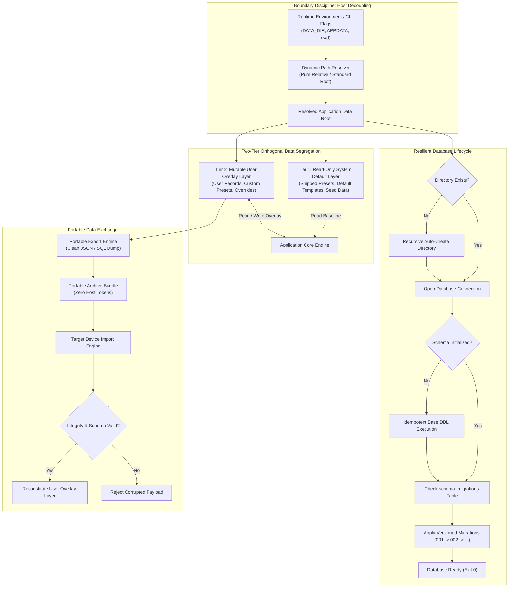

# Technical Design: Universal Portability, Database Migration Resilience, and User/Default Data Orthogonal Segregation Governance

## 1. Architectural Overview & Problem Analysis

In modern distributed development, applications, web services, CLI tools, and agent workflows frequently need to run across diverse environments (developer workstations, CI runners, containerized clusters, end-user machines). However, software architectures frequently suffer from three fundamental state and environment entanglements:
1. **Host-Bound Environment Coupling**: Absolute file paths (e.g. `C:\Users\Admin\...`, `/home/user/...`) and fixed network bindings leak into application sources and static configs, breaking cross-platform portability.
2. **Database Bootstrap Fragility**: Database initialization relies on unmanaged filesystem assumptions. Cold starts on fresh machines fail when parent directories do not exist, and schema changes lack declarative, versioned, and idempotent migration logic.
3. **Data Entanglement (Defaults vs. User Data)**: Shipped baseline defaults (built-in templates, factory presets, configuration archetypes) are commingled with user-authored runtime data in shared physical tables or directories. Upgrades clobber user records, while user reset actions obliterate system defaults.

To permanently solve these entanglements, this design establishes a formal **Universal Portability and Orthogonal Data Segregation Architecture** within Ps-openspec, directly applying Lauren Tan's core principles:
- `principle-boundary-discipline`: Environmental variables, filesystem paths, and external storage boundaries are parsed into typed configuration structures at the absolute system perimeter.
- `principle-separate-before-serializing-shared-state`: Shared mutable state is eliminated; immutable system defaults and mutable user overlays reside in strictly disjoint storage tiers.
- `principle-make-operations-idempotent`: Database directory creation, schema bootstrap, and migration application execute idempotently with zero errors on repeated executions.



---

## 2. Component Specifications

### 2.1 Host-Decoupled Dynamic Boundary Resolution
- **Perimeter Resolution**: No business logic or database connector may directly invoke OS path construction without using the canonical dynamic path resolver.
- **Path Precedence**:
  1. Explicit CLI argument or configuration override (`--data-dir`).
  2. Environment variable (`DATA_DIR`, platform-standard `APPDATA` on Windows or `XDG_DATA_HOME` on Linux/macOS).
  3. Safe fallback relative to application execution root (`path.resolve(process.cwd(), './data')`).
- **Forbidden Patterns**: Any regex match against hardcoded drive-letter roots (`/^[a-zA-Z]:[\\\/]Users[\\\/]/i`) or Unix user homes (`/^\/home\/[^\/]+/`) in committed source or config assets triggers `HARDCODED_HOST_ENVIRONMENT_BLOCKED`.

### 2.2 Resilient Database Auto-Bootstrapping & Migration Pipeline
- **Auto-Bootstrap Protocol**:
  ```typescript
  interface DatabaseBootstrapConfig {
    dbPath: string; // Dynamic path
    migrationsDir: string;
    autoCreateDir: boolean;
  }
  ```
  1. The connector verifies parent directory presence; if missing, calls `fs.mkdirSync(dir, { recursive: true })`.
  2. The connector opens the database file and initializes the metadata tracking table:
     ```sql
     CREATE TABLE IF NOT EXISTS _schema_migrations (
       version TEXT PRIMARY KEY,
       applied_at TIMESTAMP DEFAULT CURRENT_TIMESTAMP
     );
     ```
  3. Ordered migration scripts (`001_init.sql`, `002_add_field.sql`) are evaluated. Only unapplied versions execute within an isolated transaction.
  4. Cross-machine migration resilience: mounting a v1 database on a v2 application automatically executes pending migrations without data loss.

### 2.3 Two-Tier Orthogonal Data Segregation Architecture
- **Layer 1: Immutable System Default Layer**:
  - Located in packaged asset bundles (e.g., `assets/defaults/`, `src/defaults/`).
  - Read-only at runtime. Application updates completely overwrite this directory without touching user data.
- **Layer 2: Mutable User Data Layer**:
  - Located in the resolved runtime user data directory (e.g., `<DATA_DIR>/user_data/`).
  - Contains only user-modified entities, user configurations, and custom records.
- **Overlay Resolution Algorithm**:
  - When querying entity `X`, the application first queries Layer 2 (User Overlay).
  - If a user custom entity or override exists, return it.
  - If absent, fall back to Layer 1 (System Default).
- **Reset Invariant**: A user reset operation recursively purges Layer 2 (`rm -rf <DATA_DIR>/user_data/`), leaving Layer 1 intact.

### 2.4 Portable Export & Restore Protocol
- **Export Filter**: The exporter iterates over Layer 2 data, serializes state to structured JSON/SQL, and strips any machine-specific metadata (timestamps with host machine names, internal local file URIs).
- **Import Verifier**: The importer verifies:
  1. Payload schema version matches or can be upgraded to current application version.
  2. Checksum/hash integrity passes.
  3. Ingestion into target Layer 2 is fully idempotent.

### 2.5 Automated L2 Static Guard (`scripts/check-universal-portability.mjs`)
- Registered in `package.json` under `guard:portability`.
- Scans `src/`, `scripts/`, `skills/`, `worker.md`, and configuration files.
- Checks:
  1. `NO_HARDCODED_HOST_PATHS`: Rejects single-machine absolute paths.
  2. `DATABASE_BOOTSTRAP_DISCIPLINE`: Rejects raw database connections that lack parent directory auto-creation or migration hooks.
  3. `DATA_SEGREGATION_DISCIPLINE`: Verifies that default data directories and user data paths are physically disjoint.

---

## 3. Statutory Invariants & Failure Codes

| Invariant Code | Violation Condition | Remediation Action |
| :--- | :--- | :--- |
| `HARDCODED_HOST_ENVIRONMENT_BLOCKED` | Hardcoded absolute developer path or single-machine hostname in source/config | Replace with dynamic environment resolution at system perimeter |
| `DATABASE_UNMANAGED_BOOTSTRAP_BLOCKED` | Database connection opened without directory auto-creation or migration safety | Wrap in auto-bootstrap helper with recursive directory creation and migrations |
| `STATE_SEGREGATION_VIOLATION_BLOCKED` | System defaults and mutable user records stored in a unified unsegregated table/dir | Separate into read-only system baseline and mutable user overlay |
| `PORTABLE_EXPORT_CONTAMINATION_BLOCKED` | Export bundle contains local machine paths or machine credentials | Sanitize export payload at boundary before serialization |
