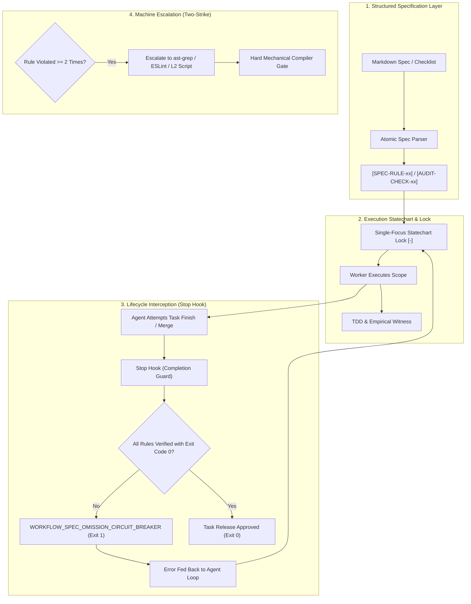
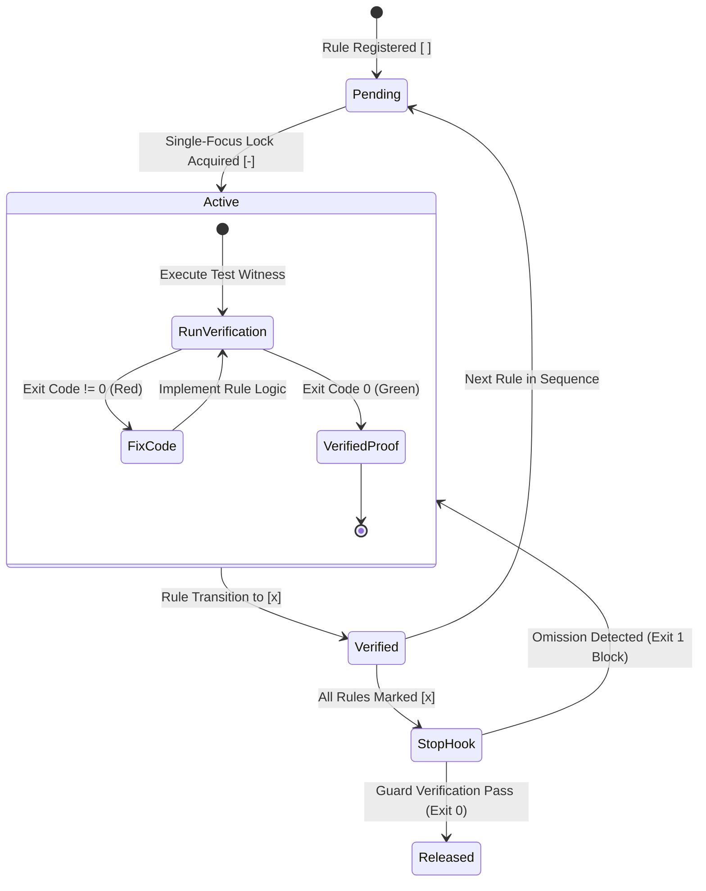

# Technical Design: Markdown Specification Deterministic Enforcement and Completion Hook Governance

## 1. Architectural Overview & Problem Analysis

In AI-driven software development and automated workflow execution, natural language Markdown is the ubiquitous medium for defining architecture rules, coding guidelines, and audit checklists. However, when treated solely as text prompts, LLMs exhibit three systemic failure modes:
1. **Attention Decay (Needle-in-a-Haystack)**: As context windows expand with code diffs and execution logs, specific Markdown rules located in long documents are neglected.
2. **Advisory Fallacy**: Natural language statements ("Must not do X", "Always ensure Y") are treated as soft suggestions rather than deterministic barriers.
3. **Premature Completion**: Agents self-declare task completion upon reaching a partial milestone, falsely confident because general tests pass, while specific audit constraints remain unfulfilled.

This technical design establishes an enforceable closed-loop governance framework:

---

## 2. Component Specifications

### 2.1 Atomic Specification Schema
Structured Markdown rules must satisfy canonical patterns:
- Rule ID: `^\[(SPEC-RULE|AUDIT-CHECK)-\d{2}\]$`
- Fields:
  - `Precondition`: Input domain or context criteria
  - `Contract`: RFC 2119 keyword (`SHALL`, `SHALL NOT`, `MUST`, `MUST NOT`)
  - `Verification`: Exact command or test file covering the rule

### 2.2 Completion Hook (Stop Hook) Architecture
The Stop Hook runs before task completion:
1. Gathers all canonical rule IDs from the target specification.
2. Inspects test execution outputs and source code diffs.
3. Asserts a 1:1 bijection: every rule ID must be bound to a test assertion exhibiting a measured Exit Code 0.
4. If $N_{\text{verified}} < N_{\text{rules}}$, terminates with status code 1 and outputs the list of unverified rules.

### 2.3 Mechanical L2 Compliance Guard (`scripts/check-workflow-spec-compliance.mjs`)
- Autonomous Node.js CLI script.
- Scans `openspec/gate1-dossiers/`, change proposals, and workflow specifications.
- Validates that all extracted `[SPEC-RULE-xx]` and `[AUDIT-CHECK-xx]` identifiers have matching automated test assertions in `tests/`.
- Provides an automated mutation test mode demonstrating that omitting an assertion triggers an Exit Code 1 failure.
- Registered under `npm run guard:workflow-spec`.

### 2.4 Invariant State Transitions

