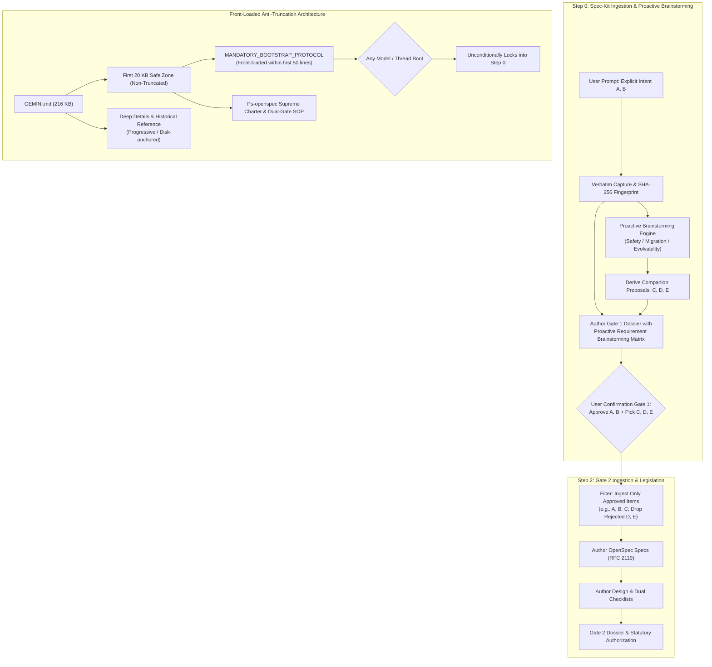

# Technical Design: Proactive Requirement Brainstorming and Universal Cross-Thread Ps-openspec Governance

## 1. Architectural Overview & Problem Analysis

In long-running AI-assisted engineering, two systemic friction points frequently break governance:
1. **The A, B -> C, D, E Blindspot**: Users supply direct intent items A and B. A robust engineering implementation, however, invariably requires companion invariants: edge defenses, data migration resilience, backward compatibility, and rollback mechanisms (C, D, E). Without a formal anticipation protocol, agents either neglect companion items or inject them arbitrarily.
2. **Context Window Truncation & Governance Evaporation**: Host platform prompt injection truncates global rules files when they exceed ~24 KB. Because `GEMINI.md` grew to 216 KB, ~192 KB was systematically truncated. New threads and alternate models received incomplete rules, leading to governance drift.

---

## 2. Component Specifications

### 2.1 Proactive Requirement Brainstorming Engine (Step 0)
- **Input**: Verbatim user prompt (`A`, `B`).
- **Anticipation Heuristics**:
  - `Dimension 1: Runtime Safety & Boundary Defense`: What happens if inputs are malformed, network calls fail, or concurrent calls clash?
  - `Dimension 2: Data Migration & Portability Resilience`: Will state changes break on another machine, OS, or user account? Are defaults segregated from user data?
  - `Dimension 3: Evolvability & Rollback Safety`: If this change causes a regression, can it be cleanly reverted or downgraded?
- **Output**: Dedicated table in Gate 1 dossier listing `[PROP-C]`, `[PROP-D]`, `[PROP-E]` with trade-off analysis.

### 2.2 Gate 2 Ingestion Filtering
- The agent cross-checks user feedback against the proposed brainstormed items.
- Only confirmed items enter `proposal.md` and `specs/`.
- Unconfirmed items are logged as deferred or excluded.

### 2.3 Front-Loaded Anti-Truncation Bootstrap Architecture
- **Safe Zone Rule**: The first 20 KB of `GEMINI.md` must be self-contained and establish:
  1. The unmissable `MANDATORY_BOOTSTRAP_PROTOCOL`.
  2. The mandatory 6-step Ps-openspec dual-gate lifecycle.
  3. The single-focus execution lock and VS Code diff review requirement.
- **Immediate Interception**: Any new model reading only the first 20 KB immediately receives the statutory instruction that answering directly or editing code without Gate 1 and Gate 2 is a fatal violation.

### 2.4 Universal Cross-Workspace Directory Synchronization
- `scripts/sync-to-global.mjs` is upgraded to distribute lightweight pointer anchors:
  - Synchronizes `GEMINI.md` to `~/.gemini/config/GEMINI.md`.
  - Ensures workspace roots (e.g. `d:\APP\AI app\Antigravity\会话`) have local pointer configs ensuring seamless inheritance regardless of CWD.

---

## 3. Statutory Invariants & Failure Codes

| Invariant Code | Violation Condition | Remediation Action |
| :--- | :--- | :--- |
| `PROACTIVE_BRAINSTORMING_OMISSION_BLOCKED` | Gate 1 dossier lacks proactive brainstorming matrix | Inject companion extrapolation table evaluating safety, migration, and evolvability |
| `UNAUTHORIZED_PROPOSAL_MUTATION_BLOCKED` | Unapproved brainstormed proposal smuggled into code | Revert unapproved code; strictly align scope with Gate 1 confirmed items |
| `GOVERNANCE_BOOTSTRAP_VIOLATION_BLOCKED` | New thread/model edits code without completing Gate 1 and Gate 2 | Immediately abort code edits; halt and output Step 0 Gate 1 dossier |
| `TRUNCATION_HAZARD_BLOCKED` | Mandatory bootstrap directive located outside first 20 KB safe zone | Relocate bootstrap directive to the top 50 lines of `GEMINI.md` |
