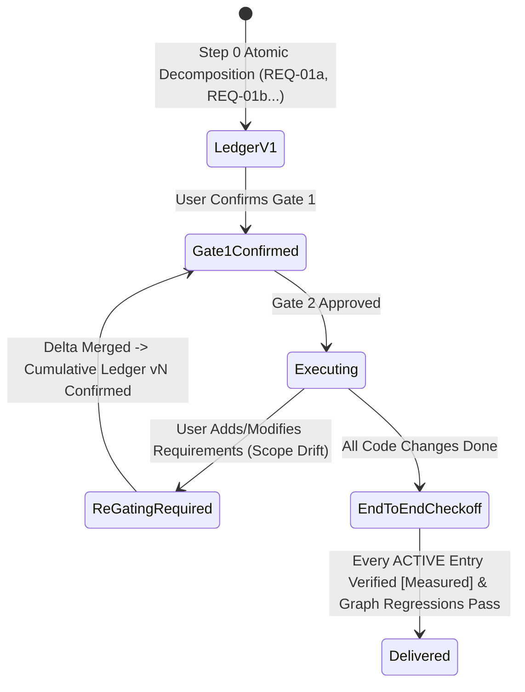

# Technical Design: Cumulative Requirement Ledger & Re-Gating Protocol (Axiom 71)

## 1. Architecture Overview
To eliminate requirement loss across multi-turn conversations, this design upgrades Gate 1 from a static one-shot snapshot into a **Persistent Cumulative Requirement Ledger** coupled with **Re-Gating** and **Project Graph Multi-Turn Regression**:



## 2. Cumulative Requirement Ledger Model (`.harness/requirement-ledger.json`)
```json
{
  "schemaVersion": "1.0.0",
  "ledgerVersion": 1,
  "baselineConfirmed": true,
  "entries": [
    {
      "id": "REQ-01a",
      "turn": 1,
      "summary": "Single verifiable behavior description",
      "graphModuleId": "mod-guards-and-sync",
      "status": "ACTIVE",
      "supersedes": null,
      "verified": true,
      "verificationEvidence": "npm run guard:ledger-continuity -> Exit Code 0"
    }
  ]
}
```
### Conservation & Continuity Invariants
1. **Algebraic Conservation**: For any version transition `v(k) -> v(k+1)`, every entry from `v(k)` must appear in `v(k+1)` either unchanged (`ACTIVE`/`MODIFIED`) or explicitly retired (`SUPERSEDED` with `supersedes` pointer). Silent omission triggers `REQUIREMENT_CONSERVATION_VIOLATION_BLOCKED`.
2. **Atomic Verification Completeness**: At Step 5 delivery, every `ACTIVE`, `MODIFIED`, or `ADDED` entry must have `verified === true` and non-empty `verificationEvidence`, else `CUMULATIVE_CHECKOFF_DEFICIT_BLOCKED`.
3. **Re-Gating Lock**: When `baselineConfirmed === false` (triggered by unconfirmed mid-session additions/changes), `RE_GATING_REQUIRED_BLOCKED` halts implementation.
4. **Graph-Coupled Regression**: Checking `.harness/project-graph.json` linkage ensures that when a later turn modifies `graphModuleId`, all earlier `ACTIVE` entries bound to that `graphModuleId` are flagged for mandatory re-verification.

## 3. L2 Static Guard (`scripts/check-ledger-continuity.mjs`)
- Validates `.harness/requirement-ledger.json` (if present in a project) or validates programmatic ledger transitions via exported functions:
  - `mergeLedgerDelta(prevLedger, delta)`
  - `validateLedgerContinuity(ledger, prevLedger)`
  - `checkGraphCoupledRegressions(ledger, modifiedModuleIds)`
- Registered in `package.json` as `guard:ledger-continuity`.
