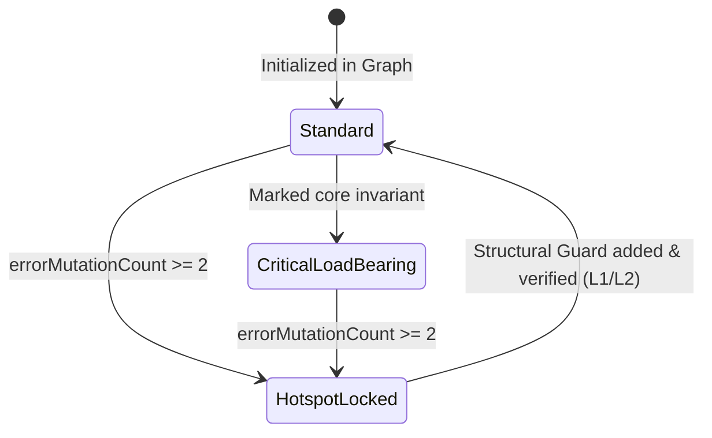

# Technical Design: Project Architecture & Maintenance Graph Governance (Axiom 70)

## 1. `@poteto` Pstack Philosophical Alignment
This design translates Lauren Tan (`@poteto`) Pstack principles into a deterministic, machine-verifiable Project Architecture & Maintenance Graph system:
- **`how` & `architect` (Module Map & Ownership)**: Every repository maintains a canonical `.harness/project-graph.json` declaring modules (`id`, `name`, `paths`, `ownership`, `entryPoints`, `dependencies`, `riskTier`, `maintenanceItems`, `errorMutationCount`, `structuralGuards`).
- **`blast-radius` (Multi-Hop Downstream Trace)**: Before any modification, Step 1 grounding computes direct and transitive dependents from `dependencies` edges, flagging downstream contracts that require verification.
- **`principle-fix-root-causes` & `principle-encode-lessons-in-structure` & `architect Phase E`**: Each module tracks `errorMutationCount` and `incidents`. When `errorMutationCount >= 2` (or `riskTier === 'hotspot_locked'`), surface patching is blocked (`REPEATED_HOTSPOT_MUTATION_BLOCKED`) unless accompanied by a structural defense (`structuralGuards` reference) or architectural redesign.

## 2. Canonical Graph Schema (`.harness/project-graph.json`)
```json
{
  "schemaVersion": "1.0.0",
  "projectName": "<repo-name>",
  "lastSyncedAt": "<ISO-8601>",
  "modules": [
    {
      "id": "mod-core-governance",
      "name": "Constitutional Governance & Rules",
      "ownership": "Core Architecture",
      "paths": ["GEMINI.md", "worker.md", "skills/"],
      "entryPoints": ["GEMINI.md"],
      "dependencies": ["mod-sync-tooling"],
      "riskTier": "critical_load_bearing",
      "errorMutationCount": 0,
      "structuralGuards": ["scripts/tests/gemini-adapter.test.mjs"],
      "maintenanceItems": [
        {
          "id": "MAINT-01",
          "title": "Keep top 20 KB safe zone non-truncated",
          "status": "active"
        }
      ]
    }
  ]
}
```

## 3. Statechart: Hotspot Circuit Breaker & Anti-Staleness


## 4. L2 Deterministic Guard (`scripts/check-project-graph.mjs`)
1. **Existence & Schema Check**: Verifies `.harness/project-graph.json` exists and contains valid `schemaVersion`, `modules` array, and required fields (`id`, `paths`, `ownership`, `dependencies`, `riskTier`, `maintenanceItems`).
2. **Anti-Staleness Check (`STALE_PROJECT_GRAPH_BLOCKED`)**: Verifies every declared path in `modules[].paths` actually resolves to an existing file or directory in the repository.
3. **Hotspot Circuit Breaker Check (`REPEATED_HOTSPOT_MUTATION_BLOCKED`)**: Flags any module with `errorMutationCount >= 2` or `riskTier === 'hotspot_locked'` that lacks a verified `structuralGuards` entry.
4. **Dependency Integrity Check**: Ensures all `dependencies` reference valid module `id`s within the Graph (no dangling references).
5. **Cold-Start Bootstrap (`--init`)**: Supports a read-only directory scan mode (`node scripts/check-project-graph.mjs --init`) to scaffold `.harness/project-graph.json` for new or legacy repositories.

## 5. Pure Universal Software Engineering Abstraction
All specifications, Graph schemas, guard outputs, and test suites strictly use pure software engineering abstractions (`Module`, `Dependency Edge`, `Origin Producer`, `Blast Radius`, `Hotspot Circuit Breaker`, `Structural Guard`, `Maintenance Ledger`) with zero domain-specific leakage.
