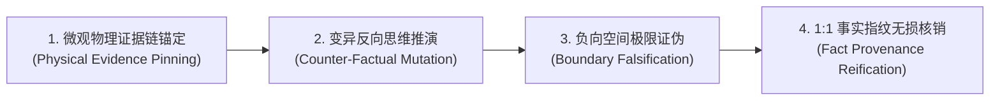

# Agent 智能体认知审计与规范核销方法论指南
# (Agent Cognitive Audit & Specification Verification Guide)

> **最高定位**：本指南为 OrbitStack（Ps-openspec 轨道工程体系）应对“AI Agent 过于依赖机械 Exit 0、迎合性自审与走过场式打勾”的法定认知审计标准。
> 机械审计（编译器、类型系统、Linter、自动化测试）负责守住系统的**下限（确定性底线）**；
> Agent 认知审计（独立 Auditor Subagent、语义契约证伪、负向空间挖掘）负责守住系统的**上限与死角（语义完备性与契约抗毁性）**。

---

## 🏛️ 一、 核心定位与心智模型：波普尔证伪主义与独立敌手审讯官

当前 AI 辅助编程中普遍存在“自施工、自审核、自夸奖”的严重自利偏差（Sycophancy & Confirmation Bias）。写代码的 Agent 会本能地为自己的实现假设寻找合理性依据。

### 1. 裁执彻底物理隔离 (Fresh Auditor by Default)
- **施工平面与审计平面解耦**：施工 Agent（Builder）严禁兼任终审法官。完成开发并通过机械确定性审计后，必须派发全新的独立 Subagent（加载只读上下文，使用更高推理算力，如 `Model='pro'`, `Workspace='branch'`），以纯粹的“局外人”身份执裁；
- **零脏状态污染**：审计 Agent 严禁继承施工 Agent 带有调试摩擦和偏见假设的上下文，恪守零信任原则。

### 2. 波普尔证伪主义心智 (Popperian Falsification Mindset)
- **审讯官心智**：审计 Agent 的第一心智不是“寻找证明它做对的理由”，而是**“穷尽一切手段证明它在某种边界下会失败”**；
- **攻击先行**：主动寻找没有被现有测试用例覆盖的极端状态、边界载荷与异常路径；只有当一段代码经历了最刻薄的边界攻击与反例推演却依然无法被推翻时，Agent 审计员才出具合格判定；
- **超越 Exit 0 幻觉**：审讯官必须持续追问：“这个 Exit 0 究竟证明了什么？它遗漏了什么没有证明？”。

```text
┌────────────────────────────────────────────────────────────────────────┐
│                        裁执物理隔离与敌手审讯架构                       │
│                                                                        │
│   ┌──────────────────────────┐         ┌──────────────────────────┐    │
│   │   施工智能体 (Builder)    │         │   审计智能体 (Auditor)    │    │
│   │   • 目标: 实现功能、单步测通 │         │   • 目标: 穷尽手段证明其崩溃 │    │
│   │   • 心智: 求解与构造       │         │   • 心智: 证伪与攻击 (波普尔)│    │
│   └─────────────┬────────────┘         └─────────────▲────────────┘    │
│                 │                                    │                 │
│                 │ 提交代码变动产出物 (Diff)             │ 敌手攻击与行号挑刺│
│                 └────────────────────────────────────┘                 │
└────────────────────────────────────────────────────────────────────────┘
```

---

## 🌐 二、 规范双轨治理网：全局规范防“暗度陈仓”，局部规范穷尽“负向空间”

在项目审计中，必须严格区分**全局规范（Macro Invariants）**与**局部规范（Micro Contracts）**，实施双轨并行穿透：

```text
┌────────────────────────────────────────────────────────────────────────┐
│                   【两阶双轨规范深度审计拓扑】                          │
├────────────────────────────────────────────────────────────────────────┤
│ 轨道一: 全局规范审讯 (Macro Invariants - 系统宪法与承重墙)             │
│   • 目标: 严防局部优化对宏观架构造成隐性腐蚀与暗度陈仓                  │
│   • 重点: 机制与策略隔离 / 状态合法性因果溯源 / 零防御性捏造 / 源码封印│
├────────────────────────────────────────────────────────────────────────┤
│ 轨道二: 局部规范审讯 (Micro Contracts - 功能模块原子行为契约)           │
│   • 目标: 穷尽微观状态空间，严格核销 RFC 2119 行为闭包与负向空间       │
│   • 重点: SHALL/WHEN/THEN 逐条兑现 / 负向异常拒绝 / 1:1 事实指纹守恒   │
└────────────────────────────────────────────────────────────────────────┘
```

### 1. 全局规范审讯（Macro Invariants）
全局规范是全系统的法定宪章。审计 Agent 必须以宏观架构师的视角，审视本次局部改动是否违背了系统级不变量：
- **机制与策略倒挂审计**：本次改动是否将调用端的业务特异逻辑或特判硬编码塞进了底层共享通用程序？
- **状态合法性因果审计**：异常出现时，是否顺着数据流逆向追溯到 Origin Producer，还是在 Consumer Sink 处进行了局部就地掩盖（Scattered Guards / Swallowed Errors / Clamped Values）？
- **防御性捏造审计**：代码中是否出现了 `val || default_value`、非法伪造的兜底数据，制造虚假的“完整性”？
- **不可变源码封印审计**：凡标注 `@ANTIGRAVITY_INVARIANT_LOCK` 的关键逻辑，是否保持 100% 绝对未被擅动？

### 2. 局部规范审讯（Micro Contracts）
局部规范针对具体功能模块的原子行为契约。机械测试往往只能覆盖正向主链路，Agent 审计必须主攻**“负向空间（Negative Space）”**：
- **未写代码的缺失审计（What is missing）**：机械测试只能验证“已写的代码能跑通”，Agent 审计必须挖掘“未写的代码会引发什么”——未捕获的错误分支、未处理的边界类型、未释放的资源句柄、并发竞态下的死锁；
- **RFC 2119 行为契约逐项兑现**：对局部规范中的每一项 `SHALL`（必须）、`WHEN`（触发边界）、`THEN`（确定性后果）进行显式控制流跟踪，杜绝死分支遮蔽；
- **项数绝对守恒与遗漏熔断 ($N_{\text{Global}} + M_{\text{Local}}$)**：出具 itemized 清算表，缺少任意一条规范的核销证据，直接触发 `SPEC_OMISSION_DETECTED` 熔断阻断。

---

## ⚡ 三、 Agent 认知审计的四大核心操作律 (The 4 Cognitive Operations)

真正的 Agent 审计绝非口水化的“经核对符合要求”，必须执行具有物理可测性的四大认知操作律：



### 1. 微观物理证据链锚定 (Physical Evidence Pinning)
- 审计报告中的每一个判定结论，必须精确绑定目标源码的**绝对路径与行号区间**（例如 `file:///repo/src/pipeline.ts#L42-L78`）以及外部终端运行日志凭据；
- 凡是没有行号区间与实测日志支持的宣称，一律判定为“口水化假对账”，直接否决。

### 2. 变异反向思维推演与弱断言识别 (Counter-Factual & Mutation Reasoning)
- **变异自问**：“如果我把这几行关键状态校验代码删掉，现有的单元测试套件会不会变红？”
- **弱断言欺诈驳回**：如果现有测试仅是浅层的 `assert.ok(res)`，即便删掉核心转换逻辑测试依然报 Exit 0，Agent 审计员必须直接判定其为 `TRIVIAL_ASSERTION_FRAUD`（弱断言欺诈），锁死任务专注锁，责令补充针对复杂状态结构的严格深度断言。

### 3. 负向空间极限证伪攻击 (Boundary Falsification Attack)
- 审计智能体必须主动推演并记录攻击尝试：注入异常变异入参（非法类型、极端空值、畸形格式、超限载荷）；
- 审查目标代码是否遵循 **Fail-Fast 原则** 在系统物理边界就地拦截并抛出受控致命异常，严禁携带脏状态向系统深处传播。

### 4. 1:1 事实指纹双向守恒清算 (Zero-Loss Fact Provenance Reconciliation)
- 坚决杜绝“粗粒度相似度欺骗（Macro-Statistical Evading）”；
- 审计员必须将任务输入载荷中的每一个微观原子意图，与最终交付代码/产出进行 1:1 逐字逐项双向物理核对，严禁任何形式的削足适履式裁剪或关键细节蒸发。

---

## 🔄 四、 防线下沉自迭代闭环：从“单次纠错”到“机械免疫” (Defense Escalation)

**Agent 审计的终极目标，不是在当前代码中充当救火队员，而是让系统获得永久免疫力。**

当审计智能体在认知层面捕获到一个漏洞、缺陷或偏离时，严禁就地打完补丁即关单，必须强制执行 **Lauren Tan 信任金字塔防线下沉规程**：

```text
┌────────────────────────────────────────────────────────────────────────┐
│                   Agent 审计驱动的防线下沉自迭代闭环                     │
│                                                                        │
│   Agent 认知审计抓到了漏洞 (Cognitive Defect Found)                     │
│                           │                                            │
│                           ▼                                            │
│      能下沉为 L1 吗？ ────> 改造类型状态机，使非法状态在编译期不可表达 │
│            │ (不能)                                                    │
│            ▼                                                           │
│      能下沉为 L2 吗？ ────> 编写一条具体的 AST / ESLint 静态拦截规则   │
│            │ (不能)         (黄金法则：同类错误出现两次，必立项为机检) │
│            ▼                                                           │
│      能下沉为 L3 吗？ ────> 固化进 AGENTS.md 宪法，作为正向准入约束    │
│            │ (不能)                                                    │
│            ▼                                                           │
│      下沉为 L4 变异测试 ──> 注入对抗性变异用例，永久防范回归退化       │
└────────────────────────────────────────────────────────────────────────┘
```

1. **L1（架构与类型承重墙）**：能否通过代数数据类型（`Option/Result`）、严格状态机或 Brand Types，让这个错误在类型检查阶段直接编译报错？
2. **L2（静态机检与 AST 规则）**：【**黄金法则：纠错两遍即立项为 Lint**】。若同类问题发生过两次，必须立刻编写带正向修复指引的 AST/ESLint 规则，下沉为机器底座准入门禁；
3. **L3（契约立法与剧本库）**：若无法写成 AST，是否需要在 `AGENTS.md` 中增加封闭作用域的正向准入标准；
4. **L4（自验证与变异测试）**：将证伪攻击用例固化为持久化的回归测试用例，确保未来任何一次修改均受到变异杀伤力保护。

---

## ⚖️ 五、 人机双钥匙准出机制 (Human Tactile Double-Key Gate)

整个研发工程的合流与交付，依托于严密的**人机双钥匙准出架构**：

$$\text{准出充要条件} = \underbrace{\text{机械确定性机检全绿 (Key 1)}}_{\text{验证隔离 + Exit 0 + 零告警 (--max-warnings=0) + 变异杀伤力}} \;\land\; \underbrace{\text{Agent 认知规范审计核销全绿 (Key 2)}}_{N_{\text{Global}} + M_{\text{Local}} \text{ 逐条物理行号锚定与证伪攻击记录}} \;\land\; \underbrace{\text{人类 VS Code Diff 终审}}_{\text{原生两栏触觉把控}}$$

1. **钥匙 1（机械入场券）**：机械机检红灯或存在编译告警，Agent 认知审计根本无需介入，直接熔断；
2. **钥匙 2（智能体判决书）**：由独立 Auditor Subagent 出具《全局规范与局部规范双向微观核销表》，完成双轨规范清算；
3. **人类终审（VS Code 原生 Diff 触觉门禁）**：双钥匙全部就绪后，调用 `vscode-review` 中的 `review_diff_in_vscode`，拉起原生两栏 Diff Editor，由人类工程师完成最终物理确认与合流发版。
---

## 🔍 六、 强制前置全量通读与任务后主动找茬铁律 (Mandatory Ingestion & Active Bug Hunting)

1. **用户规范方案前置 100% 全量通读 (Zero-Omission Ingestion)**：
   - 凡用户在会话上下文、提示词或引用文档中给出了系统架构规范、正确做法或审计方案，任何 Agent（主 Agent 及全部 Subagents）动工前必须 100% 逐字全量阅读并建立对账基准；
   - 严禁大模型凭通用预训练常识擅自脑补，严禁粗粒度略读或截断遗漏。
2. **任务后主动认知审计（结合机械审计，Agent 必须主动找茬）**：
   - 机械 Exit Code 0 是必要底座（钥匙 1），但绝不能作为验收充要凭证；
   - 任务交付前，Agent 必须以敌手身份主动寻找代码中的深层死角、未处理的边界异常、状态机未响应分支与资源泄漏，主动证明系统存在的问题，严禁消极放行与走过场式打勾。

---

## 🔨 七、 变异反欺诈与逆向举证硬门禁机制 (Mutation Anti-Fraud & Negative Proof Gate)

为彻底解决 Agent 自检悖论（自审确认偏差）、虚假 Exit Code 0、弱断言欺诈与形式主义走过场，体系设立四道机器硬阻断门禁：

### 1. 变异元注入反欺诈门禁 (Mutation Sanity Gate & TRIVIAL_ASSERTION_FRAUD)
- **变异杀伤力公理**：任何自动化测试集与验证脚本必须具备变异杀伤力。
- **自动反例变异注入**：在系统准出前，受控注入反例变异体（如反转核心条件分支、跳过关键前置校验、替换关键返回值）。
- **弱断言欺诈硬阻断**：若测试套件与审计脚本在变异体侵入状态下依然输出 Exit Code 0 或绿灯判定，系统直接判定为弱断言欺诈（`TRIVIAL_ASSERTION_FRAUD`），任务执行锁（`[-] lock`）坚决锁死，一票否决。

### 2. 逆向举证门禁与强制找茬配额 (Negative Proof Gate & Mandatory Adversarial Quota)
- **严禁 0 缺陷消极放行**：对任何非平凡（Non-Trivial）工程任务（涉及业务逻辑增改、状态机流转或架构契约变更），审计报告若宣称“0 缺陷 / 0 问题 / 完美通过”，直接触发 `ZERO_FINDING_SUSPICION` 熔断驳回。
- **强制逆向举证配额**：审计 Agent 必须强制出具至少 1~2 项主动构造的证伪反例攻击记录（包含具体的执行命令、非预期崩溃/异常表现、以及系统边界防御见证），或出具 1 项经变异测试验证杀伤力的实测见证。凡未出具对抗性证伪反例、仅凭口水化宣称“无问题”的审计报告一律视为无效。

### 3. 裁执物理死锁与全新独立 Pro 审讯官 (Fresh Pro Auditor Enforcement)
- **施工者物理剥夺审判权**：施工 Agent 仅拥有代码编写权，被底层系统在物理上剥夺任务自审打勾与终审放行权。
- **全新独立 Pro 敌手审讯**：终审必须派发全新的独立子智能体（`Model='pro'`, `Workspace='branch'`），加载 `/interrogate` 敌手剧本，以推翻施工假设、攻击极端边界为唯一目标执行敌手审讯。

### 4. 用户规范两碰立项机器化下沉公理 (Two-Strike Machine Escalation Axiom)
- **散文劝诫为最弱防线**：Prompt 劝诫与文档口水说教是防御金字塔中最脆弱的一层。
- **两碰立项硬下沉**：凡用户在交互或人工 Review 中指出达到两次的同类执行偏差、排版疏漏或审计漏洞，严禁仅在代码中打创可贴了事，必须强制将其转化为具体的、具备真实 Exit 1 阻断力的机器机检资产（AST/Lint 规则、预提交钩子或参数化变异测试用例），永久固化到系统底座。
